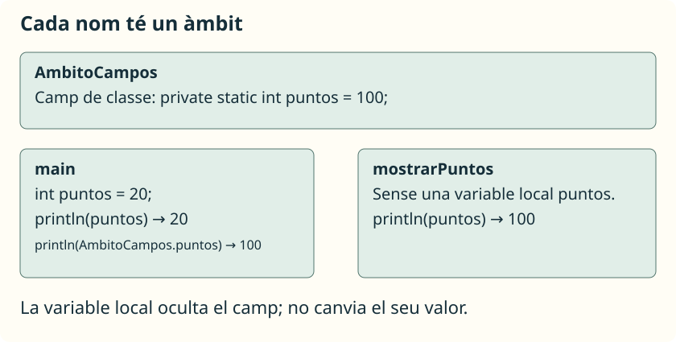

L’**àmbit** d’una variable és la part del codi on podem utilitzar el seu nom. Separar un programa en mètodes també separa les seues variables: una crida no té accés automàtic a les variables locals del mètode que l’ha cridat.

## Variables locals i paràmetres

Guarda este exemple en **`AmbitoLocal.java`**:

```java
public class AmbitoLocal {
    public static void main(String[] args) {
        int numero = 10;
        System.out.println(duplicar(numero));
        System.out.println(numero);
    }

    public static int duplicar(int valor) {
        int resultado = valor * 2;
        return resultado;
    }
}
```

```text
20
10
```

`numero` pertany al bloc de `main`. `valor` és un paràmetre de `duplicar`, i `resultado` és una variable local d’eixe mètode. Per a treballar amb la dada de `main`, proporcionem un argument; per a comunicar el càlcul a l’exterior, usem `return`.

No podries escriure `System.out.println(resultado);` en `main`: allí eixe nom no existix. Tampoc podries usar `numero` directament dins de `duplicar`.

Els paràmetres ja estan declarats: no es permet declarar dins del mateix mètode una altra variable local amb el mateix nom. Dos mètodes diferents sí que poden tindre variables locals anomenades `resultado`.

## Les claus també delimiten l’àmbit

Fragment per a col·locar dins de `main`:

```java
int puntos = 12;
if (puntos >= 10) {
    String mensaje = "Objectiu aconseguit";
    System.out.println(mensaje);
}
// mensaje no és accessible ací.
```

`puntos` es pot utilitzar en el bloc interior perquè està declarat en el bloc exterior abans d’eixe ús. `mensaje` només es pot usar des de la seua declaració fins al tancament del bloc de l’`if`.

Una variable local ha de rebre un valor abans de llegir-se. Si necessites un resultat calculat dins d’una condició, pots retornar-lo des d’un mètode o declarar una variable fora i garantir-ne l’assignació en tots els camins.

## Camps de classe

Una variable declarada en la classe, fora dels mètodes, és un **camp**. En alguns materials es diu «variable global», però no és una variable global de tot el programa: pertany a una classe o als seus objectes i té regles d’accés.

Guarda este exemple en **`AmbitoCampos.java`**:

```java
public class AmbitoCampos {
    private static int puntos = 100;

    public static void main(String[] args) {
        int puntos = 20;
        System.out.println(puntos);
        System.out.println(AmbitoCampos.puntos);
        mostrarPuntos();
    }

    public static void mostrarPuntos() {
        System.out.println(puntos);
    }
}
```

```text
20
100
100
```

El camp té `static` perquè l’utilitzem des de mètodes estàtics. En `main`, el nom simple `puntos` es referix a la variable local. Esta **oculta** el camp; no el sobreescriu ni canvia el seu valor. `AmbitoCampos.puntos` identifica expressament el camp. En `mostrarPuntos` no hi ha una variable local amb eixe nom, de manera que s’usa el camp.

## Triar com comunicar dades



Podríem fer que tots els mètodes llegiren i modificaren camps, però això dificultaria saber què necessita cada un i què canvia. Per als càlculs d’esta unitat preferirem **paràmetres i valors de retorn**: fan visibles les entrades i eixides.

Els camps són útils quan una dada pertany a l’estat d’una classe o d’un objecte. Els estudiarem amb més profunditat en programació orientada a objectes. No cal convertir una variable en camp només per a poder usar-la des de dos mètodes.
