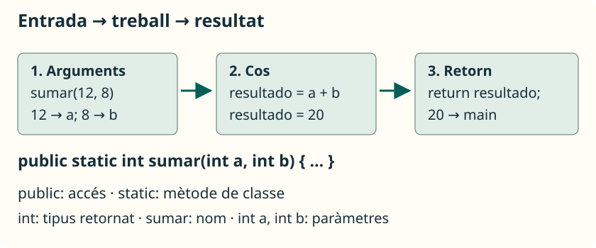

Declarar un mètode consistix a explicar com es diu, quines dades necessita i quina operació fa. **Declarar-lo no l’executa**: perquè treballe cal cridar-lo des d’una instrucció que arribe a executar-se.

## Llegir una declaració



Este fragment es col·loca dins de la classe, però fora de `main`:

```java
public static int sumar(int primero, int segundo) {
    int resultado = primero + segundo;
    return resultado;
}
```

| Part | Significat |
| --- | --- |
| `public` | Permet accedir al mètode des d’altres classes, si la classe també és accessible. |
| `static` | El mètode pertany a la classe; no necessitem crear un objecte per a cridar-lo. |
| `int` | La crida retorna un valor enter. |
| `sumar` | Nom que descriu l’operació. |
| `(int primero, int segundo)` | Dos paràmetres: tipus i nom de cada entrada. |
| `{ ... }` | Cos: instruccions que s’executen en cridar. |
| `return resultado;` | Acaba eixa crida i entrega el resultat. |

La **capçalera** és la part anterior al cos. En estos exemples, la **signatura** s’identifica amb el nom i els tipus dels paràmetres, en ordre: `sumar(int, int)`. El tipus de retorn i els noms dels paràmetres no distingixen signatures.

Usa noms com `calcularMedia`, `mostrarMenu` o `esPar`: comencen en minúscula i les paraules següents comencen en majúscula. Un nom no pot començar amb una xifra ni ser una paraula reservada. No uses `$` o `_` per a fer noms menys clars.

## Paràmetres i arguments

Els **paràmetres** són les variables que escrivim en la declaració. Els **arguments** són els valors o expressions que proporcionem en cridar:

```java
int puntos = 12;
int total = sumar(puntos, 3 + 2);
```

Este fragment va dins de `main` d’una classe que continga el mètode `sumar`. Primer s’avaluen els arguments: `puntos` aporta `12` i `3 + 2` aporta `5`. Els paràmetres reben eixos valors **per posició**, no per coincidència de noms. El resultat `17` es guarda en `total`.

<aside class="java-document-note">
<p><strong>EN PARAULES SENZILLES</strong></p>
<p>Imagina una fitxa amb dos buits: «primer nombre» i «segon nombre». Els <strong>paràmetres</strong> són eixos buits amb nom; els <strong>arguments</strong> són les dades que hi posem en cada crida. En <code>sumar(12, 5)</code>, el primer paràmetre rep <code>12</code> i el segon rep <code>5</code>. Una altra crida pot omplir eixos mateixos buits amb altres valors.</p>
</aside>

Els arguments han de ser compatibles amb els tipus declarats. Un paràmetre `double` pot rebre un `int` mitjançant conversió automàtica; un paràmetre `int` no accepta directament `2.5`. Els parèntesis són obligatoris encara que no hi haja paràmetres. Entre paràmetres s’usen comes i cada un porta el seu tipus.

## Retornar i mostrar són tasques diferents

`return` entrega un valor al codi que ha cridat el mètode. `println` escriu en consola. Un mètode pot calcular sense mostrar res, cosa que permet usar el resultat en una altra operació:

```java
int doble = sumar(4, 3) * 2;
System.out.println(doble); // 14
```

Si escrius només `sumar(4, 3);`, la crida es fa, però descartes el resultat: no es mostra automàticament.

<aside class="java-document-note">
<p><strong>EN PARAULES SENZILLES</strong></p>
<p><strong>Retornar és entregar; mostrar és ensenyar en pantalla.</strong> Si demanes una suma, <code>return</code> t’entrega el nombre perquè pugues guardar-lo o continuar calculant. <code>println</code> l’escriu en la consola. Entregar el resultat no fa que aparega automàticament en pantalla.</p>
</aside>

Un mètode amb retorn ha de proporcionar un valor compatible en tots els camins que puguen acabar normalment. Per exemple, este mètode pot retornar `true` o `false`:

```java
public static boolean esPar(int numero) {
    return numero % 2 == 0;
}
```

No necessita un `if`: la comparació ja produïx un `boolean`. `esPar(8)` retorna `true` i `esPar(7)` retorna `false`.

## Mètodes sense retorn: `void`

Guarda este programa en **`Menu.java`**:

```java
public class Menu {
    public static void main(String[] args) {
        mostrarMenu();
        saludar("Ana");
    }

    public static void mostrarMenu() {
        System.out.println("1. Jugar");
        System.out.println("0. Eixir");
    }

    public static void saludar(String nombre) {
        if (nombre.isEmpty()) {
            return;
        }
        System.out.println("Hola, " + nombre);
    }
}
```

```text
1. Jugar
0. Eixir
Hola, Ana
```

`mostrarMenu()` no rep arguments ni retorna cap valor. `saludar` rep una cadena; suposa que no és `null`. El seu `return;` acaba la crida si el text està buit. En un mètode `void`, `return` no porta valor i es pot ometre al final. No pots assignar `mostrarMenu()` a una variable.

## Accés i altres modificadors

L’**accés** indica des d’on es pot utilitzar un membre. Un paquet agrupa classes; per ara els nostres exemples usen una sola classe.

| Accés | Idea que convé conéixer |
| --- | --- |
| `public` | Accés des d’altres classes quan la classe contenidora és accessible. |
| `private` | Ús intern de la classe en estos exemples. |
| Sense modificador | Accés des de classes del mateix paquet. No s’escriu `default`. |
| `protected` | Accés des del mateix paquet i, amb regles addicionals, des de subclasses d’altres paquets. S’estudiarà amb herència. |

`static` no és un modificador d’accés. L’utilitzem per a cridar els nostres mètodes des del `main` estàtic sense crear objectes. Des d’una altra classe accessible, una crida seria `PrimerMetodo.sumar(2, 3)`.

Els materials originals mencionen `final`, `abstract`, `synchronized` i `throws`. Els deixem com a referències per a unitats posteriors: `final` restringix la redefinició d’un mètode d’instància; `abstract` declara mètodes sense implementació en els contextos permesos; `synchronized` està relacionat amb concurrència, i `throws` declara excepcions que pot propagar un mètode. No necessitem incorporar-los a les capçaleres d’esta unitat.

## Detectar errors de declaració

Estos fragments són **errors deliberats**; no formen un programa vàlid:

```java
public static int obtenerNumero() {
    System.out.println(5);
} // Falta retornar l’enter.
```

```java
public static int obtenerPositivo(int numero) {
    if (numero > 0) {
        return numero;
    }
} // Falta un resultat quan numero <= 0.
```

Mostrar un valor no substituïx retornar-lo. En el segon cas has de decidir el comportament per a entrades no positives, segons el propòsit del mètode; afegir un `return 0` sense raonar-lo pot ocultar un problema de disseny.
