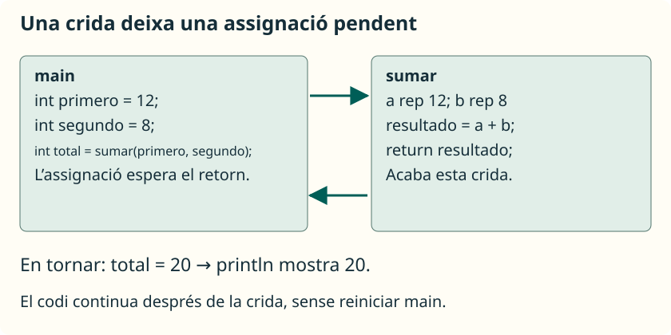

Quan s’executa una crida, el programa passa al mètode cridat. Quan este acaba, continua en el punt des del qual s’ha fet la crida. Comprendre eixe recorregut ajuda a distingir la declaració d’un mètode de la seua execució.

## Partir d’un programa conegut

Guarda en **`SumaInicial.java`** esta versió que concentra el treball en `main`. Suposa que introduïxes dos enters vàlids i menuts:

```java
import java.util.Scanner;

public class SumaInicial {
    public static void main(String[] args) {
        Scanner entrada = new Scanner(System.in);
        System.out.print("Primer número: ");
        int primero = entrada.nextInt();
        System.out.print("Segon número: ");
        int segundo = entrada.nextInt();
        int total = primero + segundo;
        System.out.println("La suma és " + total);
    }
}
```

Podem identificar tres tasques: llegir, calcular i mostrar. Començarem extraient **el càlcul**. Esta reorganització, que conserva el comportament del programa, es denomina **refactorització**.

## Dissenyar abans d’escriure

Per a dissenyar `sumar`, respon en este ordre:

1. **Què farà?** Sumar dos enters.
2. **Què rep?** Dos valors de tipus `int`.
3. **Què retorna?** Un `int` amb la suma.
4. **Necessita llegir o mostrar?** No; `main` s’encarrega de la conversa.
5. **Com el provem?** Amb positius, negatius i zero, evitant desbordaments en estos primers exemples.

Separar càlcul i consola permet reutilitzar la suma encara que canvie la manera d’obtindre les dades.

## Extraure i cridar

Guarda la nova versió en **`SumaConMetodos.java`**:

```java
import java.util.Scanner;

public class SumaConMetodos {
    public static void main(String[] args) {
        Scanner entrada = new Scanner(System.in);
        System.out.print("Primer número: ");
        int primero = entrada.nextInt();
        System.out.print("Segon número: ");
        int segundo = entrada.nextInt();
        int total = sumar(primero, segundo);
        System.out.println("La suma és " + total);
    }

    public static int sumar(int a, int b) {
        int resultado = a + b;
        return resultado;
    }
}
```

Amb les entrades `12` i `8`, les dos versions mostren:

```text
Primer número: 12
Segon número: 8
La suma és 20
```

Els nombres després de les preguntes són les respostes de l’usuari. Es conserva un únic `Scanner` sobre `System.in`, disponible fins que acaba el procés. La validació d’entrades es va estudiar en [el seu apartat](/ApuntesProgramacion/ca/guides/introduccion-a-java/entrada-y-salida-de-datos/validacion-de-entradas/).

## Seguir una crida pas a pas



| Pas | On estem | Què ocorre |
| --- | --- | --- |
| 1 | `main` | `primero` guarda `12` i `segundo` guarda `8`. |
| 2 | Crida `sumar(primero, segundo)` | S’avaluen els arguments i es creen els paràmetres `a = 12`, `b = 8`. |
| 3 | `sumar` | La seua variable local `resultado` rep `20`. |
| 4 | `return resultado` | Acaba `sumar` i entrega `20`. |
| 5 | `main` | L’assignació pendent guarda `20` en `total`. |
| 6 | `main` | Es mostra el resultat i acaba el programa. |

Que `sumar` estiga escrit després de `main` no impedix cridar-lo. **L’ordre de les crides determina l’execució**, no l’ordre en què s’han col·locat els mètodes en el fitxer. No es poden declarar mètodes dins de `main`.

<aside class="java-document-note">
<p><strong>EN PARAULES SENZILLES</strong></p>
<p>Cridar un mètode és com posar un punt de llibre en la tasca que estaves fent. Vas a resoldre la tasca del mètode i, quan acaba, tornes al punt que havies deixat pendent. En <code>int total = sumar(12, 8);</code>, primer cal obtindre <code>20</code>; després es completa l’assignació a <code>total</code>.</p>
</aside>

## Crides dins d’altres crides

Este fragment va en el mateix `main` i utilitza el mètode anterior:

```java
int total = sumar(sumar(2, 3), 4);
System.out.println(total); // 9
```

Per a conéixer el primer argument de la crida exterior, Java executa `sumar(2, 3)` i obté `5`. Després la crida exterior equival a `sumar(5, 4)`. Cada crida té els seus propis paràmetres i variables locals, encara que els noms siguen els mateixos.

## Proves menudes i verificables

No n’hi ha prou que el programa compile: cal comprovar el resultat. Pots cridar `sumar` amb estes dades des de `main` i comparar el que es mostra:

| Crida | Resultat esperat |
| --- | --- |
| `sumar(2, 3)` | `5` |
| `sumar(-4, 7)` | `3` |
| `sumar(0, 0)` | `0` |
| `sumar(-2, -3)` | `-5` |

Usa entrades amb un resultat que càpia en `int`. Extraure una operació a un mètode no evita el desbordament numèric.

En [testing amb JUnit](/ApuntesProgramacion/ca/guides/testing-con-junit/) automatitzarem estes comprovacions en un projecte Java sense gestor de dependències.
