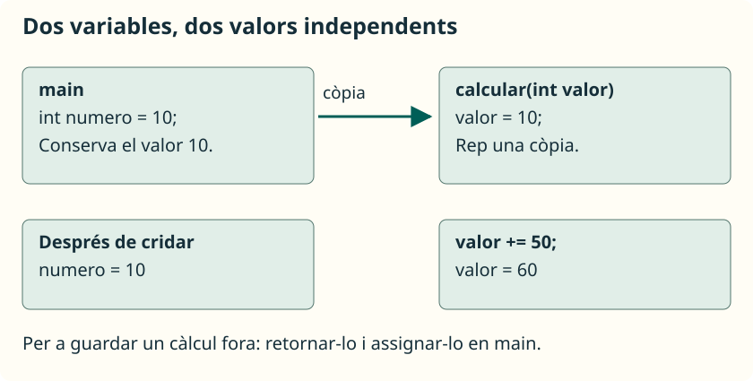
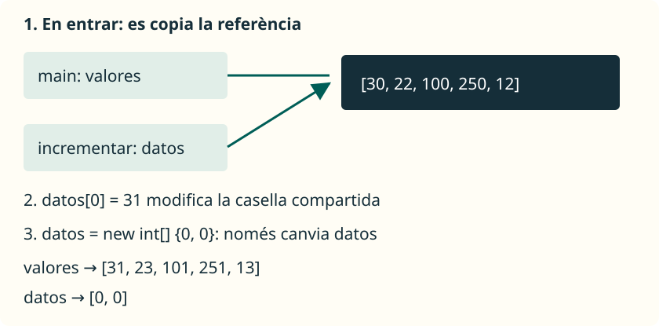

En Java, **tots els arguments es passen per valor**: cada paràmetre rep una còpia del valor proporcionat. El que canvia segons el tipus és quin valor estem copiant: una dada primitiva o una referència a un objecte, com un array.

## Copiar un valor primitiu



Guarda l’exemple següent en **`PasoPorValor.java`**:

```java
public class PasoPorValor {
    public static void main(String[] args) {
        int numero = 10;
        System.out.println(numero);
        calcular(numero);
        System.out.println(numero);
    }

    public static void calcular(int valor) {
        valor += 50;
        System.out.println(valor);
    }
}
```

```text
10
60
10
```

| Moment | `numero` en `main` | `valor` en `calcular` |
| --- | --- | --- |
| Abans de cridar | `10` | Encara no existix per a eixa crida. |
| En entrar | `10` | Còpia de `10`. |
| Després de sumar | `10` | `60`. |
| En tornar | `10` | La crida ha acabat. |

L’assignació canvia el paràmetre, no la variable de `main`. Si necessitem conservar el resultat fora, podem retornar-lo i assignar-lo: `numero = aumentar(numero);`, usant un mètode que retorne el nou valor.

## Copiar una referència a un array

Una variable de tipus array guarda una **referència** que permet accedir a l’array. En passar-la, es copia eixa referència, no totes les seues caselles. Durant la crida hi ha dos variables diferents que permeten accedir al mateix array.



Guarda este programa en **`PasoArray.java`**:

```java
import java.util.Arrays;

public class PasoArray {
    public static void main(String[] args) {
        int[] valores = { 30, 22, 100, 250, 12 };
        incrementar(valores);
        System.out.println(Arrays.toString(valores));
        sustituir(valores);
        System.out.println(Arrays.toString(valores));
    }

    public static void incrementar(int[] datos) {
        for (int i = 0; i < datos.length; i++) {
            datos[i]++;
        }
    }

    public static void sustituir(int[] datos) {
        datos = new int[] { 0, 0 };
        datos[0] = 99;
    }
}
```

```text
[31, 23, 101, 251, 13]
[31, 23, 101, 251, 13]
```

`incrementar` modifica les caselles de l’array al qual també accedix `valores`; per això el canvi és visible en `main`. En canvi, `sustituir` fa que el seu paràmetre apunte a un array nou. No canvia la referència guardada en la variable `valores` de qui l’ha cridat.

<aside class="java-document-note">
<p><strong>IDEA CLAU</strong></p>
<p>Modificar una casella i reassignar un paràmetre són operacions diferents. Els arrays també es passen per valor: es copia el valor de la referència. No hi ha pas per referència de la variable de qui fa la crida.</p>
</aside>

Els mètodes anteriors suposen que l’array no és `null`. `incrementar` accepta un array buit: el bucle no fa cap volta. En este exemple usem valors menuts per a evitar el desbordament.

## Retornar un array nou

Si volem una còpia modificada i conservar l’original, podem construir-la. Este mètode es col·loca dins d’una classe i fora de `main`:

```java
public static int[] crearIncrementado(int[] datos) {
    int[] copia = new int[datos.length];
    for (int i = 0; i < datos.length; i++) {
        copia[i] = datos[i] + 1;
    }
    return copia;
}
```

Amb este mètode en la mateixa classe, dins de `main`:

```java
int[] original = { 2, 5 };
int[] nuevo = crearIncrementado(original);
System.out.println(original[0]); // 2
System.out.println(nuevo[0]);    // 3
```

El tipus de retorn `int[]` indica que es retorna una referència a un array d’enters. L’array nou continua disponible després d’acabar el mètode perquè qui l’ha cridat conserva la seua referència. No hem de confondre que acabe una variable local amb el fet que desaparega immediatament l’objecte al qual apuntava.

## Què ocorre amb `String`

`String` és un tipus de referència, no un tipus primitiu. Els seus objectes són **immutables**: no podem modificar-ne el contingut. Les operacions que produïxen un altre text retornen una cadena, que hem de guardar si volem utilitzar-la.

Guarda este exemple en **`PasoTexto.java`**:

```java
public class PasoTexto {
    public static void main(String[] args) {
        String nombre = "Ana";
        cambiar(nombre);
        System.out.println(nombre);
        nombre = prepararSaludo(nombre);
        System.out.println(nombre);
    }

    public static void cambiar(String texto) {
        texto = "Hola, " + texto;
    }

    public static String prepararSaludo(String texto) {
        return "Hola, " + texto;
    }
}
```

```text
Ana
Hola, Ana
```

`cambiar` reassigna únicament el seu paràmetre. `prepararSaludo` retorna la referència al text resultant, que `main` guarda en `nombre`.

## Referència

- [Oracle: arguments, paràmetres i pas per valor](https://docs.oracle.com/javase/tutorial/java/javaOO/arguments.html).
