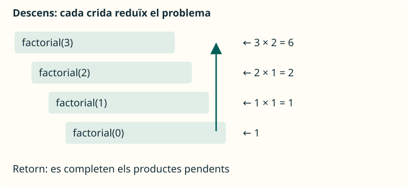

Un mètode pot cridar un altre mètode i també pot **cridar-se a si mateix**. Esta tècnica es diu **recursió**. Servix quan podem resoldre un problema utilitzant la solució d’una versió més menuda del mateix problema.

## Dos peces inseparables

Tot disseny recursiu d’esta unitat tindrà:

- Un **cas base**, que es resol sense una altra crida recursiva.
- Un **cas recursiu**, que reduïx el problema i s’acosta al cas base.

No n’hi ha prou amb escriure un cas base: les entrades permeses han d’arribar-hi. Si cada crida torna a plantejar el mateix problema sense reduir-lo, no acabarem.

<aside class="java-document-note">
<p><strong>EN PARAULES SENZILLES</strong></p>
<p>Imagina que baixes una escala per a resoldre una tasca cada vegada més menuda. El <strong>cas base</strong> és l’escaló on ja pots respondre sense continuar baixant. Després puges i uses cada resposta per a acabar la tasca que havia quedat pendent dalt. Perquè funcione, cada crida ha d’acostar-te a eixe escaló final; baixar sense arribar-hi mai no resol el problema.</p>
</aside>

## Factorial d’un nombre

El factorial d’un enter no negatiu és el producte dels enters des d’`1` fins a eixe nombre. S’escriu `n!`. Per definició, `0! = 1`. Per exemple, `4! = 4 × 3 × 2 × 1 = 24`.

Podem descompondre’l així:

| Cas | Resultat |
| --- | --- |
| `n = 0` | `1` |
| `n > 0` | `n × factorial(n - 1)` |

Calcular `factorial(4)` exigix conéixer `factorial(3)`. Esta nova crida necessita `factorial(2)`, i així fins a `factorial(0)`. Aleshores comencen a completar-se les multiplicacions pendents.

## Programa complet i límits

Guarda en **`Factorial.java`** este programa. Admetem únicament valors de `0` a `20`, el factorial dels quals cap en `long`:

```java
public class Factorial {
    public static void main(String[] args) {
        int numero = 6;
        if (numero >= 0 && numero <= 20) {
            System.out.println(factorial(numero));
        } else {
            System.out.println("Usa un enter entre 0 i 20.");
        }
    }

    // Requerix un numero entre 0 i 20.
    public static long factorial(int numero) {
        if (numero == 0) {
            return 1L;
        }
        return numero * factorial(numero - 1);
    }
}
```

```text
720
```

`1L` és el literal enter de tipus `long`. La crida recursiva també retorna `long`, de manera que la multiplicació es fa amb eixe tipus. Amb `int`, `13!` ja no cap; amb `long`, `21!` tampoc cap. La recursió no evita el desbordament.

La comprovació de `main` protegix esta crida. El mètode establix una **precondició**: una condició que ha de complir qui el crida. Si el reutilitzes des d’un altre lloc, has de respectar-la o afegir una validació apropiada. No crides directament el mètode amb un nombre negatiu: s’allunyaria de zero.

## Cridar i tornar són dos fases



| Fase | Crida | Què queda pendent o què retorna |
| --- | --- | --- |
| Descens | `factorial(3)` | Espera per a multiplicar `3 × factorial(2)`. |
| Descens | `factorial(2)` | Espera per a multiplicar `2 × factorial(1)`. |
| Descens | `factorial(1)` | Espera per a multiplicar `1 × factorial(0)`. |
| Cas base | `factorial(0)` | Retorna `1`. |
| Retorn | `factorial(1)` | Retorna `1 × 1 = 1`. |
| Retorn | `factorial(2)` | Retorna `2 × 1 = 2`. |
| Retorn | `factorial(3)` | Retorna `3 × 2 = 6`. |

Les crides pendents es gestionen en una **pila de crides**: l’última crida que entra és la primera que acaba. Cada crida té el seu propi paràmetre `numero`; no existix un únic `numero` que canvie alhora en totes les crides.

## Comparar amb un bucle

Este mètode es pot afegir a la mateixa classe. Té la mateixa precondició:

```java
public static long factorialIterativo(int numero) {
    long producto = 1L;
    for (int factor = 2; factor <= numero; factor++) {
        producto *= factor;
    }
    return producto;
}
```

Amb `numero = 0` el bucle no entra i retorna `1`. Amb `6` retorna `720`, igual que la versió recursiva. El bucle conserva un acumulador; la versió recursiva manté crides pendents. Per a este càlcul lineal el bucle sol ser més senzill i evita acumular crides. Aprenem factorial recursiu perquè fa visible la descomposició del problema, no perquè siga l’única solució.

## Errors freqüents

| Error | Què ocorre | Com raonar-ho |
| --- | --- | --- |
| Falta el cas base | Les crides no es detenen. | Identifica el problema més menut. |
| Cridar amb `numero` en lloc de `numero - 1` | El problema no es reduïx. | Comprova que cada crida s’acosta al cas base. |
| Admetre negatius sense tractar-los | Restar-ne un s’allunya de zero. | Definix i valida les entrades permeses. |
| Oblidar `return` en el cas recursiu | No s’entrega el càlcul; pot faltar un retorn. | Seguix el valor que necessita cada crida anterior. |
| Fer massa crides imbricades | Es pot produir `StackOverflowError`. | Comprova la profunditat; considera una solució iterativa. |
