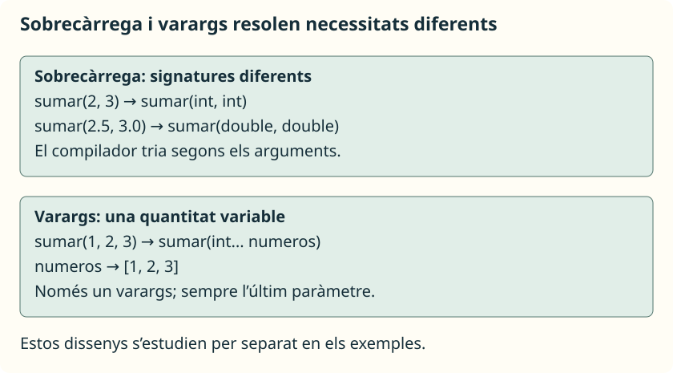

A vegades una mateixa operació té sentit amb diferents tipus o quantitats de dades. La **sobrecàrrega** permet utilitzar el mateix nom per a diversos mètodes, sempre que les seues llistes de tipus de paràmetres siguen diferents.

## Un nom, diverses signatures



Guarda este programa en **`Sobrecarga.java`**:

```java
public class Sobrecarga {
    public static void main(String[] args) {
        System.out.println(sumar(2, 3));
        System.out.println(sumar(2.5, 3.0));
        System.out.println(sumar(2, 3, 4));
    }

    public static int sumar(int a, int b) {
        return a + b;
    }

    public static double sumar(double a, double b) {
        return a + b;
    }

    public static int sumar(int a, int b, int c) {
        return a + b + c;
    }
}
```

```text
5
5.5
9
```

El compilador selecciona el mètode segons els tipus i el nombre d’arguments. En estes crides hi ha una coincidència exacta: `sumar(int, int)`, `sumar(double, double)` i `sumar(int, int, int)`.

Si crides `sumar(2, 3.5)`, els dos arguments són compatibles amb la versió de dos `double`; el primer es convertix i el resultat és `5.5`. No es convertix automàticament `3.5` en `int`.

<aside class="java-document-note">
<p><strong>EN PARAULES SENZILLES</strong></p>
<p>Dos eines poden dir-se «sumar», però estar preparades per a entrades diferents: una per a dos enters i una altra per a dos decimals. El compilador mira els tipus dels arguments per a triar l’eina. <strong>Canviar només el tipus de resultat no és suficient</strong>: les entrades continuarien sent iguals i no distingirien les dos versions.</p>
</aside>

## Què no crea una sobrecàrrega

Estos dos mètodes junts en la mateixa classe produïxen un **error deliberat**:

```java
public static int obtener(int numero) {
    return numero;
}

public static double obtener(int valor) {
    return valor;
}
```

Els dos tenen la signatura `obtener(int)`. Canviar el nom del paràmetre o el tipus de retorn no permet distingir-los. Canviar l’accés o afegir `static` tampoc soluciona una signatura duplicada.

L’ordre dels tipus sí que compta: `mostrar(String, int)` i `mostrar(int, String)` són signatures diferents. Evita crear variants innecessàries que facen difícil interpretar una crida.

## Una quantitat variable: `varargs`

Si volem sumar zero, un o diversos enters, no necessitem escriure un mètode diferent per a cada quantitat. Un paràmetre `int... numeros` accepta una quantitat variable d’arguments i s’utilitza **com un array dins del mètode**.

Guarda este exemple en **`SumaVariable.java`**:

```java
public class SumaVariable {
    public static void main(String[] args) {
        System.out.println(sumar());
        System.out.println(sumar(10));
        System.out.println(sumar(1, 2, 3));
        int[] puntos = { 4, 5 };
        System.out.println(sumar(puntos));
    }

    public static int sumar(int... numeros) {
        int total = 0;
        for (int numero : numeros) {
            total += numero;
        }
        return total;
    }
}
```

```text
0
10
6
9
```

La crida sense arguments proporciona un array buit i l’acumulador es manté a zero. També pots passar un array existent. En eixe cas es compartix el mateix array mitjançant una còpia de la seua referència; si el mètode modificara caselles, el canvi seria visible fora. Este mètode només les llig i suposa una referència no nul·la.

<aside class="java-document-note">
<p><strong>EN PARAULES SENZILLES</strong></p>
<p><code>varargs</code> és com rebre els nombres junts en una safata. Pots entregar-ne cap, un o diversos; dins del mètode es recorren com un array. En <code>sumar(1, 2, 3)</code>, la «safata» conté tres enters. No es crea una versió nova del mètode per a cada quantitat.</p>
</aside>

## Regles que cal respectar

Només pot haver-hi **un paràmetre `varargs`**, i ha de ser **l’últim**. Abans d’ell pot haver-hi paràmetres ordinaris:

```java
public static int sumarDesde(int inicial, int... numeros) {
    int total = inicial;
    for (int numero : numeros) {
        total += numero;
    }
    return total;
}
```

Col·loca el mètode dins d’una classe. En el seu `main`, `System.out.println(sumarDesde(10, 2, 3));` mostra `15`; `sumarDesde(10)` retorna `10`.

No compilarien les capçaleres `sumar(int... numeros, int inicial)` ni `sumar(int... a, int... b)`. A més, no pots declarar alhora `sumar(int[])` i `sumar(int...)`: representen el mateix tipus de paràmetre a efectes de la signatura.

Per a esta unitat mantenim la sobrecàrrega i `varargs` en exemples separats. Combinar-los amb moltes conversions pot produir crides ambigües; si el compilador no pot triar una única versió, has de simplificar el disseny o fer més explícits els tipus.

## Referència

- [Oracle: definició i sobrecàrrega de mètodes](https://docs.oracle.com/javase/tutorial/java/javaOO/methods.html).
