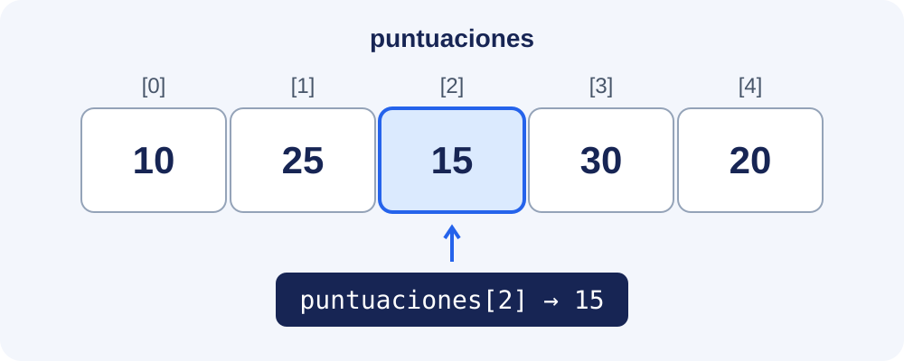

Un array permet guardar diverses dades del mateix tipus en una sola variable. Aprendrem a declarar-lo, inicialitzar-lo i recórrer-lo, i a treballar amb diverses dimensions.

## Una fila de caselles: les puntuacions d'un videojoc

Imagina que vols guardar els punts que has aconseguit en cinc partides: **10, 25, 15, 30 i 20**. Podries crear cinc variables (`punts1`, `punts2`, etc.), però resulta més còmode guardar totes eixes puntuacions juntes, en un **array**.

Pensa en ell com una fila de caselles: **cada casella guarda una dada** i té un número que permet localitzar-la. Eixe número s'anomena **índex** i, en Java, comença en **0**.



En Java podem crear eixa fila així:

```java
int[] puntuaciones = { 10, 25, 15, 30, 20 };
```

`int[]` indica que guardem un array de nombres enters; `puntuaciones` és el nom de la variable i les claus contenen els seus cinc valors inicials.

Per a consultar una casella, escrivim el nom de l'array i el seu índex entre claudàtors:

```java
System.out.println(puntuaciones[0]); // Primera partida: 10
System.out.println(puntuaciones[2]); // Tercera partida: 15
```

També podem canviar el contingut d'una casella:

```java
puntuaciones[2] = 50;
System.out.println(puntuaciones[2]); // Ara mostra 50
```

**Només canvia la tercera casella**: l'array passa a guardar `10, 25, 50, 30, 20`. Continua tenint cinc elements, tots del mateix tipus. Recorda la diferència: **l'índex indica on està una dada; el valor és el que guarda eixa casella**.

Necessites conéixer variables, condicions i bucles. En els apartats següents aprendràs a crear i recórrer arrays, resoldre problemes, treballar amb taules i utilitzar les operacions de `java.util.Arrays`.
