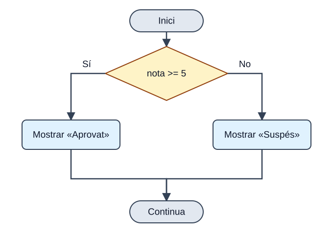
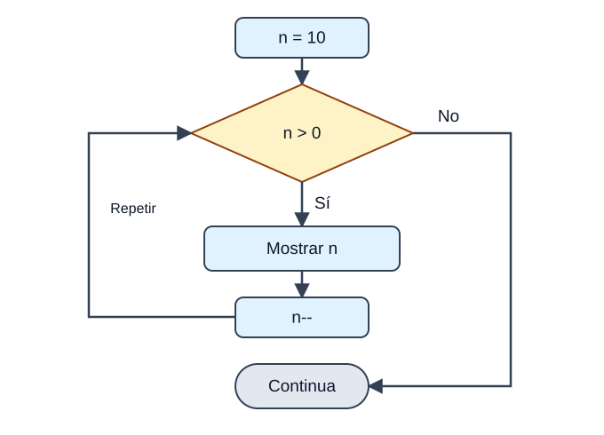
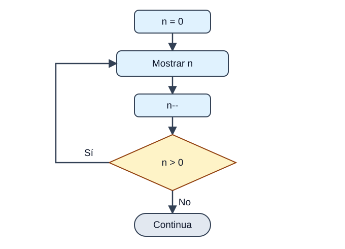
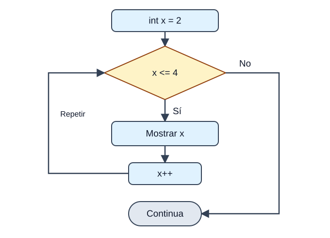

## 1. Estructures de control

<p><em>Sense estructures de control, un programa seria una recepta que s'executa línia a línia sense pensar. Amb elles, el teu programa decidix, repetix i salta: passa de ser una recepta a ser un GPS que recalcula la ruta segons el que troba.</em></p>

<p>Com vam veure en la unitat d'algoritmes, les estructures de control fan que el flux del programa <strong>no siga sempre seqüencial</strong>. Gràcies a elles el nostre algoritme pot executar uns blocs o uns altres segons unes condicions, o repetir instruccions automàticament. Java distingix tres tipus:</p>

<div class="java-document-table">
<table>
<tr>
<th scope="col"><p><strong>Tipus</strong></p></th>
<th scope="col"><p><strong>Estructures</strong></p></th>
<th scope="col"><p><strong>La pregunta que responen</strong></p></th>
</tr>
<tr>
<td><p><strong>Selecció</strong></p></td>
<td><p><code>if</code>, <code>if-else</code>, <code>if-else-if</code>, <code>switch</code></p></td>
<td><p>«Quin camí prenc?»</p></td>
</tr>
<tr>
<td><p><strong>Iteració</strong></p></td>
<td><p><code>while</code>, <code>do-while</code>, <code>for</code>, <code>for-each</code></p></td>
<td><p>«Quantes vegades ho repetisc?»</p></td>
</tr>
<tr>
<td><p><strong>Salt</strong></p></td>
<td><p><code>break</code>, <code>continue</code>, <code>return</code></p></td>
<td><p>«Isc ja o em bote esta volta?»</p></td>
</tr>
</table>
</div>

<p>I per descomptat, totes es poden <strong>posar unes dins d'altres</strong>: pots col·locar-ne una dins del bloc d'una altra tantes vegades com necessites.</p>

## 2. Estructures de selecció

### if

<p>L'estructura <code>if</code> dirigix l'execució del programa per un de <strong>dos camins possibles</strong> segons una condició. La seua sintaxi és:</p>



<p><em>El rombe és una pregunta: només s’executa una de les dos branques. Després, els camins es tornen a unir.</em></p>

```java
if (condicion) {
    bloque1;
} else {
    bloque2;
}
```

<p>La condició és qualsevol expressió que retorne un <code>boolean</code>, i la clàusula <code>else</code> és <strong>opcional</strong>. Un exemple senzill:</p>

```java
int nota = 7;
if (nota >= 5) {
    System.out.println("Aprovat");
} else {
    System.out.println("Suspés");
}
```

<p><strong>EIXIDA PER CONSOLA</strong></p>

```text
Aprovat
```

<aside class="java-document-note">
<p><strong>TRUC</strong></p>
<p><strong>Posa sempre les claus</strong>, fins i tot si el bloc té una sola instrucció. Java et deixa ometre-les, però és una font clàssica d'errors quan després afiges més línies.</p>
</aside>

<p>Dins de cada bloc pots incloure nous <code>if</code>. Quan hi ha diversos <code>if</code> i <code>else</code> mesclats, la regla és: <strong>cada `else` s'associa amb l'`if` més pròxim que encara no tinga `else`</strong>.</p>

```java
if (i == 10) {
    if (j < 20) a = b;
    if (k > 100) c = d;    // este if ...
    else a = c;            // ... s'associa amb este else
} else a = d;              // este else pertany a if (i == 10)
```

### if-else-if (l'escala)

<p>Quan hi ha més de dos camins, s'encadenen diversos <code>if</code>. Java avalua les condicions <strong>de dalt cap avall</strong> i executa el bloc de la <strong>primera que siga verdadera</strong>; la resta s'ignora. L'<code>else</code> final arreplega tot el que no encaixa.</p>

```java
if (condicion1) {
    bloque1
} else if (condicion2) {
    bloque2
} else if (condicion3) {
    bloque3
} else {
    bloqueFinal
}
```

```java
class IfElse {
    public static void main(String[] args) {
        int mes = 4;   // Abril
        String estacion;
        if (mes == 12 || mes == 1 || mes == 2)       estacion = "Hivern";
        else if (mes == 3 || mes == 4 || mes == 5)   estacion = "Primavera";
        else if (mes == 6 || mes == 7 || mes == 8)   estacion = "Estiu";
        else if (mes == 9 || mes == 10 || mes == 11) estacion = "Tardor";
        else                                         estacion = "Mes erroni";
        System.out.println("Abril pertany a l'estació " + estacion + ".");
    }
}
```

<p><strong>EIXIDA PER CONSOLA</strong></p>

```text
Abril pertany a l'estació Primavera.
```

### switch

<p>El <code>switch</code> permet que el programa seguisca <strong>camins diferents segons el valor d'una expressió</strong>. És com un <code>if-else-if</code> molt llarg, però més ordenat quan comparem sempre la mateixa variable amb valors concrets. Pot utilitzar-se amb <code>byte</code>, <code>short</code>, <code>char</code>, <code>int</code>, els seus embolcalls, <code>String</code> i enumerats.</p>

```java
switch (expresion) {
    case valor1:
        bloque1
        break;
    case valor2:
        bloque2
        break;
    // ...
    default:
        bloquePorDefecto
}
```

<p>En l'exemple següent s'executa el <code>case</code> el valor del qual coincidix amb <code>i</code>. Com que ací no en coincidix cap (<code>i</code> val 4), s'executa el bloc <code>default</code>, que actua com l'<code>else</code> final:</p>

```java
class EjemploSwitch {
    public static void main(String[] args) {
        int i = 4;
        switch (i) {
            case 0:
                System.out.println("i és zero.");
                break;
            case 1:
                System.out.println("i és u.");
                break;
            case 2:
                System.out.println("i és dos.");
                break;
            default:
                System.out.println("i no és 0, 1 ni 2.");
        }
    }
}
```

<p><strong>EIXIDA PER CONSOLA</strong></p>

```text
i no és 0, 1 ni 2.
```

### El break i l'«efecte cascada»

<p>El <code>break</code> acaba el <code>switch</code>. Si <strong>s'omet</strong>, l'execució <strong>continua pel `case` següent</strong> encara que no coincidisca (això s'anomena *fall-through*, o efecte cascada). Sol ser un descuit, però de vegades s'aprofita a propòsit perquè diversos valors compartisquen el mateix codi:</p>

```java
class SwitchSinBreak {
    public static void main(String[] args) {
        int i = 3;
        switch (i) {
            case 1:
            case 2:
            case 3:
            case 4:
                System.out.println("i és menor que 5");
                break;
            case 5:
            case 6:
            case 7:
            case 8:
            case 9:
                System.out.println("i és menor que 10");
                break;
            default:
                System.out.println("i és 10 o més");
        }
    }
}
```

<p><strong>EIXIDA PER CONSOLA</strong></p>

```text
i és menor que 5
```

<p>Ací <code>i</code> val 3: coincidix amb <code>case 3</code>, i com que eixe <code>case</code> no té <code>break</code>, l'execució «cau» fins al <code>case 4</code>, on sí que troba la instrucció i el <code>break</code>.</p>

### switch modern (Java 14 en avant)

<p>Fins a Java 11, el <code>switch</code> era només una <strong>instrucció</strong>: servia per a executar blocs de codi i sempre necessitava <code>break</code>. A partir de Java 14 (i, per tant, en JDK 17) disposem del <strong>`switch` com a expressió</strong>: una versió més moderna que, a més, <strong>retorna un valor</strong>.</p>

```java
int num = 2;
String dia = switch (num) {
    case 1 -> "Dilluns";
    case 2 -> "Dimarts";
    default -> "Un altre dia";
};
```

<p>Fixa't en tres novetats: el <code>switch</code> retorna un valor que guardem en <code>dia</code>, utilitzem la fletxa <code>-&gt;</code> en lloc de <code>:</code>, i <strong>ja no cal `break`</strong> (no hi ha efecte cascada). A més, un mateix cas pot agrupar diversos valors separats per comes:</p>

```java
int dia = 6;
String tipo = switch (dia) {
    case 1, 2, 3, 4, 5 -> "Laborable";
    case 6, 7          -> "Cap de setmana";
    default            -> "Dia no vàlid";
};
```

<p>Si necessites diverses línies en un cas, obri claus <code>{ }</code> i utilitza la paraula <strong>`yield`</strong> per a retornar el valor:</p>

```java
int num = 2;
String dia = switch (num) {
    case 1 -> "Dilluns";
    case 2 -> {
        System.out.println("Processant...");
        yield "Dimarts";
    }
    default -> "Un altre dia";
};
```

<div class="java-document-table">
<table>
<tr>
<th scope="col"></th>
<th scope="col"><p><strong>switch clàssic</strong></p></th>
<th scope="col"><p><strong>switch modern</strong></p></th>
</tr>
<tr>
<td><p>Sintaxi del cas</p></td>
<td><p><code>case 1:</code></p></td>
<td><p><code>case 1 -&gt;</code></p></td>
</tr>
<tr>
<td><p>Necessita <code>break</code>?</p></td>
<td><p>Sí (o cau al cas següent)</p></td>
<td><p>No</p></td>
</tr>
<tr>
<td><p>Retorna un valor?</p></td>
<td><p>No, només executa instruccions</p></td>
<td><p>Sí, pot assignar-se a una variable</p></td>
</tr>
<tr>
<td><p>Diversos valors per cas</p></td>
<td><p>Diversos <code>case</code> seguits</p></td>
<td><p><code>case 1, 2, 3 -&gt;</code></p></td>
</tr>
</table>
</div>

## 3. Estructures d'iteració

<p>Java té quatre formes de crear <strong>bucles</strong>, és a dir, d'executar un mateix bloc de codi de manera repetida mentre es complisca una condició: <code>while</code>, <code>do-while</code>, <code>for</code> i <code>for-each</code>. Triar l'adequada és qüestió de respondre a estes preguntes:</p>

<div class="java-document-table">
<table>
<tr>
<th scope="col"><p><strong>Bucle</strong></p></th>
<th scope="col"><p><strong>Comprova la condició…</strong></p></th>
<th scope="col"><p><strong>Mínim de voltes</strong></p></th>
<th scope="col"><p><strong>Utilitza'l quan…</strong></p></th>
</tr>
<tr>
<td><p><code>while</code></p></td>
<td><p>Al principi</p></td>
<td><p>0</p></td>
<td><p>No saps quantes repeticions hi haurà</p></td>
</tr>
<tr>
<td><p><code>do-while</code></p></td>
<td><p>Al final</p></td>
<td><p>1</p></td>
<td><p>Necessites executar el bloc <strong>almenys una vegada</strong> (per exemple, un menú)</p></td>
</tr>
<tr>
<td><p><code>for</code></p></td>
<td><p>Al principi</p></td>
<td><p>0</p></td>
<td><p>Saps per endavant quantes vegades has de repetir</p></td>
</tr>
<tr>
<td><p><code>for-each</code></p></td>
<td><p>—</p></td>
<td><p>0</p></td>
<td><p>Vols recórrer <strong>tots</strong> els elements d'un array o col·lecció</p></td>
</tr>
</table>
</div>

### while

<p>Repetix un bloc <strong>mentre</strong> una condició siga verdadera. Si la condició és falsa des del principi, el bloc no s'executa ni una sola vegada. És com «mentre hi haja sopa en el plat, continua menjant».</p>



<p><em>Primer es comprova n > 0. Si és fals des del principi, el cos no s’executa. Després de mostrar n i restar-li 1, tornem a comprovar la condició.</em></p>

```java
while (condicion) {
    bloque
}
```

```java
class EjemploWhile {
    public static void main(String[] args) {
        int n = 10;
        while (n > 0) {
            System.out.println("Pas " + n);
            n--;
        }
    }
}
```

<p><strong>EIXIDA PER CONSOLA</strong></p>

```text
Pas 10
Pas 9
Pas 8
Pas 7
Pas 6
Pas 5
Pas 4
Pas 3
Pas 2
Pas 1
```

<aside class="java-document-note">
<p><strong>COMPTE AMB AIXÒ</strong></p>
<p><strong>Bucle infinit:</strong> si dins del bucle mai canvies la variable que controla la condició (ací, oblidar el <code>n--</code>), la condició serà sempre verdadera i el programa no acabarà mai. Abans d'executar un bucle, pregunta't: «què fa que algun dia pare?»</p>
</aside>

### do-while

<p>És com el <code>while</code>, però amb una diferència fonamental: la condició es comprova <strong>al final</strong>, així que el cos s'executa <strong>sempre almenys una vegada</strong>. És com tastar la sopa abans de decidir si te la menges.</p>



<p><em>Primer s’executa el cos i després es pregunta. Amb n = 0, es mostra 0, n passa a −1 i el bucle acaba: ha fet una volta.</em></p>

```java
do {
    bloque
} while (condicion);      // no oblides el punt i coma!
```

```java
int n = 0;
do {
    System.out.println("Això s'executa encara que n valga " + n);
    n--;
} while (n > 0);
```

<p><strong>EIXIDA PER CONSOLA</strong></p>

```text
Això s'executa encara que n valga 0
```

<p>Amb un <code>while</code> normal este bloc no s'hauria executat mai, perquè <code>n &gt; 0</code> és fals des del principi.</p>

### for

<p>El <code>for</code> reunix en <strong>una sola línia</strong> els tres elements d'un bucle controlat per comptador: on comença, fins quan continua i com avança. És més compacte que el <code>while</code> i més fàcil de depurar.</p>



<p><em>La inicialització només es fa una vegada. Després repetim: condició → cos → actualització. Este exemple mostra 2, 3 i 4; quan x val 5, ix del bucle.</em></p>

```java
for (inicializacion; condicion; actualizacion) {
    bloque
}
```

<div class="java-document-table">
<table>
<tr>
<th scope="col"><p><strong>Part</strong></p></th>
<th scope="col"><p><strong>Què fa</strong></p></th>
</tr>
<tr>
<td><p><strong>Inicialització</strong></p></td>
<td><p>S'executa <strong>una sola vegada</strong> al principi. Ací es declara o inicialitza la variable de control (<code>int i = 0</code>). Si es declara ací, només existix dins del bucle.</p></td>
</tr>
<tr>
<td><p><strong>Condició</strong></p></td>
<td><p>Es comprova <strong>abans de cada volta</strong>. Ha de ser un <code>boolean</code>. Quan passa a fals, el bucle acaba.</p></td>
</tr>
<tr>
<td><p><strong>Cos</strong></p></td>
<td><p>Les instruccions que es repetixen mentre la condició siga verdadera.</p></td>
</tr>
<tr>
<td><p><strong>Actualització</strong></p></td>
<td><p>S'executa <strong>al final de cada volta</strong> (normalment <code>i++</code>) per a preparar la següent.</p></td>
</tr>
</table>
</div>

```java
class EjemploFor {
    public static void main(String[] args) {
        // el bucle comença amb x = 2 i continua mentre x <= 4
        for (int x = 2; x <= 4; x++) {
            System.out.println("Valor de x: " + x);
        }
    }
}
```

<p><strong>EIXIDA PER CONSOLA</strong></p>

```text
Valor de x: 2
Valor de x: 3
Valor de x: 4
```

<p>Un altre exemple molt típic: la taula de multiplicar del 3.</p>

```java
for (int i = 1; i <= 5; i++) {
    System.out.println("3 x " + i + " = " + (3 * i));
}
```

<p><strong>EIXIDA PER CONSOLA</strong></p>

```text
3 x 1 = 3
3 x 2 = 6
3 x 3 = 9
3 x 4 = 12
3 x 5 = 15
```

### Les tres parts del for són opcionals

<p>Pots ometre qualsevol de les tres parts (mantenint els punts i comes). En el primer exemple, la inicialització es fa fora del bucle i la condició utilitza una variable booleana; en el segon, en ometre-ho tot, creem un <strong>bucle infinit</strong> que només acaba amb un <code>break</code>:</p>

```java
int i = 0;
boolean done = false;
for ( ; !done; ) {
    System.out.println("i és " + i);
    if (i == 10) done = true;
    i++;
}
```

```java
for ( ; ; ) {
    // s'executa infinites vegades (fins que un break el detinga)
}
```

### for-each (el bucle for millorat)

<p>Java 5 va introduir una versió del <code>for</code> pensada per a <strong>recórrer tots els elements</strong> d'un array o d'una col·lecció de manera senzilla, sense preocupar-te dels índexs. Es llig com «per a cada element de la col·lecció…».</p>

```java
for (Tipo elemento : coleccion) {
    bloque
}
```

```java
class EjemploForEach {
    public static void main(String[] args) {
        String[] amigos = {"Ron", "Harry", "Hermione"};
        for (String x : amigos) {
            System.out.println(x);
        }
    }
}
```

<p><strong>EIXIDA PER CONSOLA</strong></p>

```text
Ron
Harry
Hermione
```

<aside class="java-document-note">
<p><strong>COMPTE AMB AIXÒ</strong></p>
<p>El <code>for-each</code> és còmode però <strong>inflexible</strong>: només servix per a recórrer tots els elements de principi a fi i no et diu en quina posició estàs. Si necessites l'índex, recórrer només una part o modificar elements, utilitza el <code>for</code> clàssic.</p>
</aside>

## 4. Estructures de salt

<p>Java disposa de tres instruccions que alteren el flux normal d'execució: <code>break</code>, <code>continue</code> i <code>return</code>.</p>

### break: eixir del bucle

<p>Amb <code>break</code> forcem la <strong>finalització immediata</strong> del bucle: se salta la comprovació de la condició i el codi restant, i el programa continua en la primera instrucció posterior al bucle.</p>

```java
class EjemploBreak {
    public static void main(String[] args) {
        for (int i = 0; i < 100; i++) {
            if (i == 10) break;          // acaba el bucle quan i val 10
            System.out.println("i: " + i);
        }
        System.out.println("Bucle completat.");
    }
}
```

<p><strong>EIXIDA PER CONSOLA</strong></p>

```text
i: 0
i: 1
i: 2
i: 3
i: 4
i: 5
i: 6
i: 7
i: 8
i: 9
Bucle completat.
```

<p>Si utilitzem <code>break</code> dins de <strong>bucles dins d'altres bucles</strong>, només acaba el bucle en què està escrit (el més intern), no tots:</p>

```java
class EjemploBreakAnidado {
    public static void main(String[] args) {
        for (int i = 0; i < 3; i++) {
            System.out.print("Pas " + i + ": ");
            for (int j = 0; j < 100; j++) {
                if (j == 10) break;      // només acaba el bucle de j
                System.out.print(j + " ");
            }
            System.out.println();
        }
        System.out.println("Bucles completats.");
    }
}
```

<p><strong>EIXIDA PER CONSOLA</strong></p>

```text
Pas 0: 0 1 2 3 4 5 6 7 8 9
Pas 1: 0 1 2 3 4 5 6 7 8 9
Pas 2: 0 1 2 3 4 5 6 7 8 9
Bucles completats.
```

<aside class="java-document-note">
<p><strong>CURIOSITAT</strong></p>
<p>Si vols eixir de <strong>diversos bucles alhora</strong>, Java permet posar una etiqueta al bucle exterior i utilitzar <code>break etiqueta;</code>:</p>
</aside>

```java
externo:
for (int i = 0; i < 3; i++) {
    for (int j = 0; j < 3; j++) {
        if (i * j == 2) break externo;   // ix dels DOS bucles
        System.out.println(i + "," + j);
    }
}
```

<p><strong>EIXIDA PER CONSOLA</strong></p>

```text
0,0
0,1
0,2
1,0
1,1
```

### continue: botar-se esta volta

<p>De vegades volem que el bucle continue, però que en una volta concreta <strong>no s'execute la resta del codi</strong>. Això és <code>continue</code>. A diferència de <code>break</code>, que acaba el bucle, <code>continue</code> només abandona la volta actual i <strong>passa a la següent</strong>.</p>

```java
class EjemploContinue {
    public static void main(String[] args) {
        for (int i = 0; i < 10; i++) {
            if (i % 2 == 0) continue;    // i parell: passa a la volta següent
            System.out.print(i + " ");
        }
    }
}
```

<p><strong>EIXIDA PER CONSOLA</strong></p>

```text
1 3 5 7 9
```

<aside class="java-document-note">
<p><strong>IDEA CLAU</strong></p>
<p><strong>`break` = «me'n vaig del bucle». `continue` = «passe a la volta següent».</strong> Un bon truc per a no confondre'ls: el <code>break</code> trenca, el <code>continue</code> continua.</p>
</aside>

### return: tornar d'un mètode

<p><code>return</code> s'utilitza per a <strong>eixir d'un mètode</strong> (els estudiarem més avant en el curs): el control del programa torna al lloc des d'on es va cridar el mètode. En el mètode <code>main</code>, un <code>return</code> finalitza el programa.</p>

```java
class EjemploReturn {
    public static void main(String[] args) {
        boolean t = true;
        System.out.println("Abans del return.");
        if (t) return;                       // ací acaba el mètode main
        System.out.println("Esta línia no s'executarà");
    }
}
```

<p><strong>EIXIDA PER CONSOLA</strong></p>

```text
Abans del return.
```

<aside class="java-document-note">
<p><strong>MINIREPTE</strong></p>
<p><strong>El clàssic FizzBuzz.</strong> Escriu un programa que recórrega els nombres de l'1 al 30 i mostre: <code>Fizz</code> si el nombre és múltiple de 3, <code>Buzz</code> si és múltiple de 5, <code>FizzBuzz</code> si ho és dels dos, i el mateix nombre en qualsevol altre cas. (Pista: pensa en l'operador <code>%</code> i en quina condició has de comprovar primer.)</p>
</aside>

<details>
<summary>Veure la solució</summary>

<p><strong>Solució</strong> (intenta-ho abans de mirar):</p>

```java
for (int i = 1; i <= 30; i++) {
    // 15 és múltiple de 3 i de 5, així que es comprova primer
    if (i % 15 == 0)      System.out.println("FizzBuzz");
    else if (i % 3 == 0)  System.out.println("Fizz");
    else if (i % 5 == 0)  System.out.println("Buzz");
    else                  System.out.println(i);
}
```

<p>La clau està en l'<strong>orde</strong>: si comprovàrem primer <code>i % 3</code>, el 15 mostraria «Fizz» i mai arribaria a «FizzBuzz».</p>

</details>

<aside class="java-document-note">
<p><strong>EN RESUM</strong></p>
<ul>
<li><strong>Selecció:</strong> <code>if</code>/<code>else</code> per a dos camins, <code>if-else-if</code> o <code>switch</code> per a diversos.</li>
<li><strong>Iteració:</strong> <code>while</code> (0 o més voltes), <code>do-while</code> (almenys 1), <code>for</code> (nombre conegut), <code>for-each</code> (recórrer-ho tot).</li>
<li><strong>Salt:</strong> <code>break</code> ix del bucle, <code>continue</code> salta a la volta següent, <code>return</code> ix del mètode.</li>
<li>Totes es poden <strong>posar unes dins d'altres</strong>.</li>
</ul>
</aside>


## Full de repàs

<div class="java-document-table">
<table>
<tr>
<th scope="col"><p><strong>Tema</strong></p></th>
<th scope="col"><p><strong>El que has de recordar</strong></p></th>
</tr>
<tr>
<td><p><strong>Selecció</strong></p></td>
<td><p><code>if / else if / else</code> · <code>switch</code> (amb <code>break</code>, o amb <code>-&gt;</code> en Java 14+).</p></td>
</tr>
<tr>
<td><p><strong>Iteració</strong></p></td>
<td><p><code>while</code> · <code>do-while</code> (mínim 1 vegada) · <code>for</code> · <code>for-each</code>.</p></td>
</tr>
<tr>
<td><p><strong>Salt</strong></p></td>
<td><p><code>break</code> ix del bucle · <code>continue</code> salta a la volta següent · <code>return</code> ix del mètode.</p></td>
</tr>
</table>
</div>

## Errors típics

<div class="java-document-table">
<table>
<tr>
<th scope="col"><p><strong>#</strong></p></th>
<th scope="col"><p><strong>L’error</strong></p></th>
<th scope="col"><p><strong>Com evitar-lo</strong></p></th>
</tr>
<tr>
<td><p>1</p></td>
<td><p>Oblidar el <code>break</code> en un <code>switch</code> clàssic</p></td>
<td><p>Posa'l sempre, o utilitza el <code>switch</code> modern amb <code>-&gt;</code>.</p></td>
</tr>
<tr>
<td><p>2</p></td>
<td><p>Bucle infinit per no actualitzar la variable de control</p></td>
<td><p>Revisa què fa que la condició deixe de complir-se.</p></td>
</tr>
</table>
</div>
