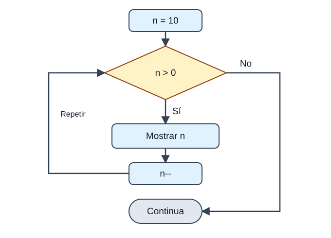
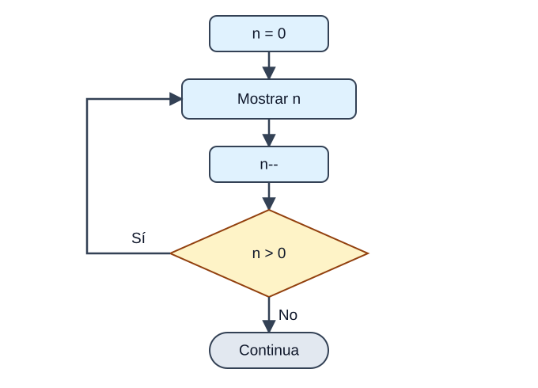
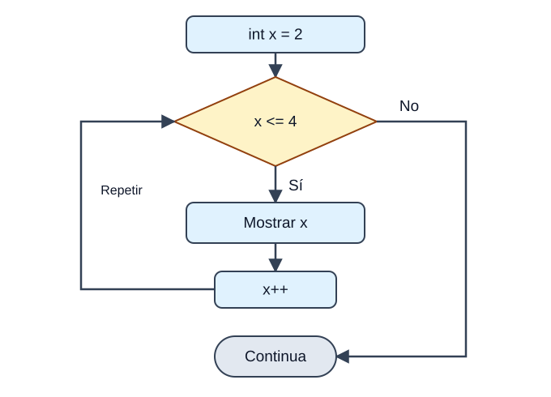

<p>Java té quatre formes de crear <strong>bucles</strong>, és a dir, d'executar un mateix bloc de codi de manera repetida mentre es complisca una condició: <code>while</code>, <code>do-while</code>, <code>for</code> i <code>for-each</code>. Triar l'adequada és qüestió de respondre a estes preguntes:</p>

<div class="java-document-table">
<table>
<tr>
<th scope="col"><p><strong>Bucle</strong></p></th>
<th scope="col"><p><strong>Comprova la condició…</strong></p></th>
<th scope="col"><p><strong>Mínim de voltes</strong></p></th>
<th scope="col"><p><strong>Utilitza'l quan…</strong></p></th>
</tr>
<tr>
<td><p><code>while</code></p></td>
<td><p>Al principi</p></td>
<td><p>0</p></td>
<td><p>No saps quantes repeticions hi haurà</p></td>
</tr>
<tr>
<td><p><code>do-while</code></p></td>
<td><p>Al final</p></td>
<td><p>1</p></td>
<td><p>Necessites executar el bloc <strong>almenys una vegada</strong> (per exemple, un menú)</p></td>
</tr>
<tr>
<td><p><code>for</code></p></td>
<td><p>Al principi</p></td>
<td><p>0</p></td>
<td><p>Saps per endavant quantes vegades has de repetir</p></td>
</tr>
<tr>
<td><p><code>for-each</code></p></td>
<td><p>—</p></td>
<td><p>0</p></td>
<td><p>Vols recórrer <strong>tots</strong> els elements d'un array o col·lecció</p></td>
</tr>
</table>
</div>

## while

<p>Repetix un bloc <strong>mentre</strong> una condició siga verdadera. Si la condició és falsa des del principi, el bloc no s'executa ni una sola vegada. És com «mentre hi haja sopa en el plat, continua menjant».</p>



<p><em>Primer es comprova n > 0. Si és fals des del principi, el cos no s’executa. Després de mostrar n i restar-li 1, tornem a comprovar la condició.</em></p>

```text
while (condicion) {
    bloque
}
```

```java
class EjemploWhile {
    public static void main(String[] args) {
        int n = 10;
        while (n > 0) {
            System.out.println("Pas " + n);
            n--;
        }
    }
}
```

<p><strong>EIXIDA PER CONSOLA</strong></p>

```text
Pas 10
Pas 9
Pas 8
Pas 7
Pas 6
Pas 5
Pas 4
Pas 3
Pas 2
Pas 1
```

<aside class="java-document-note">
<p><strong>COMPTE AMB AIXÒ</strong></p>
<p><strong>Bucle infinit:</strong> si dins del bucle mai canvies la variable que controla la condició (ací, oblidar el <code>n--</code>), la condició serà sempre verdadera i el programa no acabarà mai. Abans d'executar un bucle, pregunta't: «què fa que algun dia pare?»</p>
</aside>

## do-while

<p>És com el <code>while</code>, però amb una diferència fonamental: la condició es comprova <strong>al final</strong>, així que el cos s'executa <strong>sempre almenys una vegada</strong>. És com tastar la sopa abans de decidir si te la menges.</p>



<p><em>Primer s’executa el cos i després es pregunta. Amb n = 0, es mostra 0, n passa a −1 i el bucle acaba: ha fet una volta.</em></p>

```text
do {
    bloque
} while (condicion);      // no oblides el punt i coma!
```

```java
int n = 0;
do {
    System.out.println("Això s'executa encara que n valga " + n);
    n--;
} while (n > 0);
```

<p><strong>EIXIDA PER CONSOLA</strong></p>

```text
Això s'executa encara que n valga 0
```

<p>Amb un <code>while</code> normal este bloc no s'hauria executat mai, perquè <code>n &gt; 0</code> és fals des del principi.</p>

## for

<p>El <code>for</code> reunix en <strong>una sola línia</strong> els tres elements d'un bucle controlat per comptador: on comença, fins quan continua i com avança. És més compacte que el <code>while</code> i més fàcil de depurar.</p>



<p><em>La inicialització només es fa una vegada. Després repetim: condició → cos → actualització. Este exemple mostra 2, 3 i 4; quan x val 5, ix del bucle.</em></p>

```text
for (inicializacion; condicion; actualizacion) {
    bloque
}
```

<div class="java-document-table">
<table>
<tr>
<th scope="col"><p><strong>Part</strong></p></th>
<th scope="col"><p><strong>Què fa</strong></p></th>
</tr>
<tr>
<td><p><strong>Inicialització</strong></p></td>
<td><p>S'executa <strong>una sola vegada</strong> al principi. Ací es declara o inicialitza la variable de control (<code>int i = 0</code>). Si es declara ací, només existix dins del bucle.</p></td>
</tr>
<tr>
<td><p><strong>Condició</strong></p></td>
<td><p>Es comprova <strong>abans de cada volta</strong>. Ha de ser un <code>boolean</code>. Quan passa a fals, el bucle acaba.</p></td>
</tr>
<tr>
<td><p><strong>Cos</strong></p></td>
<td><p>Les instruccions que es repetixen mentre la condició siga verdadera.</p></td>
</tr>
<tr>
<td><p><strong>Actualització</strong></p></td>
<td><p>S'executa <strong>al final de cada volta</strong> (normalment <code>i++</code>) per a preparar la següent.</p></td>
</tr>
</table>
</div>

```java
class EjemploFor {
    public static void main(String[] args) {
        // el bucle comença amb x = 2 i continua mentre x <= 4
        for (int x = 2; x <= 4; x++) {
            System.out.println("Valor de x: " + x);
        }
    }
}
```

<p><strong>EIXIDA PER CONSOLA</strong></p>

```text
Valor de x: 2
Valor de x: 3
Valor de x: 4
```

<p>Un altre exemple molt típic: la taula de multiplicar del 3.</p>

```java
for (int i = 1; i <= 5; i++) {
    System.out.println("3 x " + i + " = " + (3 * i));
}
```

<p><strong>EIXIDA PER CONSOLA</strong></p>

```text
3 x 1 = 3
3 x 2 = 6
3 x 3 = 9
3 x 4 = 12
3 x 5 = 15
```

## Les tres parts del for són opcionals

<p>Pots ometre qualsevol de les tres parts (mantenint els punts i comes). En el primer exemple, la inicialització es fa fora del bucle i la condició utilitza una variable booleana; en el segon, en ometre-ho tot, creem un <strong>bucle infinit</strong> que només acaba amb un <code>break</code>:</p>

```java
int i = 0;
boolean done = false;
for ( ; !done; ) {
    System.out.println("i és " + i);
    if (i == 10) done = true;
    i++;
}
```

```java
for ( ; ; ) {
    // s'executa infinites vegades (fins que un break el detinga)
}
```

## for-each (el bucle for millorat)

<p>Java 5 va introduir una versió del <code>for</code> pensada per a <strong>recórrer tots els elements</strong> d'un array o d'una col·lecció de manera senzilla, sense preocupar-te dels índexs. Es llig com «per a cada element de la col·lecció…».</p>

```text
for (Tipo elemento : coleccion) {
    bloque
}
```

```java
class EjemploForEach {
    public static void main(String[] args) {
        String[] amigos = {"Ron", "Harry", "Hermione"};
        for (String x : amigos) {
            System.out.println(x);
        }
    }
}
```

<p><strong>EIXIDA PER CONSOLA</strong></p>

```text
Ron
Harry
Hermione
```

<aside class="java-document-note">
<p><strong>COMPTE AMB AIXÒ</strong></p>
<p>El <code>for-each</code> és còmode però <strong>inflexible</strong>: només servix per a recórrer tots els elements de principi a fi i no et diu en quina posició estàs. Si necessites l'índex, recórrer només una part o modificar elements, utilitza el <code>for</code> clàssic.</p>
</aside>

## Practica: FizzBuzz

<aside class="java-document-note">
<p><strong>MINIREPTE</strong></p>
<p><strong>El clàssic FizzBuzz.</strong> Escriu un programa que recórrega els nombres de l'1 al 30 i mostre: <code>Fizz</code> si el nombre és múltiple de 3, <code>Buzz</code> si és múltiple de 5, <code>FizzBuzz</code> si ho és dels dos, i el mateix nombre en qualsevol altre cas. (Pista: pensa en l'operador <code>%</code> i en quina condició has de comprovar primer.)</p>
</aside>

<details>
<summary>Veure la solució</summary>

<p><strong>Solució</strong> (intenta-ho abans de mirar):</p>

```java
for (int i = 1; i <= 30; i++) {
    // 15 és múltiple de 3 i de 5, així que es comprova primer
    if (i % 15 == 0)      System.out.println("FizzBuzz");
    else if (i % 3 == 0)  System.out.println("Fizz");
    else if (i % 5 == 0)  System.out.println("Buzz");
    else                  System.out.println(i);
}
```

<p>La clau està en l'<strong>orde</strong>: si comprovàrem primer <code>i % 3</code>, el 15 mostraria «Fizz» i mai arribaria a «FizzBuzz».</p>

</details>

## Repàs

<div class="java-document-table">
<table>
<tr>
<th scope="col"><p><strong>Tema</strong></p></th>
<th scope="col"><p><strong>El que has de recordar</strong></p></th>
</tr>
<tr>
<td><p><strong>Iteració</strong></p></td>
<td><p><code>while</code> · <code>do-while</code> (mínim 1 vegada) · <code>for</code> · <code>for-each</code>.</p></td>
</tr>
</table>
</div>

## Errors freqüents

<div class="java-document-table">
<table>
<tr>
<th scope="col"><p><strong>L’error</strong></p></th>
<th scope="col"><p><strong>Com evitar-lo</strong></p></th>
</tr>
<tr>
<td><p>Bucle infinit per no actualitzar la variable de control</p></td>
<td><p>Revisa què fa que la condició deixe de complir-se.</p></td>
</tr>
</table>
</div>
