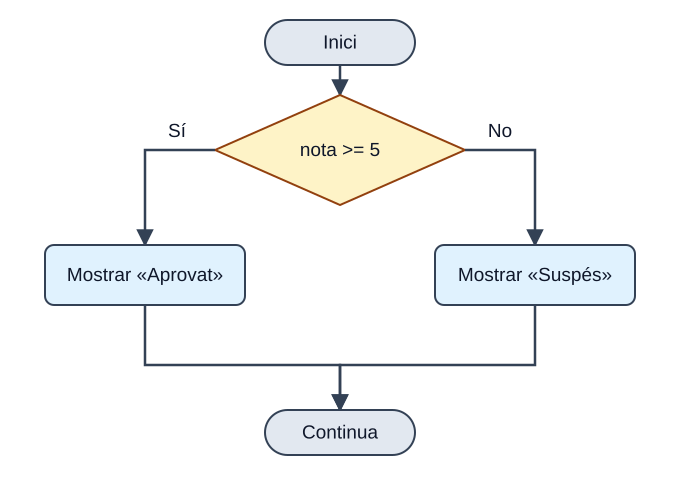

Les estructures de selecció permeten triar quin bloc de codi executar segons el resultat d’una condició. Utilitzarem `if` i `else` per a condicions i `switch` per a distingir casos a partir d’un valor.

## if

<p>L'estructura <code>if</code> dirigix l'execució del programa per un de <strong>dos camins possibles</strong> segons una condició. La seua sintaxi és:</p>



<p><em>El rombe és una pregunta: només s’executa una de les dos branques. Després, els camins es tornen a unir.</em></p>

```text
if (condicion) {
    bloque1;
} else {
    bloque2;
}
```

<p>La condició és qualsevol expressió que retorne un <code>boolean</code>, i la clàusula <code>else</code> és <strong>opcional</strong>. Un exemple senzill:</p>

```java
int nota = 7;
if (nota >= 5) {
    System.out.println("Aprovat");
} else {
    System.out.println("Suspés");
}
```

<p><strong>EIXIDA PER CONSOLA</strong></p>

```text
Aprovat
```

<aside class="java-document-note">
<p><strong>TRUC</strong></p>
<p><strong>Posa sempre les claus</strong>, fins i tot si el bloc té una sola instrucció. Java et deixa ometre-les, però és una font clàssica d'errors quan després afiges més línies.</p>
</aside>

<p>Dins de cada bloc pots incloure nous <code>if</code>. Quan hi ha diversos <code>if</code> i <code>else</code> mesclats, la regla és: <strong>cada <code>else</code> s'associa amb l'<code>if</code> més pròxim que encara no tinga <code>else</code></strong>.</p>

Este fragment va dins de `main` i pressuposa variables enteres `i`, `j`, `k`, `a`, `b`, `c` i `d` ja declarades i inicialitzades. L’objectiu és observar a quin `if` pertany cada `else`.

```java
if (i == 10) {
    if (j < 20) a = b;
    if (k > 100) c = d;    // este if ...
    else a = c;            // ... s'associa amb este else
} else a = d;              // este else pertany a if (i == 10)
```

## if-else-if (l'escala)

<p>Quan hi ha més de dos camins, s'encadenen diversos <code>if</code>. Java avalua les condicions <strong>de dalt cap avall</strong> i executa el bloc de la <strong>primera que siga verdadera</strong>; la resta s'ignora. L'<code>else</code> final arreplega tot el que no encaixa.</p>

```text
if (condicion1) {
    bloque1
} else if (condicion2) {
    bloque2
} else if (condicion3) {
    bloque3
} else {
    bloqueFinal
}
```

```java
class IfElse {
    public static void main(String[] args) {
        int mes = 4;   // Abril
        String estacion;
        if (mes == 12 || mes == 1 || mes == 2)       estacion = "Hivern";
        else if (mes == 3 || mes == 4 || mes == 5)   estacion = "Primavera";
        else if (mes == 6 || mes == 7 || mes == 8)   estacion = "Estiu";
        else if (mes == 9 || mes == 10 || mes == 11) estacion = "Tardor";
        else                                         estacion = "Mes erroni";
        System.out.println("Abril pertany a l'estació " + estacion + ".");
    }
}
```

<p><strong>EIXIDA PER CONSOLA</strong></p>

```text
Abril pertany a l'estació Primavera.
```

## switch

<p>El <code>switch</code> permet que el programa seguisca <strong>camins diferents segons el valor d'una expressió</strong>. És com un <code>if-else-if</code> molt llarg, però més ordenat quan comparem sempre la mateixa variable amb valors concrets. Pot utilitzar-se amb <code>byte</code>, <code>short</code>, <code>char</code>, <code>int</code>, els seus embolcalls, <code>String</code> i enumerats.</p>

```text
switch (expresion) {
    case valor1:
        bloque1
        break;
    case valor2:
        bloque2
        break;
    // ...
    default:
        bloquePorDefecto
}
```

<p>En l'exemple següent s'executa el <code>case</code> el valor del qual coincidix amb <code>i</code>. Com que ací no en coincidix cap (<code>i</code> val 4), s'executa el bloc <code>default</code>, que actua com l'<code>else</code> final:</p>

```java
class EjemploSwitch {
    public static void main(String[] args) {
        int i = 4;
        switch (i) {
            case 0:
                System.out.println("i és zero.");
                break;
            case 1:
                System.out.println("i és u.");
                break;
            case 2:
                System.out.println("i és dos.");
                break;
            default:
                System.out.println("i no és 0, 1 ni 2.");
        }
    }
}
```

<p><strong>EIXIDA PER CONSOLA</strong></p>

```text
i no és 0, 1 ni 2.
```

## El break i l'«efecte cascada»

<p>El <code>break</code> acaba el <code>switch</code>. Si <strong>s'omet</strong>, l'execució <strong>continua pel <code>case</code> següent</strong> encara que no coincidisca (això s'anomena *fall-through*, o efecte cascada). Sol ser un descuit, però de vegades s'aprofita a propòsit perquè diversos valors compartisquen el mateix codi:</p>

```java
class SwitchSinBreak {
    public static void main(String[] args) {
        int i = 3;
        switch (i) {
            case 1:
            case 2:
            case 3:
            case 4:
                System.out.println("i és menor que 5");
                break;
            case 5:
            case 6:
            case 7:
            case 8:
            case 9:
                System.out.println("i és menor que 10");
                break;
            default:
                System.out.println("i és 10 o més");
        }
    }
}
```

<p><strong>EIXIDA PER CONSOLA</strong></p>

```text
i és menor que 5
```

<p>Ací <code>i</code> val 3: coincidix amb <code>case 3</code>, i com que eixe <code>case</code> no té <code>break</code>, l'execució «cau» fins al <code>case 4</code>, on sí que troba la instrucció i el <code>break</code>.</p>

## switch modern (Java 14 en avant)

<p>Fins a Java 11, el <code>switch</code> era només una <strong>instrucció</strong>: servia per a executar blocs de codi i sempre necessitava <code>break</code>. A partir de Java 14 (i, per tant, en JDK 17) disposem del <strong><code>switch</code> com a expressió</strong>: una versió més moderna que, a més, <strong>retorna un valor</strong>.</p>

```java
int num = 2;
String dia = switch (num) {
    case 1 -> "Dilluns";
    case 2 -> "Dimarts";
    default -> "Un altre dia";
};
```

<p>Fixa't en tres novetats: el <code>switch</code> retorna un valor que guardem en <code>dia</code>, utilitzem la fletxa <code>-&gt;</code> en lloc de <code>:</code>, i <strong>ja no cal <code>break</code></strong> (no hi ha efecte cascada). A més, un mateix cas pot agrupar diversos valors separats per comes:</p>

```java
int dia = 6;
String tipo = switch (dia) {
    case 1, 2, 3, 4, 5 -> "Laborable";
    case 6, 7          -> "Cap de setmana";
    default            -> "Dia no vàlid";
};
```

<p>Si necessites diverses línies en un cas, obri claus <code>{ }</code> i utilitza la paraula <strong><code>yield</code></strong> per a retornar el valor:</p>

```java
int num = 2;
String dia = switch (num) {
    case 1 -> "Dilluns";
    case 2 -> {
        System.out.println("Processant...");
        yield "Dimarts";
    }
    default -> "Un altre dia";
};
```

<div class="java-document-table">
<table>
<tr>
<th scope="col"></th>
<th scope="col"><p><strong>switch clàssic</strong></p></th>
<th scope="col"><p><strong>switch modern</strong></p></th>
</tr>
<tr>
<td><p>Sintaxi del cas</p></td>
<td><p><code>case 1:</code></p></td>
<td><p><code>case 1 -&gt;</code></p></td>
</tr>
<tr>
<td><p>Necessita <code>break</code>?</p></td>
<td><p>Sí (o cau al cas següent)</p></td>
<td><p>No</p></td>
</tr>
<tr>
<td><p>Retorna un valor?</p></td>
<td><p>No, només executa instruccions</p></td>
<td><p>Sí, pot assignar-se a una variable</p></td>
</tr>
<tr>
<td><p>Diversos valors per cas</p></td>
<td><p>Diversos <code>case</code> seguits</p></td>
<td><p><code>case 1, 2, 3 -&gt;</code></p></td>
</tr>
</table>
</div>

## Repàs

<div class="java-document-table">
<table>
<tr>
<th scope="col"><p><strong>Tema</strong></p></th>
<th scope="col"><p><strong>El que has de recordar</strong></p></th>
</tr>
<tr>
<td><p><strong>Selecció</strong></p></td>
<td><p><code>if / else if / else</code> · <code>switch</code> (amb <code>break</code>, o amb <code>-&gt;</code> en Java 14+).</p></td>
</tr>
</table>
</div>

## Errors freqüents

<div class="java-document-table">
<table>
<tr>
<th scope="col"><p><strong>L’error</strong></p></th>
<th scope="col"><p><strong>Com evitar-lo</strong></p></th>
</tr>
<tr>
<td><p>Oblidar el <code>break</code> en un <code>switch</code> clàssic</p></td>
<td><p>Posa'l sempre, o utilitza el <code>switch</code> modern amb <code>-&gt;</code>.</p></td>
</tr>
</table>
</div>
