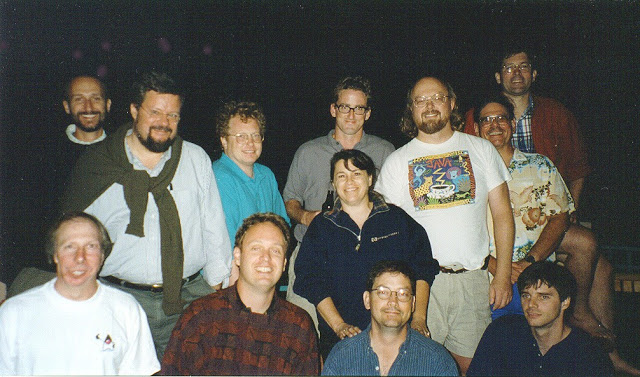
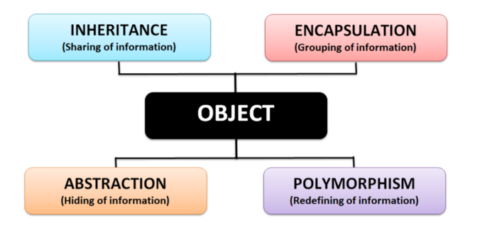
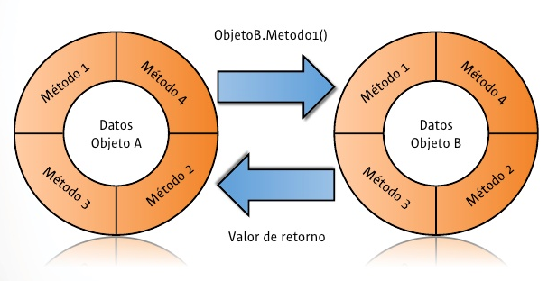
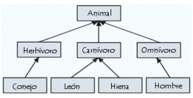
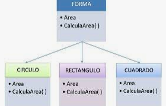
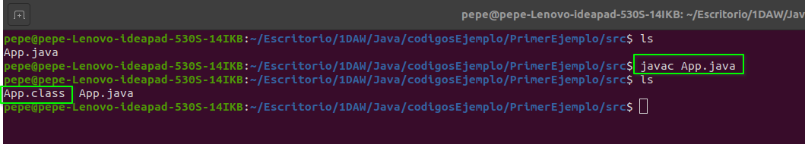
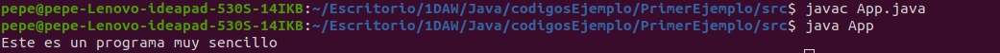
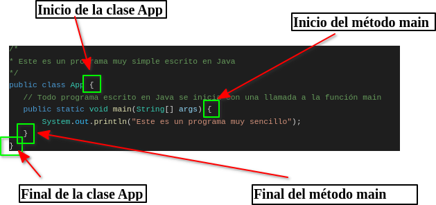
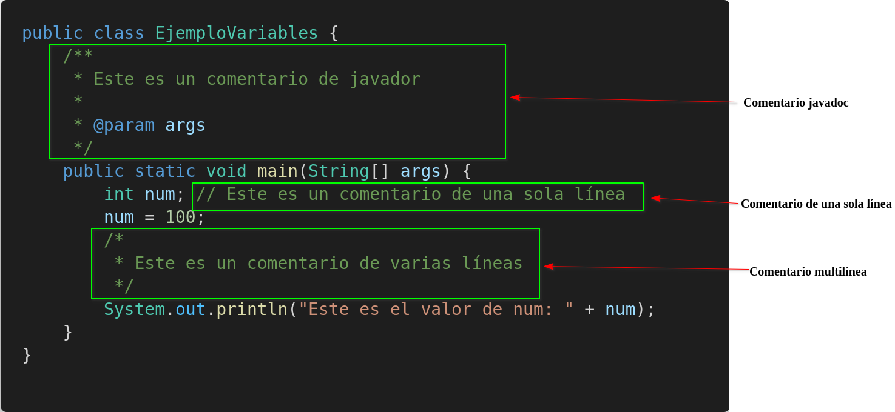

## 1. Història

<p><em>Darrere de cada llenguatge hi ha una història, i la de Java comença amb una pregunta molt senzilla: i si tots els aparells electrònics parlaren el mateix idioma?</em></p>

<p>Quan comencem a estudiar un llenguatge de programació solem fixar-nos només en la sintaxi i en la lògica. Tanmateix, conéixer <strong>per què</strong> es va crear ens ajuda a entendre <strong>per què és com és</strong>: moltes de les regles de Java (la màquina virtual, la comprovació estricta dels tipus, la gestió automàtica de la memòria…) van ser la resposta a problemes reals que va tindre el seu equip de disseny.</p>

### 1.1 Els inicis: el Green Project (1991)

<p>En 1991, l'informàtic <strong>James Gosling</strong>, que aleshores treballava com a desenvolupador de programari en <strong>Sun Microsystems</strong>, es va posar al capdavant d'un projecte d'investigació intern anomenat <strong>Green Project</strong>, format per 13 persones.</p>

<p>L'equip tenia una intuïció avançada al seu temps: els microprocessadors no es quedarien només dins dels ordinadors. Les indústries ja els estaven instal·lant en telèfons, ascensors, locomotores, sistemes d'il·luminació… i a este grup el fascinava la idea que tots aquells aparells pogueren programar-se i comunicar-se entre si. Hui ho anomenaríem «Internet de les coses»; ells ho imaginaven en els anys noranta.</p>

<div class="java-document-image" style="max-width: 380px;">



</div>

<p><em>L'equip del Green Project, en Sun Microsystems.</em></p>

### 1.2 El problema: C++ es quedava curt

<p>Per a desenvolupar les seues idees, el Green Project utilitzava sobretot <strong>C++</strong>. Prompte va quedar clar que este llenguatge no estava a l'altura en tres aspectes imprescindibles: <strong>xarxes, seguretat i independència de la plataforma</strong>.</p>

<p>El tercer era el més greu. Un programa en C++ es compila per a un processador concret: si el fabricant canviava de xip, calia tornar a programar-lo quasi des de zero. És com si hagueres de reescriure l'aplicació del teu mòbil cada vegada que canvies de model. En un món amb milers de dispositius diferents, això era inviable. Per este motiu, Gosling es va oferir a crear un llenguatge propi que s'adaptara a les exigències del projecte.</p>

<aside class="java-document-note">
<p><strong>OBJECTIU</strong>  ·  <strong>La meta de Java</strong></p>
<p>Crear un llenguatge amb una estructura i una sintaxi semblants a les de C++ (perquè els programadors pogueren aprendre'l ràpidament), <strong>fortament orientat a objectes</strong> i amb <strong>una màquina virtual pròpia</strong>. Tot això amb un lema que s'ha fet famós:</p>
<p><strong>«Write Once, Run Anywhere»</strong>: escriu-lo una vegada, executa'l en qualsevol lloc.</p>
</aside>

<p>Com s'aconseguix eixa màgia? Pensa en un intèrpret de conferències: l'orador prepara el seu discurs una sola vegada i, en cada país, un intèrpret el traduïx en directe. En Java, el programador escriu el programa una vegada; el compilador el convertix en un codi intermedi anomenat <strong>bytecode</strong>, i en cada sistema (Windows, Linux, macOS, un electrodomèstic…) una <strong>màquina virtual de Java (JVM)</strong> fa d'intèrpret. Més avant ho veurem amb un esquema.</p>

### 1.3 D'Oak a Java (1995)

<p>Gosling va batejar el seu llenguatge com a <strong>Oak</strong> («roure» en valencià), segons conta la tradició, pel roure que veia des de la finestra del seu despatx. Però eixe nom ja estava registrat com a marca, així que calgué buscar-ne un altre: en <strong>1995</strong> el llenguatge va passar a anomenar-se definitivament <strong>Java</strong>.</p>

<p>Gosling no va estar a soles. Enginyers com <strong>Bill Joy, Arthur van Hoff, Jonathan Payne, Frank Yellin i Tim Lindholm</strong> van ser clau perquè aquell prototip madurara fins a convertir-se en un llenguatge de propòsit general.</p>

<p>L'impuls definitiu va arribar de la mà de la web. Les pàgines d'aleshores eren estàtiques; Java va permetre incloure xicotets programes dins d'elles, els <strong>applets</strong> (hui en desús), i el navegador Netscape Navigator els va admetre. Java va fer així el salt dels electrodomèstics a Internet. La seua primera versió pública, <strong>JDK 1.0</strong>, va eixir al gener de 1996 i, des d'aleshores, el llenguatge no ha deixat de créixer amb nous paquets i biblioteques.</p>

### 1.4 Línia del temps

<div class="java-document-table">
<table>
<tr>
<th scope="col"><p><strong>1991</strong></p></th>
<th scope="col"><p><strong>1995</strong></p></th>
<th scope="col"><p><strong>1996</strong></p></th>
<th scope="col"><p><strong>2006-07</strong></p></th>
<th scope="col"><p><strong>2010</strong></p></th>
<th scope="col"><p><strong>2017</strong></p></th>
</tr>
<tr>
<td><p>Naix el Green Project en Sun Microsystems.</p></td>
<td><p>Oak passa a anomenar-se Java.</p></td>
<td><p>Ix JDK 1.0, la primera versió pública.</p></td>
<td><p>Java s'allibera com a programari lliure (OpenJDK).</p></td>
<td><p>Oracle adquirix Sun Microsystems.</p></td>
<td><p>Comença el cicle d'una versió nova cada sis mesos.</p></td>
</tr>
</table>
</div>

<aside class="java-document-note">
<p><strong>HO SABIES?</strong>  ·  <strong>Curiositats: d'on ix el nom «Java»?</strong></p>
<p>El seu origen és objecte de debat i circulen diverses teories:</p>
<ul>
<li><strong>La del café</strong>, la més difosa: en anglés «java» és una manera col·loquial d'anomenar el café (per l'illa indonèsia del mateix nom) i l'equip en prenia molt. D'ací vindria també el logotip, una tassa de café fumejant.</li>
<li><strong>La de l'acrònim</strong>: <em>Just Another Vague Acronym</em> («només un altre acrònim ambigu més»). Sona a broma de programadors, i probablement ho és.</li>
<li><strong>La més plausible</strong>: el nom es va triar d'una llista de candidats, perquè complia les exigències legals de registre de marca.</li>
</ul>
<p>I una altra més: la mascota de Java, <strong>Duke</strong>, és anterior al mateix nom. Va nàixer com a personatge de la interfície d'un dels prototips del Green Project.</p>
</aside>

## 2. Característiques

<p><em>Quan Sun va presentar Java, va resumir la seua filosofia en una llista de paraules clau. Són les seues «cartes de presentació» i entendre-les t'ajudarà a saber què pots esperar del llenguatge.</em></p>

<p>La principal motivació de Java (independència de la plataforma, xarxes i seguretat) ja la coneixem, però altres factors també van modelar la seua forma final. L'equip de Java va resumir les consideracions clau en la llista següent, que podem prendre com les seues principals característiques. Fixa't en l'última columna: traduïx cada terme tècnic al que <strong>notaràs tu</strong> quan programes.</p>

<div class="java-document-table">
<table>
<tr>
<th scope="col"><p><strong>Característica</strong></p></th>
<th scope="col"><p><strong>Què significa</strong></p></th>
<th scope="col"><p><strong>Ho notaràs quan…</strong></p></th>
</tr>
<tr>
<td><p><strong>Simple</strong></p></td>
<td><p>Java es va dissenyar per a aprendre'l i utilitzar-lo amb facilitat: té una sintaxi semblant a la de C++, però sense les seues parts més perilloses (no hi ha punters i la memòria s'allibera a soles).</p></td>
<td><p>Aprengues ràpidament i no hages de preocupar-te de reservar ni alliberar memòria a mà.</p></td>
</tr>
<tr>
<td><p><strong>Orientat a objectes</strong></p></td>
<td><p>Hereu dels seus predecessors, basa el seu model en objectes que es creen a partir de classes. Tot el codi viu dins de classes.</p></td>
<td><p>Representes clients, comandes o cotxes quasi tal com els veus en la vida real.</p></td>
</tr>
<tr>
<td><p><strong>Robust</strong></p></td>
<td><p>Busca problemes tant en compilar com en executar: tipatge estricte, gestió d'excepcions i recol·lector de fem que allibera la memòria que ja no s'utilitza.</p></td>
<td><p>El compilador t'avise d'una fallada abans que la patisca l'usuari.</p></td>
</tr>
<tr>
<td><p><strong>Segur</strong></p></td>
<td><p>Abans d'executar, la JVM verifica els <em>bytecodes</em> i el llenguatge no permet accedir directament a la memòria.</p></td>
<td><p>Executes codi alié sense que puga «fer el que vulga» amb el teu equip.</p></td>
</tr>
<tr>
<td><p><strong>Portable</strong></p>
<p>(independent de l'arquitectura)</p></td>
<td><p>El mateix bytecode funciona en qualsevol sistema que tinga una JVM. A més, els tipus tenen una grandària fixa: un <code>int</code> ocupa 32 bits en totes parts.</p></td>
<td><p>Programes en Windows i la teua aplicació funcione igual en Linux o macOS.</p></td>
</tr>
<tr>
<td><p><strong>Interpretat</strong></p></td>
<td><p>Es compila a una representació intermèdia (bytecode) que la JVM executa. És alhora compilat i interpretat.</p></td>
<td><p>Compiles una sola vegada i distribuïsques el mateix <code>.class</code> a tot el món.</p></td>
</tr>
<tr>
<td><p><strong>Alt rendiment</strong></p></td>
<td><p>La JVM incorpora un compilador JIT (<em>Just-In-Time</em>) que traduïx a codi natiu les parts que més s'executen.</p></td>
<td><p>Els teus programes guanyen velocitat a mesura que porten un temps executant-se.</p></td>
</tr>
<tr>
<td><p><strong>Distribuït</strong></p></td>
<td><p>Java en si no és un sistema distribuït, però la seua biblioteca estàndard oferix tot el que cal per a crear-los: compatibilitat amb TCP/IP i protocols com <em>http</em> o <em>ftp</em>. Accedir a informació en xarxa és quasi tan fàcil com obrir un fitxer local.</p></td>
<td><p>Descarregues una pàgina web o parles amb un servidor amb poques línies de codi.</p></td>
</tr>
<tr>
<td><p><strong>Multifil</strong></p>
<p>(multiprocés)</p></td>
<td><p>Permet escriure programes que realitzen moltes accions alhora. Des de Java 21 hi ha, a més, els «fils virtuals», molt lleugers.</p></td>
<td><p>El teu programa descarregue un fitxer mentre la interfície continua responent.</p></td>
</tr>
<tr>
<td><p><strong>Dinàmic</strong></p></td>
<td><p>Els programes porten molta informació que s'utilitza en temps d'execució, i les classes es carreguen només quan fan falta. Permet vincular codi de manera segura i ràpida.</p></td>
<td><p>Afiges biblioteques o amplies un programa sense haver de reconstruir-lo sencer.</p></td>
</tr>
</table>
</div>

#### El truc de la portabilitat, pas a pas

<p>De totes les característiques, la més important és sens dubte la <strong>portabilitat</strong>. Este esquema mostra com funciona:</p>

<div class="java-document-table">
<table>
<tr>
<td><p><strong>Codi font</strong></p>
<p>fitxer .java</p></td>
<td><p><strong>→</strong></p></td>
<td><p><strong>Compilador</strong></p>
<p>javac</p></td>
<td><p><strong>→</strong></p></td>
<td><p><strong>Bytecode</strong></p>
<p>fitxer .class</p></td>
<td><p><strong>→</strong></p></td>
<td><p><strong>JVM</strong></p>
<p>una per a cada sistema</p></td>
<td><p><strong>→</strong></p></td>
<td><p><strong>S'executa</strong></p>
<p>Windows · Linux · macOS</p></td>
</tr>
</table>
</div>

<aside class="java-document-note">
<p><strong>RECORDA</strong></p>
<p>El compilador <strong>no</strong> genera codi per a un processador concret, sinó bytecode: un «idioma intermedi» que entén qualsevol JVM. L'única cosa que canvia d'un sistema a un altre és la JVM, no el teu programa. Per això el mateix <code>.class</code> funciona igual en el portàtil de classe i en un servidor d'un altre continent.</p>
</aside>

## 3. Popularitat

<p><em>Java té més de 30 anys i continua en la part alta de totes les classificacions. Val la pena aprendre'l? Vegem què diuen les dades.</em></p>

<p>Des de fa més de dos dècades, la popularitat de Java el manté entre els primers llocs de l'índex <strong>TIOBE</strong>; al setembre de 2026 ocupa el <strong>quart lloc</strong>. A més, la seua comunitat és enorme (Oracle parla de més de 9 milions de desenvolupadors a tot el món), cosa que significa que per a quasi qualsevol dubte que et sorgisca ja hi ha una resposta publicada en fòrums, llibres i tutorials.</p>

<div class="java-document-table">
<table>
<tr>
<th scope="col"><p><strong>Lloc</strong></p></th>
<th scope="col"><p><strong>Llenguatge</strong></p></th>
<th scope="col"><p><strong>Quota</strong></p></th>
</tr>
<tr>
<td><p>1</p></td>
<td><p>Python</p></td>
<td><p>17,76 %</p></td>
</tr>
<tr>
<td><p>2</p></td>
<td><p>C</p></td>
<td><p>10,28 %</p></td>
</tr>
<tr>
<td><p>3</p></td>
<td><p>C++</p></td>
<td><p>8,67 %</p></td>
</tr>
<tr>
<td><p><strong>4</strong></p></td>
<td><p><strong>Java</strong></p></td>
<td><p><strong>7,54 %</strong></p></td>
</tr>
<tr>
<td><p>5</p></td>
<td><p>C#</p></td>
<td><p>4,22 %</p></td>
</tr>
</table>
</div>

<p><em>Cinc primers llocs de l'índex TIOBE, setembre de 2026.</em></p>

<p>Java va ser, a més, triat <strong>«llenguatge de l'any»</strong> per TIOBE en 2005 i en 2015.</p>

<aside class="java-document-note">
<p><strong>HO SABIES?</strong>  ·  <strong>Què és l'índex TIOBE?</strong></p>
<p>El <em>TIOBE Programming Community Index</em> mesura la popularitat dels llenguatges de programació. L'elabora l'empresa TIOBE, amb seu a Eindhoven (Països Baixos), a partir del nombre de resultats que retornen els cercadors per a consultes que contenen el nom de cada llenguatge.</p>
<p>Compte: mesura <strong>popularitat</strong>, no qualitat ni la quantitat de codi que hi ha escrit en cada llenguatge.</p>
</aside>

### 3.1 On s'utilitza Java?

<p>Java és un llenguatge versàtil i pràctic, i eixa és una de les raons per les quals oferix una ocupabilitat tan alta. S'utilitza per a crear aplicacions d'escriptori i mòbils, videojocs i pàgines web, entre moltes altres coses:</p>

<div class="java-document-table">
<table>
<tr>
<th scope="col"><p><strong>Àmbit</strong></p></th>
<th scope="col"><p><strong>Exemples</strong></p></th>
</tr>
<tr>
<td><p><strong>Servidors i empresa</strong></p></td>
<td><p>Aplicacions de bancs, asseguradores i administracions públiques; molts servicis web es programen amb Java i marcs de treball com Spring.</p></td>
</tr>
<tr>
<td><p><strong>Mòbils</strong></p></td>
<td><p>Android va nàixer amb Java com a llenguatge principal (hui compartix protagonisme amb Kotlin).</p></td>
</tr>
<tr>
<td><p><strong>Videojocs</strong></p></td>
<td><p>Minecraft: Java Edition, un dels videojocs més venuts de la història, està escrit en Java.</p></td>
</tr>
<tr>
<td><p><strong>Escriptori</strong></p></td>
<td><p>Entorns de desenvolupament com Eclipse, NetBeans o IntelliJ IDEA estan fets en Java.</p></td>
</tr>
<tr>
<td><p><strong>Dades massives</strong></p></td>
<td><p>Ferramentes de <em>big data</em> i sistemes distribuïts com Apache Hadoop o Cassandra.</p></td>
</tr>
<tr>
<td><p><strong>Dispositius xicotets</strong></p></td>
<td><p>Targetes intel·ligents (Java Card) i sistemes encastats, fidel a l'esperit original del Green Project.</p></td>
</tr>
</table>
</div>

<p>Per tot això, empreses com <strong>Google, Amazon, Twitter, IBM, Netflix</strong> i fins i tot la <strong>NASA</strong> utilitzen o han utilitzat Java.</p>

<aside class="java-document-note">
<p><strong>MINIREPTE</strong>  ·  <strong>Investiga</strong></p>
<p>Busca en un portal d'ocupació (InfoJobs, LinkedIn…) ofertes que demanen Java. Anota quines altres tecnologies apareixen al seu costat i quina experiència se sol·licita. Ho comentarem a classe.</p>
</aside>

## 4. Versions

<p><em>Java ha canviat tant que un programa de 1996 i un de hui semblen quasi de llenguatges diferents. Repassem-ne l'evolució.</em></p>

<p>Des de la seua primera versió (gener de 1996), Java ha seguit un cicle constant de llançaments. Durant anys les versions apareixien cada dos o tres anys, però des de <strong>2017</strong> hi ha un calendari fix: <strong>una versió nova cada sis mesos</strong> (al març i al setembre). Algunes són <strong>LTS</strong> (<em>Long Term Support</em>, «suport a llarg termini»): versions que reben actualitzacions durant anys, pensades per a les empreses que no poden canviar de versió cada sis mesos. Al principi les LTS arribaven cada tres anys; des de Java 17 arriben <strong>cada dos</strong>. Això ha permés una evolució més contínua i previsible.</p>

### 4.1 Principals fites de Java

<div class="java-document-table">
<table>
<tr>
<th scope="col"><p><strong>Versió</strong></p></th>
<th scope="col"><p><strong>Any</strong></p></th>
<th scope="col"><p><strong>Novetats destacades</strong></p></th>
</tr>
<tr>
<td><p>JDK 1.0</p></td>
<td><p>1996</p></td>
<td><p>Primera versió estable: applets i la promesa «Write Once, Run Anywhere».</p></td>
</tr>
<tr>
<td><p>Java 2 (1.2)</p></td>
<td><p>1998</p></td>
<td><p>Edicions diferenciades (SE, EE i ME) i la biblioteca gràfica Swing.</p></td>
</tr>
<tr>
<td><p>Java 5</p></td>
<td><p>2004</p></td>
<td><p>Genèrics, anotacions, enumerats, bucle <em>for-each</em> i millores en concurrència.</p></td>
</tr>
<tr>
<td><p>Java 6</p></td>
<td><p>2006</p></td>
<td><p>Millor integració amb altres llenguatges i compatibilitat ampliada amb plataformes.</p></td>
</tr>
<tr>
<td><p>Java 7</p></td>
<td><p>2011</p></td>
<td><p>Nova biblioteca NIO.2 per a fitxers, <code>try-with-resources</code> i compatibilitat amb llenguatges dinàmics.</p></td>
</tr>
<tr>
<td><p><strong>Java 8</strong> · LTS</p></td>
<td><p>2014</p></td>
<td><p>Expressions lambda, <em>streams</em> i nova API de dates: el gran salt cap a la programació funcional.</p></td>
</tr>
<tr>
<td><p>Java 9</p></td>
<td><p>2017</p></td>
<td><p>Sistema de mòduls (Project Jigsaw) i <code>jshell</code>. Comença el cicle de sis mesos.</p></td>
</tr>
<tr>
<td><p>Java 10</p></td>
<td><p>2018</p></td>
<td><p>Inferència de tipus amb <code>var</code>.</p></td>
</tr>
<tr>
<td><p><strong>Java 11</strong> · LTS</p></td>
<td><p>2018</p></td>
<td><p>Client HTTP estàndard, possibilitat d'executar un <code>.java</code> directament i retirada d'API obsoletes.</p></td>
</tr>
<tr>
<td><p><strong>Java 17</strong> · LTS</p></td>
<td><p>2021</p></td>
<td><p><em>Records</em>, blocs de text, classes segellades i <em>pattern matching</em> amb <code>instanceof</code>.</p></td>
</tr>
<tr>
<td><p><strong>Java 21</strong> · LTS</p></td>
<td><p>2023</p></td>
<td><p>Fils virtuals, <em>pattern matching</em> en <code>switch</code> i <em>record patterns</em>.</p></td>
</tr>
<tr>
<td><p><strong>Java 25</strong> · LTS</p></td>
<td><p>2025</p></td>
<td><p>Última LTS publicada: programes més senzills per a començar (mètode <code>main</code> simplificat) i millores de rendiment.</p></td>
</tr>
<tr>
<td><p>Java 26 i 27</p></td>
<td><p>2026</p></td>
<td><p>Les versions més recents: Java 26 (març) i Java 27 (15 de setembre de 2026).</p></td>
</tr>
</table>
</div>

<aside class="java-document-note">
<p><strong>RECORDA</strong>  ·  <strong>Quina versió trie?</strong></p>
<p>Per a aprendre i per a projectes reals convé una versió <strong>LTS</strong>: hui, Java 21 o Java 25. Les versions intermèdies servixen per a provar novetats, però deixen de rebre actualitzacions als sis mesos.</p>
<p>Així i tot, moltes empreses mantenen aplicacions en Java 8 o 11. Saber què va canviar en cada versió t'ajudarà a llegir codi antic sense perdre't.</p>
</aside>

## 5. Programació orientada a objectes (OOP)

<p><em>Java és orientat a objectes fins al moll de l'os. Abans d'escriure codi convé canviar de manera de pensar: en lloc de pensar en «passos», pensarem en «coses» que col·laboren entre si.</em></p>

<p>La programació orientada a objectes (POO, o <em>OOP</em> en anglés) és el nucli de Java. Per això resulta de vital importància entendre'n els principis bàsics abans de començar a escriure un programa, per senzill que siga. Es recolza en quatre pilars:</p>

<div class="java-document-image" style="max-width: 430px;">



</div>

<p><em>Els quatre pilars de la POO: abstracció, encapsulació, herència i polimorfisme.</em></p>

### 5.1 Classes i objectes: la idea base

<p>Pensa en un motle de galletes. El motle no es menja, però definix la forma de totes les galletes que faces amb ell. En POO, eixe motle és una <strong>classe</strong> i cada galleta és un <strong>objecte</strong> (o <em>instància</em>). La classe descriu <strong>quines dades</strong> té i <strong>què pot fer</strong>; cada objecte guarda els seus propis valors.</p>

<div class="java-document-table">
<table>
<tr>
<th scope="col"><p><strong>Concepte</strong></p></th>
<th scope="col"><p><strong>Significat</strong></p></th>
<th scope="col"><p><strong>Exemple</strong></p></th>
</tr>
<tr>
<td><p><strong>Classe</strong></p></td>
<td><p>El motle: descriu com són i què fan els objectes d'un tipus.</p></td>
<td><p><code>Cotxe</code></p></td>
</tr>
<tr>
<td><p><strong>Objecte</strong></p></td>
<td><p>Una «galleta» concreta creada amb eixe motle.</p></td>
<td><p>El cotxe roig del teu veí</p></td>
</tr>
<tr>
<td><p><strong>Atributs</strong></p></td>
<td><p>Les dades que guarda cada objecte.</p></td>
<td><p>marca, color, velocitat</p></td>
</tr>
<tr>
<td><p><strong>Mètodes</strong></p></td>
<td><p>El que l'objecte sap fer (el seu comportament).</p></td>
<td><p><code>accelerar()</code>, <code>frenar()</code></p></td>
</tr>
</table>
</div>

<p>Amb esta idea al cap, vegem els quatre pilars un a un.</p>

### 5.2 Abstracció

<p>Un element essencial de la programació orientada a objectes és l'abstracció. Els humans gestionem la complexitat a través d'ella: ningú pensa en un automòbil com un conjunt de milers de peces soltes, sinó com un objecte ben definit amb el seu propi comportament (arrancar, frenar, girar). Per a conduir-lo no necessites saber com funciona el motor: en tens prou amb el volant i els pedals. Abstraure és <strong>quedar-se amb l'essencial i ignorar els detalls</strong>.</p>

<p>Una manera potent de gestionar l'abstracció és mitjançant <strong>classificacions jeràrquiques</strong>, que ens permeten dividir sistemes complexos en peces més manejables. Des de fora, l'automòbil és un sol objecte; una vegada dins, veiem que consta de diversos subsistemes (direcció, frens, so, cinturons de seguretat, calefacció…) i que cadascun es compon, al seu torn, de sistemes més especialitzats.</p>

<p>Les abstraccions jeràrquiques es poden aplicar igualment al desenvolupament de programari. En un programa tradicional, orientat a processos, tindríem una seqüència de passos. En un d'orientat a objectes, les dades es transformen en objectes i la seqüència de passos es convertix en una col·lecció de <strong>missatges</strong> entre ells. Cada objecte descriu el seu propi comportament i respon als missatges que li demanen fer alguna cosa. Eixa és l'essència de la programació orientada a objectes.</p>

<aside class="java-document-note">
<p><strong>RECORDA</strong>  ·  <strong>L'abstracció depén del problema</strong></p>
<p>Per a una aplicació de taller mecànic, un <code>Cotxe</code> necessita matrícula i quilometratge; per a un videojoc de carreres, potència i velocitat màxima. És el mateix cotxe real, però dos abstraccions diferents: cada programa es queda només amb el que li importa.</p>
</aside>

### 5.3 Encapsulació

<p>Els objectes són l'abstracció que fa possible l'encapsulació, un concepte fonamental. Consistix a <strong>fer que les dades només puguen modificar-se a través de les funcions (mètodes) pensades per a això</strong>. D'esta manera, les dades conserven un estat vàlid i consistent, i s'evita que qualsevol codi extern les deixe en una situació absurda.</p>

<p>S'anomena <em>encapsulació</em> perquè les dades i les seues estructures no són accessibles de manera directa: per a consultar-les o manipular-les cal passar pels seus mètodes associats, com si estigueren dins d'una càpsula. Pensa en un caixer automàtic: no fiques la mà en la caixa forta, sinó que utilitzes la pantalla i el teclat, i el caixer decidix si la teua operació és vàlida.</p>

<div class="java-document-image" style="max-width: 340px;">



</div>

<p><em>Cada objecte protegix les seues dades i només es comunica amb altres mitjançant els seus mètodes.</em></p>

<p><code>Exemple d'encapsulació (només perquè en veges l'aspecte)</code></p>

```java
public class CompteBancari {
    private double saldo;               // ningú de fora pot tocar-lo directament

    public void ingressar(double quantitat) {
        if (quantitat > 0) {             // el mateix objecte valida l'operació
            saldo = saldo + quantitat;
        }
    }

    public double getSaldo() {          // accés de només lectura
        return saldo;
    }
}
```

<p>Encara no cal que entengues cada línia. Fixa't només en la idea: <code>private</code> («privat») impedix que altres modifiquen <code>saldo</code> al seu gust, i <code>ingressar</code> s'assegura que mai s'ingresse una quantitat negativa.</p>

### 5.4 Herència

<p>L'herència és el procés mitjançant el qual un objecte adquirix les propietats d'un altre objecte. La major part del coneixement es fa manejable mitjançant classificacions jeràrquiques (de dalt cap avall): un Golden Retriever és un gos, que al seu torn forma part de la classe dels mamífers, que es troba davall de la classe més àmplia dels animals.</p>

<p>Sense jerarquies, cada objecte hauria de definir explícitament totes les seues característiques. Amb l'herència, un objecte només necessita definir el que el fa únic dins de la seua classe i <strong>hereta</strong> els atributs generals del seu pare. Si descrigueres els animals de manera abstracta, diries que tenen atributs (grandària, intel·ligència, tipus d'esquelet) i comportaments (mengen, respiren, dormen). Eixa descripció d'atributs i comportament és la definició de classe per a <em>Animal</em>; gossos, lleons o conills la reutilitzen i hi afigen les seues particularitats.</p>

<div class="java-document-image" style="max-width: 330px;">



</div>

<p><em>Jerarquia de classes: cada nivell hereta el que definix el nivell superior.</em></p>

<p><code>Un Gos pot respirar() i lladrar()</code></p>

```java
public class Animal {
    public void respirar() { /* ... */ }
}

public class Gos extends Animal {     // Gos HERETA d’Animal
    public void lladrar() { /* ... */ }
}
```

<aside class="java-document-note">
<p><strong>RECORDA</strong>  ·  <strong>La prova de l'«és un»</strong></p>
<p>Per a saber si l'herència té sentit, pregunta't: un gos <strong>és un</strong> animal? Sí, per tant <code>Gos</code> pot heretar d'<code>Animal</code>. Un cotxe <strong>és un</strong> motor? No: un cotxe <strong>té un</strong> motor, així que el motor serà un atribut del cotxe, no la seua classe pare.</p>
</aside>

### 5.5 Polimorfisme

<p>La paraula polimorfisme es compon de dos arrels gregues: <em>poli</em>, que significa «molts», i <em>morfo</em>, que significa «forma». Literalment, «moltes formes». Està relacionat amb el comportament dels objectes: un objecte polimorf és aquell que té diverses formes de comportar-se o, més concretament, diverses maneres de fer les coses.</p>

<p>Pensa en el botó «reproduir» del teu mòbil: és sempre el mateix botó, però si hi ha un vídeo el projecta, si hi ha una cançó la reproduïx i si hi ha un pòdcast el narra. Mateixa orde, resposta adaptada a cada cas.</p>

<p>Els objectes poden manifestar esta qualitat de dos maneres: directament amb el seu <strong>comportament</strong> (mètodes amb el mateix nom però diferents paràmetres) i a través de la <strong>relació d'herència</strong> (les subclasses redefinixen un mètode de la seua classe pare a la seua manera).</p>

<div class="java-document-image" style="max-width: 250px;">



</div>

<p><em>Totes les formes calculen la seua àrea, cadascuna amb la seua pròpia fórmula.</em></p>

<p><code>Mateixa orde, resultat diferent</code></p>

```java
Forma f1 = new Cercle();
Forma f2 = new Rectangle();

f1.calcularArea();   // aplica la fórmula del cercle
f2.calcularArea();   // aplica la del rectangle
```

#### Els quatre pilars d'una ullada

<div class="java-document-table">
<table>
<tr>
<th scope="col"><p><strong>Pilar</strong></p></th>
<th scope="col"><p><strong>En una frase</strong></p></th>
<th scope="col"><p><strong>Una imatge per a recordar-ho</strong></p></th>
</tr>
<tr>
<td><p><strong>Abstracció</strong></p></td>
<td><p>Quedar-se amb l'essencial i ignorar els detalls.</p></td>
<td><p>Conduir sense saber de mecànica.</p></td>
</tr>
<tr>
<td><p><strong>Encapsulació</strong></p></td>
<td><p>Protegir les dades i donar-hi accés només mitjançant mètodes.</p></td>
<td><p>Un caixer automàtic.</p></td>
</tr>
<tr>
<td><p><strong>Herència</strong></p></td>
<td><p>Reutilitzar i ampliar el que definix una classe pare.</p></td>
<td><p>Gos → Mamífer → Animal.</p></td>
</tr>
<tr>
<td><p><strong>Polimorfisme</strong></p></td>
<td><p>Una mateixa orde amb respostes diferents segons l'objecte.</p></td>
<td><p>El botó «reproduir».</p></td>
</tr>
</table>
</div>

## 6. Un primer programa escrit en Java

<p><em>És tradició que el primer programa en qualsevol llenguatge salude el món. El nostre serà un poc més modest, però complix la mateixa funció: comprovar que tot funciona.</em></p>

<p>Ara que ja coneixem un poc la història de Java, les seues característiques i el model de POO en què es basa, vegem un xicotet exemple. Compilarem i executarem el codi següent (per a preparar l'entorn de treball, consulta el document corresponent):</p>

<p><code>App.java</code></p>

```java
/*
 * Este és un programa molt simple escrit en Java
 */
public class App {
    // Tot programa escrit en Java s'inicia amb una crida a la funció main
    public static void main(String[] args) {
        System.out.println("Este és un programa molt senzill");
    }
}
```

### 6.1 El nom del fitxer importa

<p>En la majoria dels llenguatges, el nom del fitxer que conté el codi font és irrellevant. En Java no és així: la primera cosa que hem de recordar és que <strong>el nom que donem al fitxer font és molt important</strong>. En este exemple ha d'anomenar-se <code>App.java</code>. Vegem per què.</p>

<p>En Java, un fitxer de codi font s'anomena oficialment <strong>unitat de compilació</strong>. És un fitxer de text que conté, entre altres coses, una o més definicions de classe (de moment utilitzarem fitxers amb una sola). El compilador exigix que tinga l'extensió <code>.java</code>.</p>

<p>En revisar el codi observem que la classe que definix el programa també s'anomena <code>App</code>. No és una coincidència: en Java, tot el codi ha de residir dins d'una classe i, per convenció, <strong>el nom de la classe principal ha de coincidir amb el del fitxer</strong>, respectant les majúscules i minúscules, perquè Java les distingix. Esta convenció pot semblar una molèstia, però facilita el manteniment i l'organització dels nostres programes.</p>

<aside class="java-document-note">
<p><strong>COMPTE</strong></p>
<p><code>App.java</code> no és el mateix que <code>app.java</code>. Si la classe pública s'anomena <code>App</code> i guardes el fitxer com a <code>app.java</code>, el compilador es negarà a compilar-lo.</p>
</aside>

### 6.2 Compilar i executar

<p>Encara que Visual Studio Code compila el programa sense que ens n'adonem quan premem «executar», és interessant saber fer-ho a mà. És com conéixer el motor d'un cotxe encara que sempre el conduïsques amb canvi automàtic.</p>

<div class="java-document-table">
<table>
<tr>
<td><p><strong><code>App.java</code></strong></p>
<p>codi font</p></td>
<td><p><strong>→</strong></p></td>
<td><p><strong><code>javac App.java</code></strong></p>
<p>compilar</p></td>
<td><p><strong>→</strong></p></td>
<td><p><strong><code>App.class</code></strong></p>
<p>bytecode</p></td>
<td><p><strong>→</strong></p></td>
<td><p><strong><code>java App</code></strong></p>
<p>executar (JVM)</p></td>
<td><p><strong>→</strong></p></td>
<td><p><strong>Resultat</strong></p>
<p>en la consola</p></td>
</tr>
</table>
</div>

<p>Per a compilar utilitzem el compilador <strong>javac</strong> (que es troba en la carpeta <code>bin</code> del nostre JDK), indicant el nom del fitxer font en la línia d'ordes. En el nostre cas:</p>

<div class="java-document-image" style="max-width: 560px;">



</div>

<p><em>Abans de compilar només existix App.java; després apareix també App.class.</em></p>

<p>El compilador <code>javac</code> crea un fitxer anomenat <strong>App.class</strong> que conté la versió en <em>bytecode</em> del programa. Com hem comentat abans, el bytecode és la representació intermèdia del nostre programa, amb instruccions que executarà la màquina virtual de Java. Per tant, l'eixida de <code>javac</code> <strong>no és un codi que es puga executar directament</strong>.</p>

<p>Per a executar realment el programa utilitzem el llançador d'aplicacions Java, anomenat <strong>java</strong>. Li passem el nom de la <em>classe</em> (<code>App</code>, sense extensió) com a argument de la línia d'ordes:</p>

<div class="java-document-image" style="max-width: 560px;">



</div>

<p>Quan s'executa, es mostra el resultat següent:</p>

<p><code>Eixida per consola</code></p>

```text
Este és un programa molt senzill
```

<p>Quan es compila el codi font, <strong>cada classe es col·loca en el seu propi fitxer d'eixida</strong>, amb el nom de la classe i l'extensió <strong>.class</strong>. En executar <code>java App</code> estem indicant el nom de la classe que volem executar: la JVM busca un fitxer amb eixe nom i extensió <code>.class</code> i, si el troba, executa el codi que conté.</p>

<aside class="java-document-note">
<p><strong>HO SABIES?</strong>  ·  <strong>Una drecera des de Java 11</strong></p>
<p>Pots executar un fitxer directament, sense compilar a banda: <code>java App.java</code>. La JVM el compila en memòria i el llança. És ideal per a proves ràpides.</p>
<p>I des de Java 25 hi ha fins i tot una forma abreujada per a programes xicotets: n'hi ha prou amb <code>void main() { IO.println("Hola"); }</code>, sense declarar la classe. Ací utilitzem la versió completa perquè és la que veuràs en qualsevol projecte real i la que millor ensenya com s'organitza un programa Java.</p>
</aside>

### 6.3 Analitzant el codi font

<p>Encara que el codi que acabem d'executar és molt simple, inclou elements comuns a molts programes escrits en Java. Els examinarem un a un, amb l'ajuda d'este esquema:</p>

<div class="java-document-image" style="max-width: 520px;">



</div>

<p><em>Parts principals del programa.</em></p>

#### Els comentaris

<p>El codi comença amb les línies <code>/* ... */</code>. Representen un <strong>comentari</strong>. Com la majoria dels llenguatges, Java permet afegir text que el compilador ignora i que, per tant, <strong>no repercutix en l'execució</strong> del programa. Servix per a descriure o explicar el funcionament del codi a qualsevol persona que el llija (inclòs tu mateix d'ací a sis mesos). En el nostre cas només afegim una descripció personal, però en aplicacions reals els comentaris solen explicar com funciona una part del programa o què fa una característica concreta.</p>

<p><strong>Java admet tres estils de comentaris.</strong> El que apareix en la part superior és el <strong>comentari multilínia</strong>: ha de començar amb <code>/*</code> i acabar amb <code>*/</code>. El compilador ignora tot el que hi haja entre estos dos símbols i, com el seu nom indica, pot ocupar diverses línies.</p>

#### La classe

<p>El bloc següent es compon de diverses ordes. Eliminem les línies del centre i quedem-nos només amb el que ens interessa de moment:</p>

```java
public class App {

    [... ací van les línies de codi ...]

}
```

<p>És la <strong>definició d'una classe</strong> anomenada <code>App</code>. De moment podem pensar que «classe» és sinònim de «programa»: el nostre programa s'anomena <code>App</code>. Més avant veurem que els programes complexos es componen de diverses classes que creen objectes que cooperen entre si.</p>

<p>La primera línia utilitza la paraula clau <code>class</code> per a declarar que estem definint una nova classe pública (d'ací el <code>public</code>, un <strong>modificador d'accés</strong>) l'identificador de la qual és <code>App</code>. Fixa't també en les <strong>claus</strong> d'obertura <code>{</code> i de tancament <code>}</code>: les veurem constantment, perquè <strong>delimiten qualsevol conjunt d'ordes dins d'un programa</strong>.</p>

#### El mètode main

<p>Després del comentari <code>// Tot programa escrit en Java...</code> (el segon estil de comentari admés: el d'<strong>una sola línia</strong>, que comença amb <code>//</code> i acaba al final de la línia) trobem este bloc:</p>

```java
public static void main(String[] args) {

    [... ací falta codi ...]

}
```

<p>Este bloc, anomenat <strong>main</strong>, representa <strong>el cos del programa</strong>: és el punt d'entrada per on la màquina virtual comença a executar. Com veus, la primera línia conté més paraules (<code>public</code>, <code>static</code>, <code>void</code>). De moment n'hi ha prou amb assumir que sempre han d'estar, però t'avancem què signifiquen:</p>

<div class="java-document-table">
<table>
<tr>
<th scope="col"><p><strong>Paraula</strong></p></th>
<th scope="col"><p><strong>Significat</strong></p></th>
</tr>
<tr>
<td><p><code>public</code></p></td>
<td><p>«Públic»: la JVM, que està fora de la nostra classe, ha de poder cridar <code>main</code>.</p></td>
</tr>
<tr>
<td><p><code>static</code></p></td>
<td><p>Permet cridar el mètode sense haver creat abans cap objecte de la classe; així la JVM pot arrancar-lo directament.</p></td>
</tr>
<tr>
<td><p><code>void</code></p></td>
<td><p>«Buit»: <code>main</code> no retorna cap valor quan acaba.</p></td>
</tr>
</table>
</div>

<p><strong>main</strong> és el mètode que es crida quan comença una aplicació Java. Recorda que <strong>Java distingix entre majúscules i minúscules</strong>: <code>Main</code> és diferent de <code>main</code>. És important entendre que el compilador compilarà classes que no continguen un mètode <code>main()</code>, però <code>java</code> no tindrà manera d'executar-les. Per tant, si escrivim <code>Main</code> en lloc de <code>main</code>, el programa compilarà, però en intentar executar-lo obtindrem un error.</p>

<p>Qualsevol informació que un mètode necessite rebre arriba mitjançant variables situades dins dels <strong>parèntesis</strong> que seguixen el seu nom: són els <strong>paràmetres</strong>. Si un mètode no en requerix cap, es deixen els parèntesis buits. En <code>main()</code> hi ha un únic paràmetre, encara que un poc especial: <strong>`String[] args`</strong> declara un paràmetre anomenat <code>args</code>, que és un <strong>array</strong> (una col·lecció ordenada d'elements del mateix tipus) d'objectes de la classe <code>String</code>, que ens permeten emmagatzemar cadenes de caràcters. En <code>args</code> es rep qualsevol argument que passem per la línia d'ordes en executar el programa.</p>

<div class="java-document-image" style="max-width: 470px;">

![En executar «java App hola món», args[0] valdrà «hola» i args[1] valdrà «món».](../../../../../assets/introduccion_java/historia-documento/argumentos-main.png)

</div>

<p><em>En executar «java App hola món», args[0] valdrà «hola» i args[1] valdrà «món».</em></p>

<p>L'últim caràcter de la línia, <code>{</code>, indica el començament del cos de <code>main()</code>. El codi que forma el mètode apareixerà entre la clau d'obertura i la de tancament.</p>

<aside class="java-document-note">
<p><strong>HO SABIES?</strong>  ·  <strong>`main()` és només el punt de partida</strong></p>
<p>Un programa complex pot tindre desenes de classes, però només una necessitarà un mètode <code>main()</code> per a arrancar. En alguns casos ni tan sols fa falta: els applets, hui en desús, es llançaven des del navegador web, que utilitzava un altre mecanisme.</p>
</aside>

#### Mostrar text per pantalla

<p>Revisem la línia següent, que s'executa dins de <code>main()</code>:</p>

```java
System.out.println("Este és un programa molt senzill");
```

<p>Esta línia mostra en pantalla el text que va entre cometes, seguit d'un salt de línia. L'eixida s'aconseguix mitjançant el mètode incorporat <strong>println()</strong> (de <em>print line</em>), que mostra la cadena que se li passa i que, com veurem, servix també per a mostrar altres tipus d'informació. La línia comença amb <code>System.out</code>; explicar-ho en detall és massa complex de moment, però, de manera molt simple, <strong>`System`</strong> és una classe predefinida que dona accés al sistema i <strong>`out`</strong> és el flux d'eixida connectat a la consola.</p>

<p>Observa que la instrucció <code>println()</code> acaba amb un <strong>punt i coma</strong>. <strong>Totes les ordes (sentències) en Java acaben amb punt i coma.</strong> Les altres línies del programa no en porten perquè, tècnicament, no són sentències sinó declaracions i blocs. Finalment, la primera <code>}</code> tanca el mètode <code>main()</code> i l'última <code>}</code> tanca la definició de la classe <code>App</code>.</p>

#### Errors típics del principiant

<p>Equivocar-se és part de l'aprenentatge, i el compilador és el teu millor aliat per a corregir-te. Estos són els missatges que més veuràs (apareixen en anglés, i convé acostumar-s'hi):</p>

<div class="java-document-table">
<table>
<tr>
<th scope="col"><p><strong>Missatge del compilador o de la JVM</strong></p></th>
<th scope="col"><p><strong>Causa probable</strong></p></th>
</tr>
<tr>
<td><p><code>class App is public, should be declared in a file named App.java</code></p></td>
<td><p>El nom del fitxer no coincidix amb el de la classe. Vigila les majúscules.</p></td>
</tr>
<tr>
<td><p><code>';' expected</code></p></td>
<td><p>Falta un punt i coma al final d'una sentència.</p></td>
</tr>
<tr>
<td><p><code>cannot find symbol</code></p></td>
<td><p>Un nom mal escrit (per exemple <code>printn</code> en lloc de <code>println</code>) o una variable sense declarar.</p></td>
</tr>
<tr>
<td><p><code>Main method not found in class App</code></p></td>
<td><p>Has escrit <code>Main</code> en lloc de <code>main</code>, o falta la declaració <code>public static void main(String[] args)</code>.</p></td>
</tr>
</table>
</div>

<aside class="java-document-note">
<p><strong>MINIREPTE</strong>  ·  <strong>Trenca el programa a propòsit</strong></p>
<p>Canvia el missatge, afig una segona línia amb <code>System.out.println(...)</code> i torna a compilar i executar. Després provoca cada error de la taula anterior a propòsit, un per un, i comprova quin missatge apareix. Perdre la por als errors és la millor manera d'aprendre a corregir-los.</p>
</aside>

## 7. Un segon programa escrit en Java

<p><em>Fins ara el nostre programa només repetia un text fix. Els programes de veritat calculen, recorden i reaccionen, i per a això necessiten un lloc on guardar dades: les variables.</em></p>

<p>En el primer exemple escrivim un text en pantalla, però eixe text estava prefixat dins del programa. El més habitual és que les dades amb què treballa un programa siguen el resultat d'alguna operació matemàtica o de qualsevol altre tipus, a partir de dades que introduïx l'usuari, que es lligen d'un fitxer, que s'obtenen d'Internet… Per això necessitem un espai on anar emmagatzemant valors temporals i els resultats de les operacions. Ací entra en joc un dels elements més importants de qualsevol llenguatge de programació: la <strong>variable</strong>.</p>

### 7.1 Què és una variable?

<aside class="java-document-note">
<p><strong>DEFINICIÓ</strong>  ·  <strong>Variable</strong></p>
<p>Una <strong>variable</strong> és el nom que s'assigna a una posició de memòria utilitzada per a guardar un valor en el nostre programa. Eixe valor pot <strong>variar</strong> durant l'execució.</p>
<p>Imagina-la com una caixa amb una etiqueta: l'etiqueta és el nom de la variable (<code>num</code>), el que hi ha dins és el valor (<code>100</code>) i la grandària de la caixa depén del que hi vages a guardar.</p>
</aside>

<p>Per exemple, si volem que l'usuari introduïsca dos nombres i que l'ordinador calcule la seua multiplicació i la mostre per pantalla, necessitem espai per a emmagatzemar, com a mínim, eixos dos nombres inicials. No seria imprescindible reservar espai per al resultat, perquè podem mostrar-lo només calcular-lo, sense guardar-lo prèviament en cap lloc. Els passos serien:</p>

<ol>

<li>Demanar a l'usuari que introduïsca un nombre.</li>

<li>Emmagatzemar eixe valor (per exemple, en un espai de memòria que anomenem «primerValor»).</li>

<li>Demanar a l'usuari que introduïsca un altre nombre.</li>

<li>Emmagatzemar el nou valor (per exemple, en un altre espai anomenat «segonValor»).</li>

<li>Mostrar en pantalla el resultat de multiplicar «primerValor» per «segonValor».</li>

</ol>

<p>En este programa utilitzaríem, per tant, dos variables anomenades «primerValor» i «segonValor». Cadascuna ens donaria accés a un espai de memòria capaç de guardar un nombre. Així es veuria en Java:</p>

<p><code>Multiplicar.java  (un avanç: no cal entendre-ho tot)</code></p>

```java
import java.util.Scanner;

public class Multiplicar {
    public static void main(String[] args) {
        Scanner teclat = new Scanner(System.in);

        System.out.print("Introduïx un nombre: ");
        int primerValor = teclat.nextInt();

        System.out.print("Introduïx un altre nombre: ");
        int segonValor = teclat.nextInt();

        System.out.println("El resultat és: " + (primerValor * segonValor));
    }
}
```

<p>Fixa't només en com <code>primerValor</code> i <code>segonValor</code> guarden els nombres i com s'utilitzen després en la multiplicació. <code>Scanner</code> és la ferramenta per a llegir del teclat; l'estudiarem més avant.</p>

<p>Per a gestionar millor la memòria de l'ordinador, l'espai que cal «reservar» depén de com de gran puga arribar a ser el nombre (la quantitat de xifres) o del tipus de valor (text o nombre). Per això hi ha diferents <strong>tipus de variables</strong>. Estos són els més habituals:</p>

<div class="java-document-table">
<table>
<tr>
<th scope="col"><p><strong>Tipus</strong></p></th>
<th scope="col"><p><strong>Què guarda</strong></p></th>
<th scope="col"><p><strong>Exemple de valor</strong></p></th>
</tr>
<tr>
<td><p><code>int</code></p></td>
<td><p>Nombres enters</p></td>
<td><p><code>100</code></p></td>
</tr>
<tr>
<td><p><code>double</code></p></td>
<td><p>Nombres amb decimals</p></td>
<td><p><code>98.6</code></p></td>
</tr>
<tr>
<td><p><code>char</code></p></td>
<td><p>Un únic caràcter</p></td>
<td><p><code>'S'</code></p></td>
</tr>
<tr>
<td><p><code>boolean</code></p></td>
<td><p>Verdader o fals</p></td>
<td><p><code>true</code></p></td>
</tr>
<tr>
<td><p><code>String</code></p></td>
<td><p>Text (cadenes de caràcters). No és un tipus bàsic, sinó una classe, per això comença amb majúscula.</p></td>
<td><p><code>"Hola"</code></p></td>
</tr>
</table>
</div>

### 7.2 Declarar, assignar i utilitzar

<p>L'exemple següent mostra com declarar una variable i assignar-li un valor en Java:</p>

<p><code>ExempleVariables.java</code></p>

```java
public class ExempleVariables {
    public static void main(String[] args) {
        int num;                // Declarem una variable de tipus enter anomenada num
        num = 100;              // Assignem a num el valor 100
        System.out.println("Este és el valor de num: " + num);
        num = num * 2;          // Multipliquem el valor de num per 2
        System.out.print("Este és el nou valor de num: ");
        System.out.println(num);
    }
}
```

<p>Si executem el codi, la consola mostra l'eixida següent:</p>

<p><code>Eixida per consola</code></p>

```text
Este és el valor de num: 100
Este és el nou valor de num: 200
```

<p>Vegem com es genera este resultat. Igual que en l'exemple anterior, hem creat un nou fitxer (<code>ExempleVariables.java</code>) que conté la definició d'una classe pública el nom de la qual coincidix amb el del fitxer. En el seu interior hem inclòs un mètode <code>main</code>. Anem línia a línia:</p>

<div class="java-document-table">
<table>
<tr>
<th scope="col"><p><strong>Línia de codi</strong></p></th>
<th scope="col"><p><strong>Què fa</strong></p></th>
</tr>
<tr>
<td><p><code>int num;</code></p></td>
<td><p><strong>Declara</strong> una variable anomenada <code>num</code>. Ens permetrà guardar valors de tipus enter (d'ací l'<code>int</code>). En Java, igual que en molts altres llenguatges, <strong>per a poder utilitzar una variable cal declarar-la abans</strong>.</p></td>
</tr>
<tr>
<td><p><code>num = 100;</code></p></td>
<td><p><strong>Assigna</strong> el valor 100 a la variable <code>num</code>, utilitzant el símbol <code>=</code> seguit del valor desitjat.</p></td>
</tr>
<tr>
<td><p><code>System.out.println("Este és el valor de num: " + num);</code></p></td>
<td><p>Mostra per consola el text entre cometes. El símbol <code>+</code> provoca que el valor de <code>num</code> es <strong>concatene</strong> (s'apegue) al text que el precedix. En realitat, primer es convertix <code>num</code> en el seu text equivalent i després s'unix amb la cadena.</p></td>
</tr>
<tr>
<td><p><code>num = num * 2;</code></p></td>
<td><p>Assigna a <code>num</code> el seu propi valor multiplicat per 2. Java utilitza <code>*</code> per a multiplicar, com la majoria de llenguatges. Després d'esta línia, <code>num</code> conté 200.</p></td>
</tr>
<tr>
<td><p><code>System.out.print("Este és el nou valor de num: ");</code></p></td>
<td><p>Mostra el text <strong>sense</strong> afegir un salt de línia, de manera que el que s'escriga a continuació continuarà en la mateixa línia.</p></td>
</tr>
<tr>
<td><p><code>System.out.println(num);</code></p></td>
<td><p>Mostra el valor de <code>num</code> (200) i salta de línia. Observa que ací <code>num</code> s'utilitza a soles, sense text. Tant <code>print()</code> com <code>println()</code> servixen per a mostrar valors de qualsevol dels tipus integrats de Java.</p></td>
</tr>
</table>
</div>

<aside class="java-document-note">
<p><strong>RECORDA</strong>  ·  <strong>Tres idees per a endur-te</strong></p>
<ul>
<li>La sintaxi més comuna per a declarar una variable és <code>tipus nomVariable;</code>, on el <em>tipus</em> indica quina classe de valor guarda (enter, caràcter, decimal…) i <em>nomVariable</em> és el nom que li donem. Es pot declarar i assignar alhora: <code>int num = 100;</code>.</li>
<li>Amb l'operador <code>+</code> pots unir tants elements com vulgues en una sola sentència <code>println()</code>.</li>
<li><code>print()</code> és igual que <code>println()</code>, excepte que <strong>no</strong> genera un salt de línia després de cada crida.</li>
</ul>
</aside>

<aside class="java-document-note">
<p><strong>MINIREPTE</strong>  ·  <strong>Posa-ho a prova</strong></p>
<p>Modifica <code>ExempleVariables</code>: (1) declara una segona variable anomenada <code>doble</code> i guarda-hi <code>num * 2</code>; (2) mostra les dos variables en una mateixa línia; (3) intenta guardar <code>3.5</code> en la variable <code>num</code>. Quin missatge d'error et dona el compilador i com ho solucionaries? <em>(Pista: el tipus `int` no admet decimals.)</em></p>
</aside>

## 8. Lèxic que cal tindre en compte

<p><em>Un idioma es construïx amb lletres, paraules i signes de puntuació. Java també té les seues «peces» bàsiques, i conéixer-les et permetrà llegir i escriure programes sense entropessar amb la gramàtica.</em></p>

<p>Ara que hem analitzat dos xicotets programes, és hora de descriure els <strong>elements atòmics</strong> que componen este llenguatge. Els programes en Java són una col·lecció d'<strong>espais en blanc, identificadors, literals, comentaris, operadors, separadors i paraules reservades</strong>. Els operadors els veurem en detall més avant; ací introduïm la resta.</p>

### 8.1 Espais en blanc

<p>A l'hora de programar en Java <strong>no necessitem respectar cap regla de sagnat o espaiat</strong>, com sí que ocorre en altres llenguatges (per exemple, Python). Els espais en blanc (un espai simple, una tabulació o un salt de línia) no es tenen en compte: qualsevol dels programes anteriors podria escriure's perfectament en una sola línia.</p>

<p><code>Això compila igual que si estiguera ben ordenat</code></p>

```java
public class A { public static void main(String[] a) { System.out.println("Hola"); } }
```

<aside class="java-document-note">
<p><strong>RECORDA</strong>  ·  <strong>Que el compilador no ho exigisca no significa que siga opcional</strong></p>
<p>Aplica sempre sagnat (quatre espais o una tabulació) i deixa línies en blanc entre blocs. El codi es llig moltes més vegades de les que s'escriu, i el codi ordenat es depura en la mitat de temps.</p>
</aside>

### 8.2 Identificadors

<p>Els identificadors <strong>s'utilitzen per a anomenar elements</strong>, com classes, variables i mètodes. Un identificador pot ser qualsevol seqüència de lletres majúscules i minúscules, nombres, el caràcter de subratllat (<code>_</code>) i el signe de dòlar (<code>$</code>). Cap identificador ha de començar amb un nombre, perquè no es confonga amb un nombre literal, ni coincidir amb una paraula reservada. I, com ja hem remarcat, <strong>Java distingix entre majúscules i minúscules</strong>: per exemple, l'identificador <code>AVGTEMP</code> és diferent d'<code>avgTemp</code>.</p>

<aside class="java-document-note">
<p><strong>DEFINICIÓ</strong>  ·  <strong>Un identificador només pot estar format per</strong></p>
<ul>
<li>Lletres (majúscules o minúscules).</li>
<li>Nombres, però <strong>mai com a primer caràcter</strong>.</li>
<li>El caràcter de subratllat <code>_</code>, encara que no és molt recomanable (des de Java 9, un <code>_</code> a soles ja no és un nom vàlid).</li>
<li>El signe <code>$</code>, que convé evitar perquè es reserva per costum per a codi generat automàticament.</li>
</ul>
</aside>

<p>Exemples d'identificadors <strong>vàlids</strong>:</p>

<div class="java-document-table">
<table>
<tr>
<td><p><code>MitjanaTemps</code></p></td>
<td><p><code>comptador</code></p></td>
<td><p><code>a5</code></p></td>
<td><p><code>exemple_id</code></p></td>
</tr>
<tr>
<td><p><code>$exemple</code></p></td>
<td><p><code>edatAlumne</code></p></td>
<td><p><code>total2</code></p></td>
<td><p><code>nomComplet</code></p></td>
</tr>
</table>
</div>

<div class="java-document-table">
<table>
<tr>
<th scope="col"><p><strong>Identificadors incorrectes</strong></p></th>
<th scope="col"><p><strong>Per què no són vàlids</strong></p></th>
</tr>
<tr>
<td><p><code>2variable</code></p></td>
<td><p>Comença per un nombre.</p></td>
</tr>
<tr>
<td><p><code>comptador-invalid</code></p></td>
<td><p>El guionet no està permés (s'interpretaria com una resta).</p></td>
</tr>
<tr>
<td><p><code>Si/No</code></p></td>
<td><p>La barra no és un caràcter vàlid en un identificador.</p></td>
</tr>
<tr>
<td><p><code>class</code></p></td>
<td><p>És una paraula reservada del llenguatge.</p></td>
</tr>
</table>
</div>

#### Convencions de noms

<p>A més de les regles, hi ha <strong>convencions</strong> que seguix tota la comunitat. No són obligatòries, però fan que qualsevol programador llija el teu codi amb naturalitat:</p>

<div class="java-document-table">
<table>
<tr>
<th scope="col"><p><strong>Element</strong></p></th>
<th scope="col"><p><strong>Convenció</strong></p></th>
<th scope="col"><p><strong>Exemple</strong></p></th>
</tr>
<tr>
<td><p>Classes</p></td>
<td><p>Cada paraula comença amb majúscula</p></td>
<td><p><code>CompteBancari</code></p></td>
</tr>
<tr>
<td><p>Variables i mètodes</p></td>
<td><p>Comencen en minúscula; cada paraula nova, en majúscula</p></td>
<td><p><code>primerValor</code>, <code>calcularArea()</code></p></td>
</tr>
<tr>
<td><p>Constants</p></td>
<td><p>Tot en majúscules, separat per guions baixos</p></td>
<td><p><code>IVA_GENERAL</code></p></td>
</tr>
</table>
</div>

<aside class="java-document-note">
<p><strong>RECORDA</strong></p>
<p>Triar bons noms és mitja programació: <code>edatAlumne</code> s'entén a soles; <code>x1</code> t'obliga a endevinar.</p>
</aside>

### 8.3 Literals

<p>Com hem vist en el segon programa, un valor en Java s'assigna utilitzant un <strong>literal</strong>: el valor escrit directament en el codi. Alguns exemples:</p>

<div class="java-document-table">
<table>
<tr>
<th scope="col"><p><code>100</code></p></th>
<th scope="col"><p><code>98.6</code></p></th>
<th scope="col"><p><code>'S'</code></p></th>
<th scope="col"><p><code>"Això és una cadena"</code></p></th>
</tr>
<tr>
<td><p>Enter</p></td>
<td><p>Decimal (flotant)</p></td>
<td><p>Caràcter (cometes simples)</p></td>
<td><p>Cadena (cometes dobles)</p></td>
</tr>
</table>
</div>

<p>D'esquerra a dreta, el primer literal representa un nombre enter, el segon un valor decimal (o flotant), el tercer un caràcter (s'escriu entre cometes simples) i el quart una cadena de text (entre cometes dobles). A més, hi ha els literals <code>true</code> i <code>false</code> (valors booleans) i <code>null</code> (absència de valor).</p>

<aside class="java-document-note">
<p><strong>COMPTE</strong>  ·  <strong>Dos trampes per als castellanoparlants</strong></p>
<ul>
<li>Els decimals porten <strong>punt</strong>, no coma: <code>98.6</code>, mai <code>98,6</code>.</li>
<li><code>'S'</code> (un caràcter) i <code>"S"</code> (una cadena d'un caràcter) <strong>no són el mateix</strong>: fixa't en les cometes.</li>
</ul>
</aside>

### 8.4 Comentaris

<p>Com s'ha mencionat, hi ha tres tipus de comentaris definits per Java. Ja n'has vist dos: el d'una sola línia i el multilínia. El tercer s'anomena <strong>comentari de documentació</strong> (solem anomenar-lo <em>javadoc</em>). S'utilitza per a produir automàticament un fitxer HTML que documenta el nostre programa. Comença amb <code>/**</code> i acaba amb <code>*/</code>.</p>

<div class="java-document-table">
<table>
<tr>
<th scope="col"><p><strong>Tipus</strong></p></th>
<th scope="col"><p><strong>Sintaxi</strong></p></th>
<th scope="col"><p><strong>Per a què s'utilitza</strong></p></th>
</tr>
<tr>
<td><p>Una sola línia</p></td>
<td><p><code>// text</code></p></td>
<td><p>Descripcions breus, línia per línia.</p></td>
</tr>
<tr>
<td><p>Multilínia</p></td>
<td><p><code>/* text */</code></p></td>
<td><p>Explicacions llargues que ocupen diverses línies.</p></td>
</tr>
<tr>
<td><p>Documentació (javadoc)</p></td>
<td><p><code>/** text */</code></p></td>
<td><p>Generar documentació HTML de classes i mètodes.</p></td>
</tr>
</table>
</div>

<div class="java-document-image" style="max-width: 560px;">



</div>

<p><em>Els tres tipus de comentaris en un mateix programa.</em></p>

### 8.5 Separadors

<p>En Java hi ha alguns caràcters que s'utilitzen com a separadors. El més utilitzat és el <strong>punt i coma</strong> que, com hem vist, servix per a acabar les sentències. La resta de separadors es mostren en la taula següent:</p>

<div class="java-document-table">
<table>
<tr>
<th scope="col"><p><strong>Símbol</strong></p></th>
<th scope="col"><p><strong>Nom</strong></p></th>
<th scope="col"><p><strong>Propòsit</strong></p></th>
</tr>
<tr>
<td><p><code>( )</code></p></td>
<td><p>Parèntesis</p></td>
<td><p>Contenen llistes de paràmetres en la definició i invocació de mètodes. També definixen la precedència en expressions, contenen expressions en sentències de control i servixen per a les conversions de tipus (<em>casting</em>).</p></td>
</tr>
<tr>
<td><p><code>{ }</code></p></td>
<td><p>Claus</p></td>
<td><p>Contenen els valors d'arrays inicialitzats automàticament. També definixen blocs de codi: classes, mètodes i àmbits locals.</p></td>
</tr>
<tr>
<td><p><code>[ ]</code></p></td>
<td><p>Claudàtors</p></td>
<td><p>S'utilitzen per a declarar arrays i per a referir-se als seus elements.</p></td>
</tr>
<tr>
<td><p><code>;</code></p></td>
<td><p>Punt i coma</p></td>
<td><p>Separa (acaba) les sentències.</p></td>
</tr>
<tr>
<td><p><code>,</code></p></td>
<td><p>Coma</p></td>
<td><p>Separa identificadors consecutius en una declaració de variables. També encadena sentències dins d'un <code>for</code>.</p></td>
</tr>
<tr>
<td><p><code>.</code></p></td>
<td><p>Punt</p></td>
<td><p>Separa els noms de paquets, subpaquets i classes. També separa una variable o mètode d'una variable de referència.</p></td>
</tr>
<tr>
<td><p><code>::</code></p></td>
<td><p>Doble dos punts</p></td>
<td><p>Servix per a crear una referència a un mètode o a un constructor (des de Java 8).</p></td>
</tr>
</table>
</div>

### 8.6 Paraules reservades

<p>Actualment hi ha <strong>50 paraules clau</strong> definides en el llenguatge Java (51 si comptem el guió baix <code>_</code>, que des de Java 9 també està reservat). Tenen un significat especial per al compilador, així que <strong>no es poden utilitzar com a identificadors</strong>: no pots anomenar <code>class</code> una variable ni <code>for</code> un mètode.</p>

<p>Les paraules <code>const</code> i <code>goto</code> estan reservades però no s'utilitzen. A més de les paraules clau, Java es reserva <code>true</code>, <code>false</code> i <code>null</code>, que són valors definits pel mateix llenguatge.</p>

<div class="java-document-table">
<table>
<tr>
<td><p><code>abstract</code></p></td>
<td><p><code>continue</code></p></td>
<td><p><code>for</code></p></td>
<td><p><code>new</code></p></td>
<td><p><code>switch</code></p></td>
</tr>
<tr>
<td><p><code>assert</code></p></td>
<td><p><code>default</code></p></td>
<td><p><code>goto</code></p></td>
<td><p><code>package</code></p></td>
<td><p><code>synchronized</code></p></td>
</tr>
<tr>
<td><p><code>boolean</code></p></td>
<td><p><code>do</code></p></td>
<td><p><code>if</code></p></td>
<td><p><code>private</code></p></td>
<td><p><code>this</code></p></td>
</tr>
<tr>
<td><p><code>break</code></p></td>
<td><p><code>double</code></p></td>
<td><p><code>implements</code></p></td>
<td><p><code>protected</code></p></td>
<td><p><code>throw</code></p></td>
</tr>
<tr>
<td><p><code>byte</code></p></td>
<td><p><code>else</code></p></td>
<td><p><code>import</code></p></td>
<td><p><code>public</code></p></td>
<td><p><code>throws</code></p></td>
</tr>
<tr>
<td><p><code>case</code></p></td>
<td><p><code>enum</code></p></td>
<td><p><code>instanceof</code></p></td>
<td><p><code>return</code></p></td>
<td><p><code>transient</code></p></td>
</tr>
<tr>
<td><p><code>catch</code></p></td>
<td><p><code>extends</code></p></td>
<td><p><code>int</code></p></td>
<td><p><code>short</code></p></td>
<td><p><code>try</code></p></td>
</tr>
<tr>
<td><p><code>char</code></p></td>
<td><p><code>final</code></p></td>
<td><p><code>interface</code></p></td>
<td><p><code>static</code></p></td>
<td><p><code>void</code></p></td>
</tr>
<tr>
<td><p><code>class</code></p></td>
<td><p><code>finally</code></p></td>
<td><p><code>long</code></p></td>
<td><p><code>strictfp</code></p></td>
<td><p><code>volatile</code></p></td>
</tr>
<tr>
<td><p><code>const</code></p></td>
<td><p><code>float</code></p></td>
<td><p><code>native</code></p></td>
<td><p><code>super</code></p></td>
<td><p><code>while</code></p></td>
</tr>
</table>
</div>

<aside class="java-document-note">
<p><strong>RECORDA</strong>  ·  <strong>Un truc del teu editor</strong></p>
<p>Visual Studio Code pinta les paraules reservades. Si un nom que has triat per a una variable apareix amb el color de les paraules clau, és que n'has utilitzat una de reservada.</p>
<p>A més, hi ha paraules més recents (<code>var</code>, <code>record</code>, <code>sealed</code>, <code>yield</code>…) que són <em>contextuals</em>: només tenen un significat especial en certs llocs. Així i tot, convé no utilitzar-les com a noms.</p>
</aside>

## 9. Repàs i autoavaluació

<p><em>Has arribat al final de la unitat. Abans de continuar, repassa les idees clau i comprova el que has aprés.</em></p>

### 9.1 L'essencial en huit idees

<ol>

<li><strong>Història:</strong> Java va nàixer en 1991 en Sun Microsystems (Green Project) per a programar dispositius de tota classe. Es va anomenar Oak, va passar a anomenar-se Java en 1995 i la seua primera versió pública, JDK 1.0, és de 1996.</li>

<li><strong>Lema:</strong> «Write Once, Run Anywhere». El compilador genera <em>bytecode</em> i la JVM l'executa en qualsevol sistema.</li>

<li><strong>Característiques:</strong> simple, orientat a objectes, robust, segur, portable, interpretat, d'alt rendiment, distribuït, multifil i dinàmic.</li>

<li><strong>Versions:</strong> una de nova cada sis mesos; les LTS (Java 21, Java 25…) són les més recomanables.</li>

<li><strong>POO:</strong> es recolza en abstracció, encapsulació, herència i polimorfisme.</li>

<li><strong>Primer programa:</strong> el fitxer s'anomena com la classe pública, el punt d'entrada és <code>main</code>, es compila amb <code>javac</code> i s'executa amb <code>java</code>.</li>

<li><strong>Variables:</strong> es declaren abans d'utilitzar-les, Java distingix majúscules de minúscules i les sentències acaben en <code>;</code>.</li>

<li><strong>Lèxic:</strong> espais en blanc, identificadors, literals, comentaris, operadors, separadors i paraules reservades.</li>

</ol>

### 9.2 Comprova el que has aprés

<p>Intenta respondre sense mirar els apartats anteriors. Les solucions estan just davall.</p>

<ol>

<li>Com s'anomenava el projecte de Sun Microsystems en què va nàixer Java i quin nom va tindre el llenguatge al principi?</li>

<li>Què significa «Write Once, Run Anywhere» i quines dos peces ho fan possible?</li>

<li>Què significa LTS i cada quant es publica una versió nova de Java?</li>

<li>Quina diferència hi ha entre una classe i un objecte? Posa'n un exemple.</li>

<li>Quin pilar de la POO il·lustra l'exemple del caixer automàtic?</li>

<li>Un fitxer conté <code>public class Salutacio</code>. Com ha d'anomenar-se el fitxer i amb quina orde es compila?</li>

<li>Si escrius <code>Main</code> en lloc de <code>main</code>, compila el programa? I s'executa?</li>

<li>Quins d'estos identificadors no són vàlids? <code>total1</code>, <code>1total</code>, <code>la-meua-nota</code>, <code>_edat</code>, <code>class</code>.</li>

<li>Què mostrarà este codi? <code>int n = 5; n = n * 3; System.out.println("n val " + n);</code></li>

<li>Quina diferència hi ha entre <code>print()</code> i <code>println()</code>?</li>

</ol>

<details>
<summary>Veure les solucions</summary>

<div class="java-document-table">
<table>
<tr>
<td><p><strong>1</strong></p></td>
<td><p>Green Project; el llenguatge es va anomenar Oak.</p></td>
</tr>
<tr>
<td><p><strong>2</strong></p></td>
<td><p>Escrius el programa una vegada i funciona en qualsevol sistema. Ho fan possible el <em>bytecode</em> i la màquina virtual de Java (JVM).</p></td>
</tr>
<tr>
<td><p><strong>3</strong></p></td>
<td><p><em>Long Term Support</em>: versió amb suport ampliat. Ix una versió nova cada sis mesos i una LTS cada dos anys.</p></td>
</tr>
<tr>
<td><p><strong>4</strong></p></td>
<td><p>La classe és el motle (<code>Cotxe</code>); l'objecte és una instància concreta creada amb eixe motle (el cotxe roig del teu veí).</p></td>
</tr>
<tr>
<td><p><strong>5</strong></p></td>
<td><p>L'encapsulació: les dades queden protegides i només s'hi accedix mitjançant operacions controlades.</p></td>
</tr>
<tr>
<td><p><strong>6</strong></p></td>
<td><p><code>Salutacio.java</code>; es compila amb <code>javac Salutacio.java</code>.</p></td>
</tr>
<tr>
<td><p><strong>7</strong></p></td>
<td><p>Sí que compila, però en executar-lo dona error: la JVM no troba el mètode <code>main</code>.</p></td>
</tr>
<tr>
<td><p><strong>8</strong></p></td>
<td><p><code>1total</code> (comença per un nombre), <code>la-meua-nota</code> (guionet) i <code>class</code> (paraula reservada). <code>_edat</code> és vàlid.</p></td>
</tr>
<tr>
<td><p><strong>9</strong></p></td>
<td><p><code>n val 15</code>.</p></td>
</tr>
<tr>
<td><p><strong>10</strong></p></td>
<td><p><code>println()</code> afig un salt de línia al final; <code>print()</code> no.</p></td>
</tr>
</table>
</div>

</details>

<aside class="java-document-note">
<p><strong>OBJECTIU</strong>  ·  <strong>Enhorabona!</strong></p>
<p>Ja coneixes d'on ve Java, com pensa i com s'escriu un programa bàsic. En la pròxima unitat començarem a treballar amb operadors i tipus de dades amb la mateixa filosofia: entendre el perquè abans que el com.</p>
</aside>
