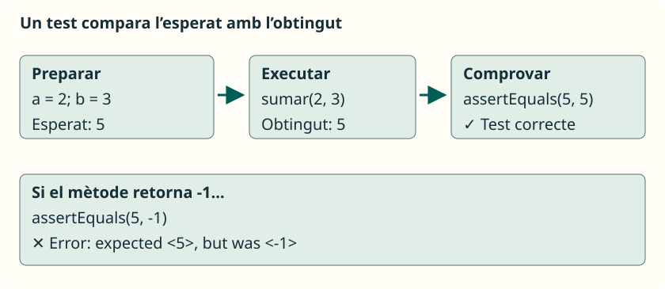

Un mètode pot compilar i retornar un resultat que no siga el que necessitem. Ara que sabem definir mètodes amb entrades i eixides, podem comprovar-los per separat: donem uns arguments, indiquem què hauria d’ocórrer i verifiquem el resultat. **JUnit automatitza eixa comprovació perquè puguem repetir-la després de cada canvi.**

Treballarem especialment la prova i depuració del codi del **RA3** i reforçarem les crides amb paràmetres del **RA2** i els mètodes estàtics del **RA4**. Utilitzarem els tipus, condicions i arrays ja estudiats. No cal conéixer encara herència, expressions lambda ni programació avançada amb objectes.

## Què és una prova unitària

Una **prova unitària** comprova una part menuda del programa de manera aïllada. En esta unitat, eixa part serà un mètode que calcula o transforma dades, sense demanar informació per teclat. Per exemple, si `sumar(2, 3)` ha de retornar `5`, el test crida el mètode i compara el valor obtingut amb `5`.

No és el mateix imprimir `5` i mirar-lo que escriure una comprovació automàtica. JUnit registra si cada test passa o falla i ens ajuda a localitzar el problema. Tampoc és suficient que tots els tests passen per a demostrar que el programa funciona amb qualsevol entrada: només hem comprovat els casos triats.

<aside class="java-document-note">

<strong>EN PARAULES SENZILLES</strong>

Un test és com una fitxa de comprovació: «Amb estes dades, ha d’eixir açò». JUnit seguix la fitxa cada vegada que li ho demanem. Si canviem el mètode i deixa de complir-la, ens avisa. Hem d’escriure la resposta esperada pensant en el problema, sense copiar-la del programa que estem comprovant.

</aside>

