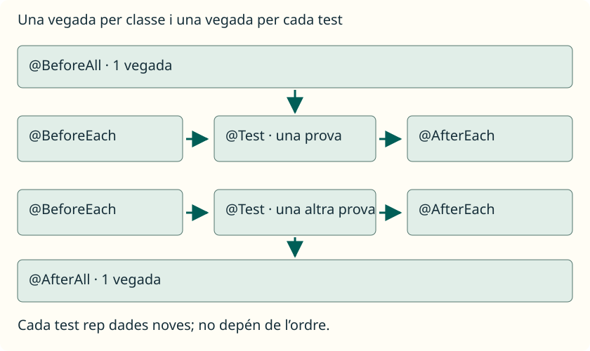

Les assercions comproven resultats. Les anotacions del **cicle de vida** indiquen quan executar tasques de preparació o finalització. No fan que un test passe per si mateixes. Al principi pots preparar dades dins de cada test; quan diversos necessiten la mateixa preparació, `@BeforeEach` evita repetir-la.

En la configuració predeterminada de JUnit Jupiter, els tests d’una classe seguixen este recorregut:

1. `@BeforeAll`: una vegada abans del grup de tests.
2. Per a cada test, JUnit crea una instància nova de la classe, executa `@BeforeEach`, executa el mètode `@Test` i executa `@AfterEach`.
3. `@AfterAll`: una vegada després del grup.

No es repetixen els passos globals per cada test. Tampoc es pressuposa que els tests s’executen en l’ordre en què els hem escrit. En este apartat conservem la configuració predeterminada: no canviem el mode de creació d’instàncies ni configurem l’execució en paral·lel.



## @BeforeAll: preparació del grup

Servix per a una tasca comuna que ha de fer-se una sola vegada abans dels tests d’eixa classe. En els nostres exemples serà un missatge que permeta seguir l’execució. Més avant podria preparar un recurs compartit; no el necessitem per a crear els arrays menuts de cada test.

En la configuració que utilitzem, el mètode és `static` i retorna `void`. No porta `@Test`, perquè no és una prova. Que ací siga estàtic no contradiu que els mètodes de test normals no hagen de ser-ho: fan papers diferents.

## @BeforeEach: dades noves per a cada prova

S’executa abans de cada test. L’utilitzarem per a crear un array nou amb els mateixos valors inicials. Així, si una prova canvia les seues dades, la següent continua començant amb el seu propi array. El mètode retorna `void` i no és `static`.

## @AfterEach: finalització de cada prova

S’executa després de cada test; també s’utilitza quan una asserció d’eixe test falla. Ací només mostrarem un missatge per a observar el recorregut. Quan es treballen recursos com ara fitxers, pot servir per a alliberar el que s’haja obert durant eixa prova. No cal inventar una tasca de neteja si no tenim res a tancar.

## @AfterAll: finalització del grup

S’executa una vegada en acabar el grup de tests de la classe. En esta configuració també usa `static` i `void`. Un missatge escrit ací no substituïx l’informe de JUnit: imprimir «fi» no demostra que els tests hagen passat.

| Anotació | Quantes vegades per a una classe amb dos tests | Mètode en esta guia |
| --- | --- | --- |
| `@BeforeAll` | Una. | `static void`. |
| `@BeforeEach` | Dos, una abans de cada test. | `void`, sense `static`. |
| `@AfterEach` | Dos, una després de cada test. | `void`, sense `static`. |
| `@AfterAll` | Una. | `static void`. |

## Exemple complet amb preparació independent

Guarda este nou fitxer en **`test/CicloDeVidaTest.java`**. Utilitza la classe `Operaciones` de [la primera prova](/ApuntesProgramacion/ca/guides/testing-con-junit/primera-prueba/):

```java
import org.junit.jupiter.api.Test;
import org.junit.jupiter.api.DisplayName;
import org.junit.jupiter.api.BeforeAll;
import org.junit.jupiter.api.BeforeEach;
import org.junit.jupiter.api.AfterEach;
import org.junit.jupiter.api.AfterAll;
import static org.junit.jupiter.api.Assertions.assertArrayEquals;

public class CicloDeVidaTest {
    private int[] datos;

    @BeforeAll
    static void iniciarClase() {
        System.out.println("Inici de CicloDeVidaTest");
    }

    @BeforeEach
    void prepararDatos() {
        datos = new int[] { 2, 5 };
        System.out.println("Preparar dades");
    }

    @Test
    @DisplayName("Incrementar després de canviar la primera dada")
    void incrementarTrasCambiarUnDato() {
        datos[0] = 10;
        int[] obtenido = Operaciones.crearIncrementado(datos);
        assertArrayEquals(new int[] { 11, 6 }, obtenido);
    }

    @Test
    @DisplayName("L’altre test rep de nou les dades inicials")
    void incrementarLosDatosIniciales() {
        int[] obtenido = Operaciones.crearIncrementado(datos);
        assertArrayEquals(new int[] { 3, 6 }, obtenido);
    }

    @AfterEach
    void terminarTest() {
        System.out.println("Fi d’un test");
    }

    @AfterAll
    static void terminarClase() {
        System.out.println("Fi de CicloDeVidaTest");
    }
}
```


`datos` és un camp de la classe de test, declarat fora dels seus mètodes. No el fem `static`: cada instància de prova treballa amb el seu propi camp. JUnit crea les instàncies automàticament i `prepararDatos` assigna un array nou abans de cada test.

En un test canviem la primera casella a `10` i esperem els increments `[11, 6]`; en l’altre esperem `[3, 6]` a partir de les dades inicials. Els dos han de funcionar encara que s’invertisca el seu ordre. Són dos comprovacions independents, no dos passos d’una mateixa prova.

<aside class="java-document-note">
<p><strong>EN PARAULES SENZILLES</strong></p>
<p><code>@BeforeEach</code> és com entregar un full net abans de cada tasca. Una persona pot escriure en el seu full sense deixar marques en el de la següent. <code>@BeforeAll</code> és obrir l’aula una sola vegada; no cal tornar a obrir-la abans de cada full.</p>
</aside>

Per a compilar també esta segona classe de tests i executar el projecte complet, usa des de la carpeta de l’exemple:

```sh
javac -encoding UTF-8 -cp lib/junit-platform-console-standalone-1.13.4.jar -d bin src/Operaciones.java test/OperacionesTest.java test/CicloDeVidaTest.java
java -jar lib/junit-platform-console-standalone-1.13.4.jar execute --class-path bin --scan-class-path --fail-if-no-tests --disable-ansi-colors
```


Esta classe aporta **2 tests**, que s’executen al costat dels que hages afegit a `OperacionesTest`. Els missatges d’inici i fi de la classe apareixen una vegada; «Preparar dades» i «Fi d’un test» apareixen dos vegades. Les anotacions del cicle de vida no afigen tests al comptador.

No utilitzes l’ordre dels missatges entre classes per a enllaçar proves: JUnit pot organitzar les classes i tests d’una altra manera. El criteri és que cada test comence amb el que necessita i puga executar-se a soles.
