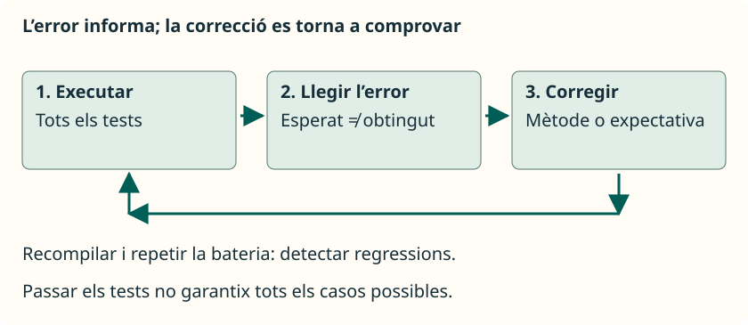

Partim dels tests correctes. Ara, **en una còpia del projecte**, introduïx este error deliberat en `sumar`, substituint el cos correcte:

```java
public static int sumar(int a, int b) {
    return a - b; // Error deliberat.
}
```


Recompila i executa la bateria. El test de `sumar(2, 3)` ha de fallar: esperava `5`, però ha rebut `-1`. Un missatge d’error pot contindre esta part:

```text
expected: <5> but was: <-1>
```


`expected` identifica el que havia d’eixir; `was` mostra el que ha eixit. Busca també `OperacionesTest.java` i la línia de l’asserció. Això localitza la comprovació que detecta el problema, però la causa pot estar en el mètode d’aplicació.

No canvies l’esperat a `-1` perquè el test passe: el comportament sol·licitat continua sent sumar. Recupera `return a + b;`, recompila i torna a executar **totes** les proves. Així comproves també que la correcció no haja espatlat altres casos. Eixa repetició ajuda a detectar **regressions**: errors en comportaments que abans funcionaven.



## Errors freqüents en escriure tests

| Què observes | Què revisar |
| --- | --- |
| `org.junit.jupiter.api` no es reconeix | El JAR ha d’estar en `lib`; revisa `referencedLibraries` i obri la carpeta completa. |
| L’editor demana un `main` | Estàs intentant executar la classe com a aplicació. Usa Testing o l’executor de JUnit. |
| No apareix cap test | Revisa `@Test`, el seu import, les rutes `src` i `test`, i que el mètode no siga `private` ni `static`. |
| Imports barrejats | Usa Jupiter: `org.junit.jupiter.api.Test`, no `org.junit.Test` de JUnit 4. |
| Expected i actual pareixen intercanviats | Escriu primer el valor esperat i després l’obtingut. |
| Una prova mostra valors però no falla mai | `println` no és una asserció: afig una comprovació de JUnit. |
| Els arrays pareixen iguals i `assertEquals` falla | Per a les seues caselles, utilitza `assertArrayEquals`. |
| El resultat canvia segons l’ordre | Cada test ha de preparar les seues dades; evita compartir arrays modificables o dependre d’un altre test. |
| Els canvis no afecten les proves de terminal | Recompila els fonts; no executes `.class` desactualitzats. |
| Hi ha molts tests correctes, però cap d’un límit | Revisa els casos triats, no només el comptador de tests. |

Estos exemples proven mètodes de càlcul i transformació. Les proves parametritzades, mocks, excepcions i l’entrada per teclat queden per a apartats posteriors: primer necessitem entendre què comprovem i per què esperem eixe resultat.

## Referències

- [Document docent de referència: JUnit i cicle de vida](https://docs.google.com/document/d/1bIacVwr0B5GcT4v-oJK4wsgz5SpAFWt8jbR_y47Wwlw/edit?usp=sharing).

- [Guia oficial de JUnit Jupiter 5.13.4](https://docs.junit.org/5.13.4/user-guide/index.html).
- [API de les assercions de JUnit](https://docs.junit.org/5.13.4/api/org.junit.jupiter.api/org/junit/jupiter/api/Assertions.html).
- [Proves Java en VS Code](https://code.visualstudio.com/docs/java/java-testing).
- [Gestió de projectes i biblioteques Java en VS Code](https://code.visualstudio.com/docs/java/java-project).
