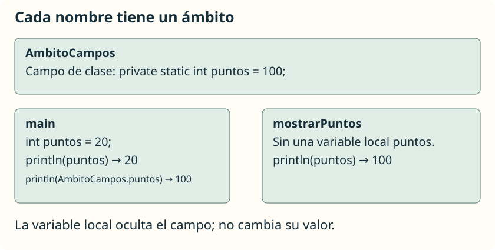

El **ámbito** de una variable es la parte del código donde podemos utilizar su nombre. Separar un programa en métodos también separa sus variables: una llamada no tiene acceso automático a las variables locales del método que la llamó.

## Variables locales y parámetros

Guarda este ejemplo en **`AmbitoLocal.java`**:

```java
public class AmbitoLocal {
    public static void main(String[] args) {
        int numero = 10;
        System.out.println(duplicar(numero));
        System.out.println(numero);
    }

    public static int duplicar(int valor) {
        int resultado = valor * 2;
        return resultado;
    }
}
```

```text
20
10
```

`numero` pertenece al bloque de `main`. `valor` es un parámetro de `duplicar`, y `resultado` es una variable local de ese método. Para trabajar con el dato de `main`, proporcionamos un argumento; para comunicar el cálculo al exterior, usamos `return`.

No podrías escribir `System.out.println(resultado);` en `main`: allí ese nombre no existe. Tampoco podrías usar `numero` directamente dentro de `duplicar`.

Los parámetros ya están declarados: no se permite declarar dentro del mismo método otra variable local con el mismo nombre. Dos métodos distintos sí pueden tener variables locales llamadas `resultado`.

<aside class="java-document-note">
<p><strong>EN PALABRAS SENCILLAS</strong></p>
<p>Imagina que cada método trabaja con su propia hoja de borrador. Un nombre escrito en la hoja de <code>duplicar</code> no aparece por sí solo en la hoja de <code>main</code>. Los parámetros permiten recibir datos y <code>return</code> permite entregar un resultado. Por eso <code>main</code> no puede leer directamente la variable local <code>resultado</code> de otro método.</p>
</aside>

## Las llaves también delimitan el ámbito

Fragmento para colocar dentro de `main`:

```java
int puntos = 12;
if (puntos >= 10) {
    String mensaje = "Objetivo conseguido";
    System.out.println(mensaje);
}
// mensaje no es accesible aquí.
```

`puntos` puede utilizarse en el bloque interior porque está declarado en el bloque exterior antes de ese uso. `mensaje` solo se puede usar desde su declaración hasta el cierre del bloque del `if`.

Una variable local debe recibir un valor antes de leerse. Si necesitas un resultado calculado dentro de una condición, puedes devolverlo desde un método o declarar una variable fuera y garantizar su asignación en todos los caminos.

## Campos de clase

Una variable declarada en la clase, fuera de los métodos, es un **campo**. En algunos materiales se la llama «variable global», pero no es una variable global de todo el programa: pertenece a una clase o a sus objetos y tiene reglas de acceso.

Guarda este ejemplo en **`AmbitoCampos.java`**:

```java
public class AmbitoCampos {
    private static int puntos = 100;

    public static void main(String[] args) {
        int puntos = 20;
        System.out.println(puntos);
        System.out.println(AmbitoCampos.puntos);
        mostrarPuntos();
    }

    public static void mostrarPuntos() {
        System.out.println(puntos);
    }
}
```

```text
20
100
100
```

El campo tiene `static` porque lo utilizamos desde métodos estáticos. En `main`, el nombre simple `puntos` se refiere a la variable local. Esta **oculta** el campo; no lo sobrescribe ni cambia su valor. `AmbitoCampos.puntos` identifica expresamente el campo. En `mostrarPuntos` no hay una variable local con ese nombre, por lo que se usa el campo.

## Elegir cómo comunicar datos



Podríamos hacer que todos los métodos leyeran y modificaran campos, pero eso dificultaría saber qué necesita cada uno y qué cambia. Para los cálculos de esta unidad preferiremos **parámetros y valores de retorno**: hacen visibles las entradas y salidas.

Los campos son útiles cuando un dato pertenece al estado de una clase o de un objeto. Los estudiaremos con más profundidad en programación orientada a objetos. No hace falta convertir una variable en campo solo para poder usarla desde dos métodos.
