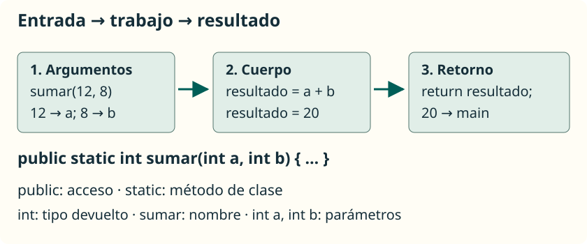

Declarar un método consiste en explicar cómo se llama, qué datos necesita y qué operación realiza. **Declararlo no lo ejecuta**: para que trabaje hay que llamarlo desde una instrucción que llegue a ejecutarse.

## Leer una declaración



Este fragmento se coloca dentro de la clase, pero fuera de `main`:

```java
public static int sumar(int primero, int segundo) {
    int resultado = primero + segundo;
    return resultado;
}
```

| Parte | Significado |
| --- | --- |
| `public` | Permite acceder al método desde otras clases, si la clase también es accesible. |
| `static` | El método pertenece a la clase; no necesitamos crear un objeto para llamarlo. |
| `int` | La llamada devuelve un valor entero. |
| `sumar` | Nombre que describe la operación. |
| `(int primero, int segundo)` | Dos parámetros: tipo y nombre de cada entrada. |
| `{ ... }` | Cuerpo: instrucciones que se ejecutan al llamar. |
| `return resultado;` | Termina esa llamada y entrega el resultado. |

La **cabecera** es la parte anterior al cuerpo. En estos ejemplos, la **firma** se identifica con el nombre y los tipos de los parámetros, en orden: `sumar(int, int)`. El tipo de retorno y los nombres de los parámetros no distinguen firmas.

Usa nombres como `calcularMedia`, `mostrarMenu` o `esPar`: empiezan en minúscula y las palabras siguientes comienzan en mayúscula. Un nombre no puede comenzar con una cifra ni ser una palabra reservada. No uses `$` o `_` para hacer nombres menos claros.

## Parámetros y argumentos

Los **parámetros** son las variables que escribimos en la declaración. Los **argumentos** son los valores o expresiones que proporcionamos al llamar:

```java
int puntos = 12;
int total = sumar(puntos, 3 + 2);
```

Este fragmento va dentro de `main` de una clase que contenga el método `sumar`. Primero se evalúan los argumentos: `puntos` aporta `12` y `3 + 2` aporta `5`. Los parámetros reciben esos valores **por posición**, no por coincidencia de nombres. El resultado `17` se guarda en `total`.

<aside class="java-document-note">
<p><strong>EN PALABRAS SENCILLAS</strong></p>
<p>Imagina una ficha con dos huecos: «primer número» y «segundo número». Los <strong>parámetros</strong> son esos huecos con nombre; los <strong>argumentos</strong> son los datos que ponemos en ellos en cada llamada. En <code>sumar(12, 5)</code>, el primer parámetro recibe <code>12</code> y el segundo recibe <code>5</code>. Otra llamada puede llenar esos mismos huecos con otros valores.</p>
</aside>

Los argumentos deben ser compatibles con los tipos declarados. Un parámetro `double` puede recibir un `int` mediante conversión automática; un parámetro `int` no acepta directamente `2.5`. Los paréntesis son obligatorios incluso si no hay parámetros. Entre parámetros se usan comas y cada uno lleva su propio tipo.

## Devolver y mostrar son tareas diferentes

`return` entrega un valor al código que llamó al método. `println` escribe en consola. Un método puede calcular sin mostrar nada, lo que permite usar el resultado en otra operación:

```java
int doble = sumar(4, 3) * 2;
System.out.println(doble); // 14
```

Si escribes solo `sumar(4, 3);`, la llamada se realiza, pero descartas el resultado: no se muestra automáticamente.

<aside class="java-document-note">
<p><strong>EN PALABRAS SENCILLAS</strong></p>
<p><strong>Devolver es entregar; mostrar es enseñar en pantalla.</strong> Si pides una suma, <code>return</code> te entrega el número para que puedas guardarlo o seguir calculando. <code>println</code> lo escribe en la consola. Entregar el resultado no hace que aparezca automáticamente en pantalla.</p>
</aside>

Un método con retorno debe proporcionar un valor compatible en todos los caminos que puedan terminar normalmente. Por ejemplo, este método puede devolver `true` o `false`:

```java
public static boolean esPar(int numero) {
    return numero % 2 == 0;
}
```

No necesita un `if`: la comparación ya produce un `boolean`. `esPar(8)` devuelve `true` y `esPar(7)` devuelve `false`.

## Métodos sin retorno: `void`

Guarda este programa en **`Menu.java`**:

```java
public class Menu {
    public static void main(String[] args) {
        mostrarMenu();
        saludar("Ana");
    }

    public static void mostrarMenu() {
        System.out.println("1. Jugar");
        System.out.println("0. Salir");
    }

    public static void saludar(String nombre) {
        if (nombre.isEmpty()) {
            return;
        }
        System.out.println("Hola, " + nombre);
    }
}
```

```text
1. Jugar
0. Salir
Hola, Ana
```

`mostrarMenu()` no recibe argumentos ni devuelve un valor. `saludar` recibe una cadena; supone que no es `null`. Su `return;` termina la llamada si el texto está vacío. En un método `void`, `return` no lleva valor y puede omitirse al final. No puedes asignar `mostrarMenu()` a una variable.

## Acceso y otros modificadores

El **acceso** indica desde dónde puede utilizarse un miembro. Un paquete agrupa clases; por ahora nuestros ejemplos usan una sola clase.

| Acceso | Idea que conviene conocer |
| --- | --- |
| `public` | Acceso desde otras clases cuando la clase contenedora es accesible. |
| `private` | Uso interno de la clase en estos ejemplos. |
| Sin modificador | Acceso desde clases del mismo paquete. No se escribe `default`. |
| `protected` | Acceso desde el mismo paquete y, con reglas adicionales, desde subclases de otros paquetes. Se estudiará con herencia. |

`static` no es un modificador de acceso. Lo utilizamos para llamar a nuestros métodos desde el `main` estático sin crear objetos. Desde otra clase accesible, una llamada sería `PrimerMetodo.sumar(2, 3)`.

Los materiales originales mencionan `final`, `abstract`, `synchronized` y `throws`. Los dejamos como referencias para unidades posteriores: `final` restringe la redefinición de un método de instancia; `abstract` declara métodos sin implementación en los contextos permitidos; `synchronized` está relacionado con concurrencia, y `throws` declara excepciones que puede propagar un método. No necesitamos incorporarlos a las cabeceras de esta unidad.

## Detectar errores de declaración

Estos fragmentos son **errores deliberados**; no forman un programa válido:

```java
public static int obtenerNumero() {
    System.out.println(5);
} // Falta devolver el entero.
```

```java
public static int obtenerPositivo(int numero) {
    if (numero > 0) {
        return numero;
    }
} // Falta un resultado cuando numero <= 0.
```

Mostrar un valor no sustituye a devolverlo. En el segundo caso tienes que decidir el comportamiento para entradas no positivas, según el propósito del método; añadir un `return 0` sin razonarlo puede ocultar un problema de diseño.
