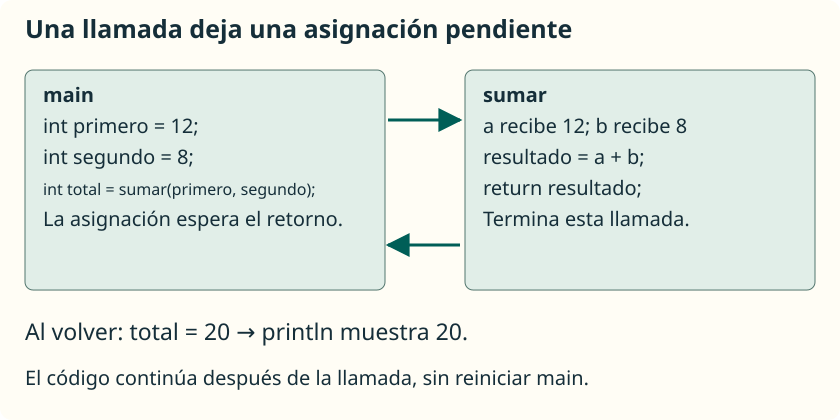

Cuando se ejecuta una llamada, el programa pasa al método llamado. Al terminar este, continúa en el punto desde el que se hizo la llamada. Comprender ese recorrido ayuda a distinguir la declaración de un método de su ejecución.

## Partir de un programa conocido

Guarda en **`SumaInicial.java`** esta versión que concentra el trabajo en `main`. Supone que introduces dos enteros válidos y pequeños:

```java
import java.util.Scanner;

public class SumaInicial {
    public static void main(String[] args) {
        Scanner entrada = new Scanner(System.in);
        System.out.print("Primer número: ");
        int primero = entrada.nextInt();
        System.out.print("Segundo número: ");
        int segundo = entrada.nextInt();
        int total = primero + segundo;
        System.out.println("La suma es " + total);
    }
}
```

Podemos identificar tres tareas: leer, calcular y mostrar. Empezaremos extrayendo **el cálculo**. Esta reorganización, que conserva el comportamiento del programa, se denomina **refactorización**.

## Diseñar antes de escribir

Para diseñar `sumar`, responde en este orden:

1. **¿Qué hará?** Sumar dos enteros.
2. **¿Qué recibe?** Dos valores de tipo `int`.
3. **¿Qué devuelve?** Un `int` con la suma.
4. **¿Necesita leer o mostrar?** No; `main` se encarga de la conversación.
5. **¿Cómo lo probamos?** Con positivos, negativos y cero, evitando desbordamientos en estos primeros ejemplos.

Separar cálculo y consola permite reutilizar la suma aunque cambie la forma de obtener los datos.

## Extraer y llamar

Guarda la nueva versión en **`SumaConMetodos.java`**:

```java
import java.util.Scanner;

public class SumaConMetodos {
    public static void main(String[] args) {
        Scanner entrada = new Scanner(System.in);
        System.out.print("Primer número: ");
        int primero = entrada.nextInt();
        System.out.print("Segundo número: ");
        int segundo = entrada.nextInt();
        int total = sumar(primero, segundo);
        System.out.println("La suma es " + total);
    }

    public static int sumar(int a, int b) {
        int resultado = a + b;
        return resultado;
    }
}
```

Con las entradas `12` y `8`, ambas versiones muestran:

```text
Primer número: 12
Segundo número: 8
La suma es 20
```

Los números tras las preguntas son las respuestas del usuario. Se conserva un solo `Scanner` sobre `System.in`, disponible hasta que termina el proceso. La validación de entradas se estudió en [su apartado](/ApuntesProgramacion/guides/introduccion-a-java/entrada-y-salida-de-datos/validacion-de-entradas/).

## Seguir una llamada paso a paso



| Paso | Dónde estamos | Qué ocurre |
| --- | --- | --- |
| 1 | `main` | `primero` guarda `12` y `segundo` guarda `8`. |
| 2 | Llamada `sumar(primero, segundo)` | Se evalúan los argumentos y se crean los parámetros `a = 12`, `b = 8`. |
| 3 | `sumar` | Su variable local `resultado` recibe `20`. |
| 4 | `return resultado` | Termina `sumar` y entrega `20`. |
| 5 | `main` | La asignación pendiente guarda `20` en `total`. |
| 6 | `main` | Se muestra el resultado y termina el programa. |

Que `sumar` esté escrito después de `main` no impide llamarlo. **El orden de las llamadas determina la ejecución**, no el orden en que se han colocado los métodos en el archivo. No se pueden declarar métodos dentro de `main`.

<aside class="java-document-note">
<p><strong>EN PALABRAS SENCILLAS</strong></p>
<p>Llamar a un método es como poner un marcapáginas en la tarea que estabas haciendo. Vas a resolver la tarea del método y, cuando termina, vuelves al punto que dejaste pendiente. En <code>int total = sumar(12, 8);</code>, primero hay que obtener <code>20</code>; después se completa la asignación a <code>total</code>.</p>
</aside>

## Llamadas dentro de otras llamadas

Este fragmento va en el mismo `main` y utiliza el método anterior:

```java
int total = sumar(sumar(2, 3), 4);
System.out.println(total); // 9
```

Para conocer el primer argumento de la llamada exterior, Java ejecuta `sumar(2, 3)` y obtiene `5`. Después la llamada exterior equivale a `sumar(5, 4)`. Cada llamada tiene sus propios parámetros y variables locales, aunque los nombres sean los mismos.

## Pruebas pequeñas y verificables

No basta con que el programa compile: hay que comprobar el resultado. Puedes llamar a `sumar` con estos datos desde `main` y comparar lo mostrado:

| Llamada | Resultado esperado |
| --- | --- |
| `sumar(2, 3)` | `5` |
| `sumar(-4, 7)` | `3` |
| `sumar(0, 0)` | `0` |
| `sumar(-2, -3)` | `-5` |

Usa entradas cuyo resultado quepa en `int`. Extraer una operación a un método no evita el desbordamiento numérico.

En [testing con JUnit](/ApuntesProgramacion/guides/testing-con-junit/) automatizaremos estas comprobaciones en un proyecto Java sin gestor de dependencias.
