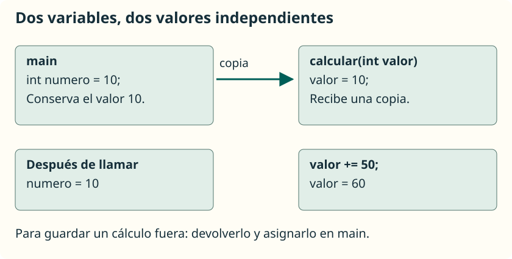
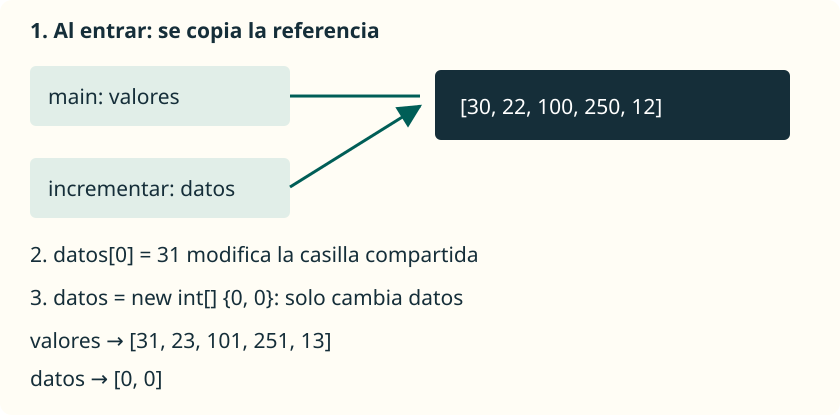

En Java, **todos los argumentos se pasan por valor**: cada parámetro recibe una copia del valor proporcionado. Lo que cambia según el tipo es qué valor estamos copiando: un dato primitivo o una referencia a un objeto, como un array.

## Copiar un valor primitivo



Guarda el siguiente ejemplo en **`PasoPorValor.java`**:

```java
public class PasoPorValor {
    public static void main(String[] args) {
        int numero = 10;
        System.out.println(numero);
        calcular(numero);
        System.out.println(numero);
    }

    public static void calcular(int valor) {
        valor += 50;
        System.out.println(valor);
    }
}
```

```text
10
60
10
```

| Momento | `numero` en `main` | `valor` en `calcular` |
| --- | --- | --- |
| Antes de llamar | `10` | Todavía no existe para esa llamada. |
| Al entrar | `10` | Copia de `10`. |
| Después de sumar | `10` | `60`. |
| Al volver | `10` | La llamada ha terminado. |

La asignación cambia el parámetro, no la variable de `main`. Si necesitamos conservar el resultado fuera, podemos devolverlo y asignarlo: `numero = aumentar(numero);`, usando un método que devuelva el nuevo valor.

## Copiar una referencia a un array

Una variable de tipo array guarda una **referencia** que permite acceder al array. Al pasarla, se copia esa referencia, no todas sus casillas. Durante la llamada hay dos variables distintas que permiten acceder al mismo array.



Guarda este programa en **`PasoArray.java`**:

```java
import java.util.Arrays;

public class PasoArray {
    public static void main(String[] args) {
        int[] valores = { 30, 22, 100, 250, 12 };
        incrementar(valores);
        System.out.println(Arrays.toString(valores));
        sustituir(valores);
        System.out.println(Arrays.toString(valores));
    }

    public static void incrementar(int[] datos) {
        for (int i = 0; i < datos.length; i++) {
            datos[i]++;
        }
    }

    public static void sustituir(int[] datos) {
        datos = new int[] { 0, 0 };
        datos[0] = 99;
    }
}
```

```text
[31, 23, 101, 251, 13]
[31, 23, 101, 251, 13]
```

`incrementar` modifica las casillas del array al que también accede `valores`; por eso el cambio es visible en `main`. En cambio, `sustituir` hace que su parámetro apunte a un array nuevo. No cambia la referencia guardada en la variable `valores` del llamador.

<aside class="java-document-note">
<p><strong>IDEA CLAVE</strong></p>
<p>Modificar una casilla y reasignar un parámetro son operaciones diferentes. Los arrays también se pasan por valor: se copia el valor de la referencia. No hay paso por referencia de la variable del llamador.</p>
</aside>

Los métodos anteriores suponen que el array no es `null`. `incrementar` acepta un array vacío: el bucle no realiza ninguna vuelta. En este ejemplo usamos valores pequeños para evitar el desbordamiento.

<aside class="java-document-note">
<p><strong>EN PALABRAS SENCILLAS</strong></p>
<p>Piensa en un array como una caja y en su referencia como una tarjeta que permite encontrarla. Al llamar al método, copiamos la tarjeta: <strong>las dos tarjetas llevan a la misma caja</strong>. Cambiar una casilla es cambiar lo que hay dentro de esa caja. Reasignar el parámetro es cambiar solo la tarjeta del método para que lleve a otra caja; la tarjeta de <code>main</code> sigue llevando a la primera.</p>
</aside>

## Devolver un array nuevo

Si queremos una copia modificada y conservar el original, podemos construirla. Este método se coloca dentro de una clase y fuera de `main`:

```java
public static int[] crearIncrementado(int[] datos) {
    int[] copia = new int[datos.length];
    for (int i = 0; i < datos.length; i++) {
        copia[i] = datos[i] + 1;
    }
    return copia;
}
```

Con este método en la misma clase, dentro de `main`:

```java
int[] original = { 2, 5 };
int[] nuevo = crearIncrementado(original);
System.out.println(original[0]); // 2
System.out.println(nuevo[0]);    // 3
```

El tipo de retorno `int[]` indica que se devuelve una referencia a un array de enteros. El array nuevo sigue disponible después de terminar el método porque el llamador conserva su referencia. No debemos confundir que termine una variable local con que desaparezca inmediatamente el objeto al que apuntaba.

## Qué ocurre con `String`

`String` es un tipo de referencia, no un tipo primitivo. Sus objetos son **inmutables**: no podemos modificar su contenido. Las operaciones que producen otro texto devuelven una cadena, que debemos guardar si queremos utilizarla.

Guarda este ejemplo en **`PasoTexto.java`**:

```java
public class PasoTexto {
    public static void main(String[] args) {
        String nombre = "Ana";
        cambiar(nombre);
        System.out.println(nombre);
        nombre = prepararSaludo(nombre);
        System.out.println(nombre);
    }

    public static void cambiar(String texto) {
        texto = "Hola, " + texto;
    }

    public static String prepararSaludo(String texto) {
        return "Hola, " + texto;
    }
}
```

```text
Ana
Hola, Ana
```

`cambiar` reasigna únicamente su parámetro. `prepararSaludo` devuelve la referencia al texto resultante, que `main` guarda en `nombre`.

## Referencia

- [Oracle: argumentos, parámetros y paso por valor](https://docs.oracle.com/javase/tutorial/java/javaOO/arguments.html).
