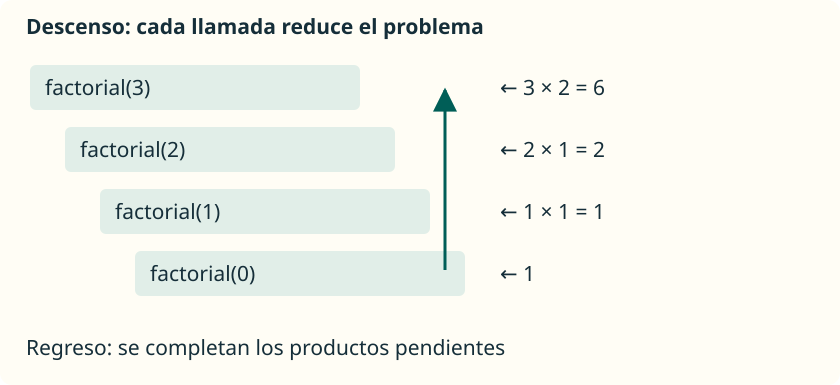

Un método puede llamar a otro método y también puede **llamarse a sí mismo**. Esta técnica se llama **recursión**. Sirve cuando podemos resolver un problema utilizando la solución de una versión más pequeña del mismo problema.

## Dos piezas inseparables

Todo diseño recursivo de esta unidad tendrá:

- Un **caso base**, que se resuelve sin otra llamada recursiva.
- Un **caso recursivo**, que reduce el problema y se acerca al caso base.

No basta con escribir un caso base: las entradas permitidas deben llegar a él. Si cada llamada vuelve a plantear el mismo problema sin reducirlo, no terminaremos.

## Factorial de un número

El factorial de un entero no negativo es el producto de los enteros desde `1` hasta ese número. Se escribe `n!`. Por definición, `0! = 1`. Por ejemplo, `4! = 4 × 3 × 2 × 1 = 24`.

Podemos descomponerlo así:

| Caso | Resultado |
| --- | --- |
| `n = 0` | `1` |
| `n > 0` | `n × factorial(n - 1)` |

Calcular `factorial(4)` exige conocer `factorial(3)`. Esta nueva llamada necesita `factorial(2)`, y así hasta `factorial(0)`. Entonces empiezan a completarse las multiplicaciones pendientes.

## Programa completo y límites

Guarda en **`Factorial.java`** este programa. Admitimos únicamente valores de `0` a `20`, cuyo factorial cabe en `long`:

```java
public class Factorial {
    public static void main(String[] args) {
        int numero = 6;
        if (numero >= 0 && numero <= 20) {
            System.out.println(factorial(numero));
        } else {
            System.out.println("Usa un entero entre 0 y 20.");
        }
    }

    // Requiere un numero entre 0 y 20.
    public static long factorial(int numero) {
        if (numero == 0) {
            return 1L;
        }
        return numero * factorial(numero - 1);
    }
}
```

```text
720
```

`1L` es el literal entero de tipo `long`. La llamada recursiva también devuelve `long`, por lo que la multiplicación se realiza con ese tipo. Con `int`, `13!` ya no cabe; con `long`, `21!` tampoco cabe. La recursión no evita el desbordamiento.

La comprobación de `main` protege esta llamada. El método establece una **precondición**: una condición que debe cumplir quien lo llama. Si lo reutilizas desde otro lugar, tienes que respetarla o añadir una validación apropiada. No llames directamente al método con un número negativo: se alejaría de cero.

## Llamar y regresar son dos fases



| Fase | Llamada | Qué queda pendiente o qué devuelve |
| --- | --- | --- |
| Descenso | `factorial(3)` | Espera para multiplicar `3 × factorial(2)`. |
| Descenso | `factorial(2)` | Espera para multiplicar `2 × factorial(1)`. |
| Descenso | `factorial(1)` | Espera para multiplicar `1 × factorial(0)`. |
| Caso base | `factorial(0)` | Devuelve `1`. |
| Regreso | `factorial(1)` | Devuelve `1 × 1 = 1`. |
| Regreso | `factorial(2)` | Devuelve `2 × 1 = 2`. |
| Regreso | `factorial(3)` | Devuelve `3 × 2 = 6`. |

Las llamadas pendientes se gestionan en una **pila de llamadas**: la última llamada que entra es la primera que termina. Cada llamada tiene su propio parámetro `numero`; no existe un único `numero` que cambie a la vez en todas las llamadas.

## Comparar con un bucle

Este método puede añadirse a la misma clase. Tiene la misma precondición:

```java
public static long factorialIterativo(int numero) {
    long producto = 1L;
    for (int factor = 2; factor <= numero; factor++) {
        producto *= factor;
    }
    return producto;
}
```

Con `numero = 0` el bucle no entra y devuelve `1`. Con `6` devuelve `720`, igual que la versión recursiva. El bucle conserva un acumulador; la versión recursiva mantiene llamadas pendientes. Para este cálculo lineal el bucle suele ser más sencillo y evita acumular llamadas. Aprendemos factorial recursivo porque hace visible la descomposición del problema, no porque sea la única solución.

## Errores frecuentes

| Error | Qué ocurre | Cómo razonarlo |
| --- | --- | --- |
| Falta el caso base | Las llamadas no se detienen. | Identifica el problema más pequeño. |
| Llamar con `numero` en lugar de `numero - 1` | El problema no se reduce. | Comprueba que cada llamada se acerca al caso base. |
| Admitir negativos sin tratarlos | Restar uno se aleja de cero. | Define y valida las entradas permitidas. |
| Olvidar `return` en el caso recursivo | No se entrega el cálculo; puede faltar un retorno. | Sigue el valor que necesita cada llamador. |
| Hacer demasiadas llamadas anidadas | Puede producirse `StackOverflowError`. | Comprueba la profundidad; considera una solución iterativa. |
