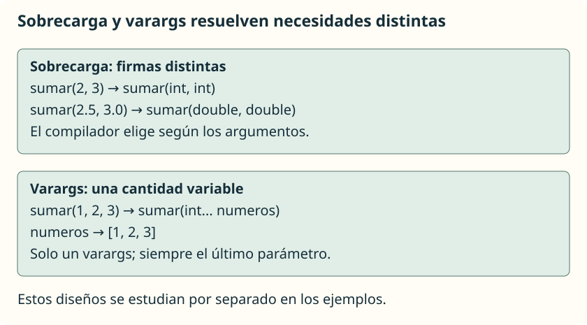

A veces una misma operación tiene sentido con distintos tipos o cantidades de datos. La **sobrecarga** permite utilizar el mismo nombre para varios métodos, siempre que sus listas de tipos de parámetros sean diferentes.

## Un nombre, varias firmas



Guarda este programa en **`Sobrecarga.java`**:

```java
public class Sobrecarga {
    public static void main(String[] args) {
        System.out.println(sumar(2, 3));
        System.out.println(sumar(2.5, 3.0));
        System.out.println(sumar(2, 3, 4));
    }

    public static int sumar(int a, int b) {
        return a + b;
    }

    public static double sumar(double a, double b) {
        return a + b;
    }

    public static int sumar(int a, int b, int c) {
        return a + b + c;
    }
}
```

```text
5
5.5
9
```

El compilador selecciona el método según los tipos y el número de argumentos. En estas llamadas hay una coincidencia exacta: `sumar(int, int)`, `sumar(double, double)` y `sumar(int, int, int)`.

Si llamas a `sumar(2, 3.5)`, los dos argumentos son compatibles con la versión de dos `double`; el primero se convierte y el resultado es `5.5`. No se convierte automáticamente `3.5` en `int`.

## Qué no crea una sobrecarga

Estos dos métodos juntos en la misma clase producen un **error deliberado**:

```java
public static int obtener(int numero) {
    return numero;
}

public static double obtener(int valor) {
    return valor;
}
```

Ambos tienen la firma `obtener(int)`. Cambiar el nombre del parámetro o el tipo de retorno no permite distinguirlos. Cambiar el acceso o añadir `static` tampoco soluciona una firma duplicada.

El orden de los tipos sí cuenta: `mostrar(String, int)` y `mostrar(int, String)` son firmas distintas. Evita crear variantes innecesarias que hagan difícil interpretar una llamada.

## Una cantidad variable: `varargs`

Si queremos sumar cero, uno o varios enteros, no necesitamos escribir un método diferente para cada cantidad. Un parámetro `int... numeros` acepta una cantidad variable de argumentos y se utiliza **como un array dentro del método**.

Guarda este ejemplo en **`SumaVariable.java`**:

```java
public class SumaVariable {
    public static void main(String[] args) {
        System.out.println(sumar());
        System.out.println(sumar(10));
        System.out.println(sumar(1, 2, 3));
        int[] puntos = { 4, 5 };
        System.out.println(sumar(puntos));
    }

    public static int sumar(int... numeros) {
        int total = 0;
        for (int numero : numeros) {
            total += numero;
        }
        return total;
    }
}
```

```text
0
10
6
9
```

La llamada sin argumentos proporciona un array vacío y el acumulador permanece a cero. También puedes pasar un array existente. En ese caso se comparte el mismo array mediante una copia de su referencia; si el método modificara casillas, el cambio sería visible fuera. Este método solo las lee y supone una referencia no nula.

## Reglas que hay que respetar

Solo puede haber **un parámetro `varargs`**, y debe ser **el último**. Antes de él puede haber parámetros ordinarios:

```java
public static int sumarDesde(int inicial, int... numeros) {
    int total = inicial;
    for (int numero : numeros) {
        total += numero;
    }
    return total;
}
```

Coloca el método dentro de una clase. En su `main`, `System.out.println(sumarDesde(10, 2, 3));` muestra `15`; `sumarDesde(10)` devuelve `10`.

No compilarían las cabeceras `sumar(int... numeros, int inicial)` ni `sumar(int... a, int... b)`. Además, no puedes declarar a la vez `sumar(int[])` y `sumar(int...)`: representan el mismo tipo de parámetro a efectos de la firma.

Para esta unidad mantenemos la sobrecarga y `varargs` en ejemplos separados. Combinarlos con muchas conversiones puede producir llamadas ambiguas; si el compilador no puede elegir una única versión, debes simplificar el diseño o hacer más explícitos los tipos.

## Referencia

- [Oracle: definición y sobrecarga de métodos](https://docs.oracle.com/javase/tutorial/java/javaOO/methods.html).
