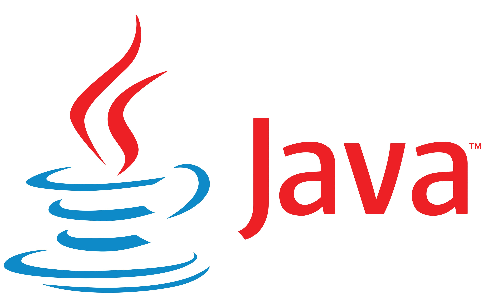

## Introducción

Hasta ahora hemos aprendido a enfrentarnos a un problema, dividirlo en pasos y construir un algoritmo para resolverlo. Con el pseudocódigo y PSeInt hemos podido poner a prueba nuestras ideas: guardar datos, tomar decisiones, repetir operaciones y comprobar si obteníamos el resultado esperado. **Ahora toca dar el siguiente paso: convertir esas ideas en programas escritos en Java.**

Entramos en el código puro y duro: archivos de código fuente, un compilador y programas que ejecutaremos desde nuestro entorno de trabajo. Vamos a escribir con la sintaxis de un lenguaje que se utiliza para desarrollar aplicaciones. Cada variable, cada condición y cada bucle que hemos trabajado hasta aquí tendrá su lugar en nuestros primeros programas.

**Todo lo aprendido viene con nosotros.** Cuando escribamos un `if`, reconoceremos el `Si` de nuestros algoritmos; cuando necesitemos repetir una tarea, volveremos a pensar en las condiciones y los contadores que ya conocemos. La lógica seguirá siendo nuestra herramienta principal. Java nos dará una nueva forma de expresarla, con reglas más precisas sobre los tipos de datos, las instrucciones y la organización del código.

Al principio aparecerán llaves, puntos y coma y mensajes del compilador que todavía no entenderemos. Habrá programas que no compilen a la primera y otros que se ejecuten, pero hagan algo distinto de lo que esperábamos. **Aprender a leer esos mensajes, seguir el valor de las variables y corregir nuestros errores también es aprender a programar.** Cada problema resuelto nos ayudará a entender mejor el código y a ganar autonomía.

Empezaremos con algo pequeño: conseguir que nuestro primer programa muestre un mensaje. Después le daremos datos, haremos cálculos, incorporaremos decisiones y conseguiremos que responda a lo que una persona escriba por teclado. Así iremos construyendo programas cuyo comportamiento podremos explicar, probar y mejorar.

Este recorrido se organiza en cinco apartados:

1. [Historia y características de Java](/ApuntesProgramacion/guides/introduccion-a-java/historia-y-caracteristicas/): conoceremos el lenguaje y las herramientas que necesitamos, y viviremos el primer paso del proceso completo: escribir, compilar y ejecutar nuestro propio programa.
2. [Tipos de datos, variables y más](/ApuntesProgramacion/guides/introduccion-a-java/tipos-de-datos-variables-y-mas/): llevaremos a Java la lógica que ya hemos practicado y aprenderemos a combinar datos, operaciones y expresiones para resolver problemas.
3. [Estructuras de control](/ApuntesProgramacion/guides/introduccion-a-java/estructuras-de-control/): tomaremos decisiones y repetiremos instrucciones con las estructuras de selección, iteración y salto.
4. [Entrada y salida de datos](/ApuntesProgramacion/guides/introduccion-a-java/entrada-y-salida-de-datos/): haremos que nuestros programas interactúen con el usuario, reciban información y comuniquen resultados de forma clara.
5. [Arrays](/ApuntesProgramacion/guides/introduccion-a-java/arrays/): guardaremos y recorreremos varios datos del mismo tipo, en una o varias dimensiones.

A lo largo de la unidad seguiremos trabajando el reconocimiento de los elementos de un programa (RA1) y la escritura y depuración de código (RA3). El objetivo es que, ante un problema sencillo, podamos plantear una solución, escribirla en Java y comprobar que funciona, entendiendo por qué.

  <strong>Es el momento de abrir el editor y escribir nuestro primer programa en Java.</strong>

