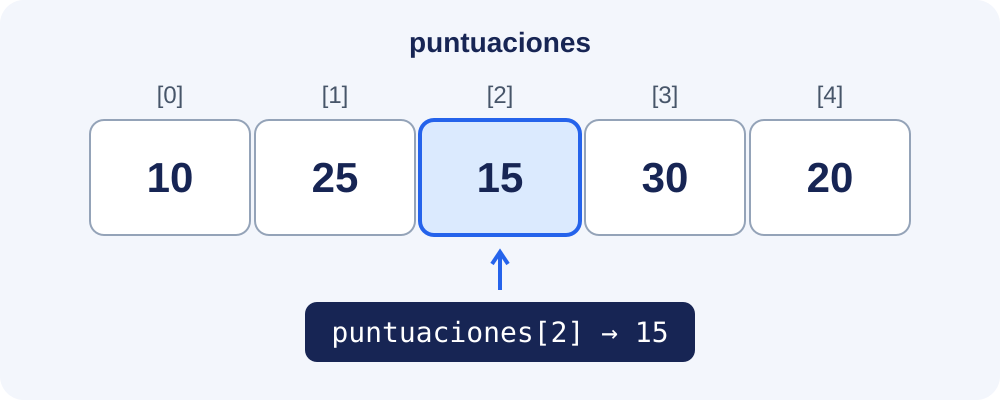

Un array permite guardar varios datos del mismo tipo en una sola variable. Aprenderemos a declararlo, inicializarlo y recorrerlo, y a trabajar con varias dimensiones.

## Una fila de casillas: las puntuaciones de un videojuego

Imagina que quieres guardar los puntos que has conseguido en cinco partidas: **10, 25, 15, 30 y 20**. Podrías crear cinco variables (`puntos1`, `puntos2`, etc.), pero resulta más cómodo guardar todas esas puntuaciones juntas, en un **array**.

Piensa en él como una fila de casillas: **cada casilla guarda un dato** y tiene un número que permite localizarla. Ese número se llama **índice** y, en Java, empieza en **0**.



En Java podemos crear esa fila así:

```java
int[] puntuaciones = { 10, 25, 15, 30, 20 };
```

`int[]` indica que guardamos un array de números enteros; `puntuaciones` es el nombre de la variable y las llaves contienen sus cinco valores iniciales.

Para consultar una casilla, escribimos el nombre del array y su índice entre corchetes:

```java
System.out.println(puntuaciones[0]); // Primera partida: 10
System.out.println(puntuaciones[2]); // Tercera partida: 15
```

También podemos cambiar el contenido de una casilla:

```java
puntuaciones[2] = 50;
System.out.println(puntuaciones[2]); // Ahora muestra 50
```

**Solo cambia la tercera casilla**: el array pasa a guardar `10, 25, 50, 30, 20`. Sigue teniendo cinco elementos, todos del mismo tipo. Recuerda la diferencia: **el índice indica dónde está un dato; el valor es lo que guarda esa casilla**.

Necesitas conocer variables, condiciones y bucles. En los siguientes apartados aprenderás a crear y recorrer arrays, resolver problemas, trabajar con tablas y utilizar las operaciones de `java.util.Arrays`.
