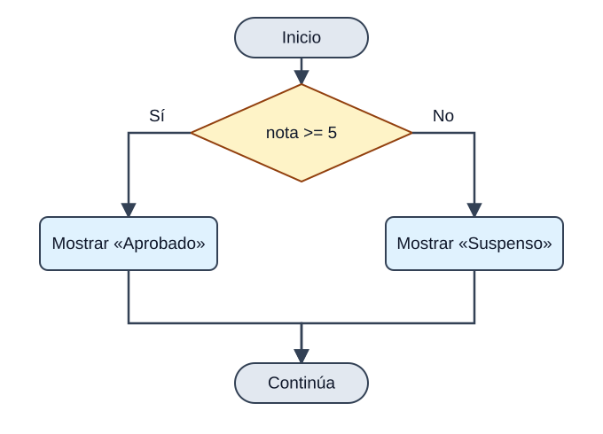
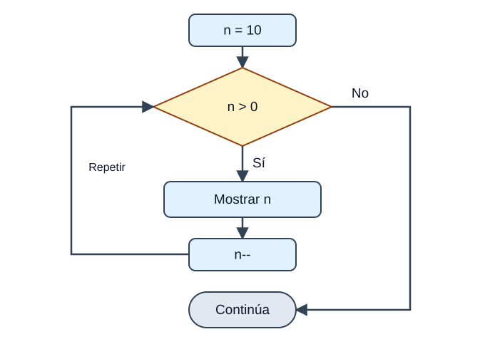
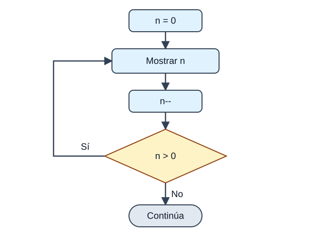
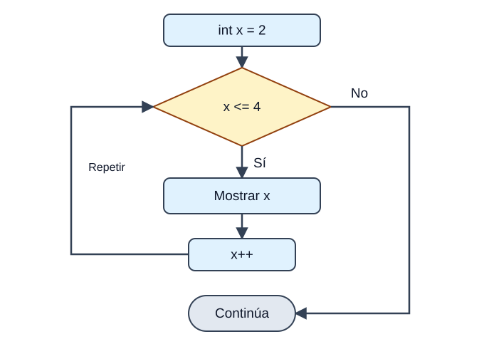

## 1. Estructuras de control

<p><em>Sin estructuras de control, un programa sería una receta que se ejecuta línea a línea sin pensar. Con ellas, tu programa decide, repite y salta: pasa de ser una receta a ser un GPS que recalcula la ruta según lo que encuentra.</em></p>

<p>Como vimos en la unidad de algoritmos, las estructuras de control hacen que el flujo del programa <strong>no sea siempre secuencial</strong>. Gracias a ellas nuestro algoritmo puede ejecutar unos bloques u otros según unas condiciones, o repetir instrucciones automáticamente. Java distingue tres tipos:</p>

<div class="java-document-table">
<table>
<tr>
<th scope="col"><p><strong>Tipo</strong></p></th>
<th scope="col"><p><strong>Estructuras</strong></p></th>
<th scope="col"><p><strong>La pregunta que responden</strong></p></th>
</tr>
<tr>
<td><p><strong>Selección</strong></p></td>
<td><p><code>if</code>, <code>if-else</code>, <code>if-else-if</code>, <code>switch</code></p></td>
<td><p>«¿Qué camino tomo?»</p></td>
</tr>
<tr>
<td><p><strong>Iteración</strong></p></td>
<td><p><code>while</code>, <code>do-while</code>, <code>for</code>, <code>for-each</code></p></td>
<td><p>«¿Cuántas veces lo repito?»</p></td>
</tr>
<tr>
<td><p><strong>Salto</strong></p></td>
<td><p><code>break</code>, <code>continue</code>, <code>return</code></p></td>
<td><p>«¿Salgo ya o me salto esta vuelta?»</p></td>
</tr>
</table>
</div>

<p>Y por supuesto, todas ellas se pueden <strong>anidar</strong>: puedes colocar una dentro del bloque de otra tantas veces como necesites.</p>

## 2. Estructuras de selección

### if

<p>La estructura <code>if</code> dirige la ejecución del programa por uno de <strong>dos caminos posibles</strong> según una condición. Su sintaxis es:</p>



<p><em>El rombo es una pregunta: solo se ejecuta una de las dos ramas. Después, los caminos vuelven a unirse.</em></p>

```java
if (condicion) {
    bloque1;
} else {
    bloque2;
}
```

<p>La condición es cualquier expresión que devuelva un <code>boolean</code>, y la cláusula <code>else</code> es <strong>opcional</strong>. Un ejemplo sencillo:</p>

```java
int nota = 7;
if (nota >= 5) {
    System.out.println("Aprobado");
} else {
    System.out.println("Suspenso");
}
```

<p><strong>SALIDA POR CONSOLA</strong></p>

```text
Aprobado
```

<aside class="java-document-note">
<p><strong>TRUCO</strong></p>
<p><strong>Pon siempre las llaves</strong>, incluso si el bloque tiene una sola instrucción. Java te deja omitirlas, pero es una fuente clásica de errores cuando después añades más líneas.</p>
</aside>

<p>Dentro de cada bloque puedes incluir nuevos <code>if</code>. Cuando hay varios <code>if</code> y <code>else</code> mezclados, la regla es: <strong>cada `else` se asocia con el `if` más cercano que aún no tenga `else`</strong>.</p>

```java
if (i == 10) {
    if (j < 20) a = b;
    if (k > 100) c = d;    // este if ...
    else a = c;            // ... se asocia con este else
} else a = d;              // este else pertenece a if (i == 10)
```

### if-else-if (la escalera)

<p>Cuando hay más de dos caminos, se encadenan varios <code>if</code>. Java evalúa las condiciones <strong>de arriba abajo</strong> y ejecuta el bloque de la <strong>primera que sea verdadera</strong>; el resto se ignora. El <code>else</code> final recoge todo lo que no encaja.</p>

```java
if (condicion1) {
    bloque1
} else if (condicion2) {
    bloque2
} else if (condicion3) {
    bloque3
} else {
    bloqueFinal
}
```

```java
class IfElse {
    public static void main(String[] args) {
        int mes = 4;   // Abril
        String estacion;
        if (mes == 12 || mes == 1 || mes == 2)       estacion = "Invierno";
        else if (mes == 3 || mes == 4 || mes == 5)   estacion = "Primavera";
        else if (mes == 6 || mes == 7 || mes == 8)   estacion = "Verano";
        else if (mes == 9 || mes == 10 || mes == 11) estacion = "Otoño";
        else                                         estacion = "Mes erróneo";
        System.out.println("Abril pertenece a la estación " + estacion + ".");
    }
}
```

<p><strong>SALIDA POR CONSOLA</strong></p>

```text
Abril pertenece a la estación Primavera.
```

### switch

<p>El <code>switch</code> permite que el programa siga <strong>caminos diferentes según el valor de una expresión</strong>. Es como un <code>if-else-if</code> muy largo, pero más ordenado cuando comparamos siempre la misma variable con valores concretos. Puede usarse con <code>byte</code>, <code>short</code>, <code>char</code>, <code>int</code>, sus envoltorios, <code>String</code> y enumerados.</p>

```java
switch (expresion) {
    case valor1:
        bloque1
        break;
    case valor2:
        bloque2
        break;
    // ...
    default:
        bloquePorDefecto
}
```

<p>En el siguiente ejemplo se ejecuta el <code>case</code> cuyo valor coincide con <code>i</code>. Como aquí ninguno coincide (<code>i</code> vale 4), se ejecuta el bloque <code>default</code>, que actúa como el <code>else</code> final:</p>

```java
class EjemploSwitch {
    public static void main(String[] args) {
        int i = 4;
        switch (i) {
            case 0:
                System.out.println("i es cero.");
                break;
            case 1:
                System.out.println("i es uno.");
                break;
            case 2:
                System.out.println("i es dos.");
                break;
            default:
                System.out.println("i no es 0, 1 ni 2.");
        }
    }
}
```

<p><strong>SALIDA POR CONSOLA</strong></p>

```text
i no es 0, 1 ni 2.
```

### El break y el «efecto cascada»

<p>El <code>break</code> termina el <code>switch</code>. Si <strong>se omite</strong>, la ejecución <strong>continúa por el siguiente `case`</strong> aunque no coincida (esto se llama *fall-through*, o efecto cascada). Suele ser un despiste, pero a veces se aprovecha a propósito para que varios valores compartan el mismo código:</p>

```java
class SwitchSinBreak {
    public static void main(String[] args) {
        int i = 3;
        switch (i) {
            case 1:
            case 2:
            case 3:
            case 4:
                System.out.println("i es menor que 5");
                break;
            case 5:
            case 6:
            case 7:
            case 8:
            case 9:
                System.out.println("i es menor que 10");
                break;
            default:
                System.out.println("i es 10 o más");
        }
    }
}
```

<p><strong>SALIDA POR CONSOLA</strong></p>

```text
i es menor que 5
```

<p>Aquí <code>i</code> vale 3: coincide con <code>case 3</code>, y como ese <code>case</code> no tiene <code>break</code>, la ejecución «cae» hasta el <code>case 4</code>, donde sí encuentra la instrucción y el <code>break</code>.</p>

### switch moderno (Java 14 en adelante)

<p>Hasta Java 11, el <code>switch</code> era solo una <strong>instrucción</strong>: servía para ejecutar bloques de código y siempre necesitaba <code>break</code>. A partir de Java 14 (y por tanto en JDK 17) disponemos del <strong>`switch` como expresión</strong>: una versión más moderna que además <strong>devuelve un valor</strong>.</p>

```java
int num = 2;
String dia = switch (num) {
    case 1 -> "Lunes";
    case 2 -> "Martes";
    default -> "Otro día";
};
```

<p>Fíjate en tres novedades: el <code>switch</code> devuelve un valor que guardamos en <code>dia</code>, usamos la flecha <code>-&gt;</code> en lugar de <code>:</code>, y <strong>ya no hace falta `break`</strong> (no hay efecto cascada). Además, un mismo caso puede agrupar varios valores separados por comas:</p>

```java
int dia = 6;
String tipo = switch (dia) {
    case 1, 2, 3, 4, 5 -> "Laborable";
    case 6, 7          -> "Fin de semana";
    default            -> "Día no válido";
};
```

<p>Si necesitas varias líneas en un caso, abre llaves <code>{ }</code> y usa la palabra <strong>`yield`</strong> para devolver el valor:</p>

```java
int num = 2;
String dia = switch (num) {
    case 1 -> "Lunes";
    case 2 -> {
        System.out.println("Procesando...");
        yield "Martes";
    }
    default -> "Otro día";
};
```

<div class="java-document-table">
<table>
<tr>
<th scope="col"></th>
<th scope="col"><p><strong>switch clásico</strong></p></th>
<th scope="col"><p><strong>switch moderno</strong></p></th>
</tr>
<tr>
<td><p>Sintaxis del caso</p></td>
<td><p><code>case 1:</code></p></td>
<td><p><code>case 1 -&gt;</code></p></td>
</tr>
<tr>
<td><p>¿Necesita <code>break</code>?</p></td>
<td><p>Sí (o cae al siguiente caso)</p></td>
<td><p>No</p></td>
</tr>
<tr>
<td><p>¿Devuelve un valor?</p></td>
<td><p>No, solo ejecuta instrucciones</p></td>
<td><p>Sí, puede asignarse a una variable</p></td>
</tr>
<tr>
<td><p>Varios valores por caso</p></td>
<td><p>Varios <code>case</code> seguidos</p></td>
<td><p><code>case 1, 2, 3 -&gt;</code></p></td>
</tr>
</table>
</div>

## 3. Estructuras de iteración

<p>Java cuenta con cuatro formas de crear <strong>bucles</strong>, es decir, de ejecutar un mismo bloque de código de forma repetida mientras se cumpla una condición: <code>while</code>, <code>do-while</code>, <code>for</code> y <code>for-each</code>. Elegir la adecuada es cuestión de responder a estas preguntas:</p>

<div class="java-document-table">
<table>
<tr>
<th scope="col"><p><strong>Bucle</strong></p></th>
<th scope="col"><p><strong>Comprueba la condición…</strong></p></th>
<th scope="col"><p><strong>Mínimo de vueltas</strong></p></th>
<th scope="col"><p><strong>Úsalo cuando…</strong></p></th>
</tr>
<tr>
<td><p><code>while</code></p></td>
<td><p>Al principio</p></td>
<td><p>0</p></td>
<td><p>No sabes cuántas repeticiones habrá</p></td>
</tr>
<tr>
<td><p><code>do-while</code></p></td>
<td><p>Al final</p></td>
<td><p>1</p></td>
<td><p>Necesitas ejecutar el bloque <strong>al menos una vez</strong> (por ejemplo, un menú)</p></td>
</tr>
<tr>
<td><p><code>for</code></p></td>
<td><p>Al principio</p></td>
<td><p>0</p></td>
<td><p>Sabes de antemano cuántas veces repetir</p></td>
</tr>
<tr>
<td><p><code>for-each</code></p></td>
<td><p>—</p></td>
<td><p>0</p></td>
<td><p>Quieres recorrer <strong>todos</strong> los elementos de un array o colección</p></td>
</tr>
</table>
</div>

### while

<p>Repite un bloque <strong>mientras</strong> una condición sea verdadera. Si la condición es falsa desde el principio, el bloque no se ejecuta ni una sola vez. Es como «mientras haya sopa en el plato, sigue comiendo».</p>



<p><em>Primero se comprueba n > 0. Si es falso desde el principio, el cuerpo no se ejecuta. Después de mostrar n y restarle 1, volvemos a comprobar la condición.</em></p>

```java
while (condicion) {
    bloque
}
```

```java
class EjemploWhile {
    public static void main(String[] args) {
        int n = 10;
        while (n > 0) {
            System.out.println("Paso " + n);
            n--;
        }
    }
}
```

<p><strong>SALIDA POR CONSOLA</strong></p>

```text
Paso 10
Paso 9
Paso 8
Paso 7
Paso 6
Paso 5
Paso 4
Paso 3
Paso 2
Paso 1
```

<aside class="java-document-note">
<p><strong>OJO CON ESTO</strong></p>
<p><strong>Bucle infinito:</strong> si dentro del bucle nunca cambias la variable que controla la condición (aquí, olvidar el <code>n--</code>), la condición será siempre verdadera y el programa no terminará jamás. Antes de ejecutar un bucle, pregúntate: «¿qué hace que algún día pare?»</p>
</aside>

### do-while

<p>Es como el <code>while</code>, pero con una diferencia fundamental: la condición se comprueba <strong>al final</strong>, así que el cuerpo se ejecuta <strong>siempre al menos una vez</strong>. Es como probar la sopa antes de decidir si te la comes.</p>



<p><em>Primero se ejecuta el cuerpo y después se pregunta. Con n = 0, se muestra 0, n pasa a −1 y el bucle termina: ha dado una vuelta.</em></p>

```java
do {
    bloque
} while (condicion);      // ¡no olvides el punto y coma!
```

```java
int n = 0;
do {
    System.out.println("Esto se ejecuta aunque n valga " + n);
    n--;
} while (n > 0);
```

<p><strong>SALIDA POR CONSOLA</strong></p>

```text
Esto se ejecuta aunque n valga 0
```

<p>Con un <code>while</code> normal este bloque no se habría ejecutado nunca, porque <code>n &gt; 0</code> es falso desde el principio.</p>

### for

<p>El <code>for</code> reúne en <strong>una sola línea</strong> los tres elementos de un bucle controlado por contador: dónde empieza, hasta cuándo sigue y cómo avanza. Es más compacto que el <code>while</code> y más fácil de depurar.</p>



<p><em>La inicialización solo se hace una vez. Después repetimos: condición → cuerpo → actualización. Este ejemplo muestra 2, 3 y 4; cuando x vale 5, sale del bucle.</em></p>

```java
for (inicializacion; condicion; actualizacion) {
    bloque
}
```

<div class="java-document-table">
<table>
<tr>
<th scope="col"><p><strong>Parte</strong></p></th>
<th scope="col"><p><strong>Qué hace</strong></p></th>
</tr>
<tr>
<td><p><strong>Inicialización</strong></p></td>
<td><p>Se ejecuta <strong>una sola vez</strong> al principio. Aquí se declara o inicializa la variable de control (<code>int i = 0</code>). Si se declara aquí, solo existe dentro del bucle.</p></td>
</tr>
<tr>
<td><p><strong>Condición</strong></p></td>
<td><p>Se comprueba <strong>antes de cada vuelta</strong>. Debe ser un <code>boolean</code>. Cuando pasa a falso, el bucle termina.</p></td>
</tr>
<tr>
<td><p><strong>Cuerpo</strong></p></td>
<td><p>Las instrucciones que se repiten mientras la condición sea verdadera.</p></td>
</tr>
<tr>
<td><p><strong>Actualización</strong></p></td>
<td><p>Se ejecuta <strong>al final de cada vuelta</strong> (normalmente <code>i++</code>) para preparar la siguiente.</p></td>
</tr>
</table>
</div>

```java
class EjemploFor {
    public static void main(String[] args) {
        // el bucle empieza con x = 2 y sigue mientras x <= 4
        for (int x = 2; x <= 4; x++) {
            System.out.println("Valor de x: " + x);
        }
    }
}
```

<p><strong>SALIDA POR CONSOLA</strong></p>

```text
Valor de x: 2
Valor de x: 3
Valor de x: 4
```

<p>Otro ejemplo muy típico: la tabla de multiplicar del 3.</p>

```java
for (int i = 1; i <= 5; i++) {
    System.out.println("3 x " + i + " = " + (3 * i));
}
```

<p><strong>SALIDA POR CONSOLA</strong></p>

```text
3 x 1 = 3
3 x 2 = 6
3 x 3 = 9
3 x 4 = 12
3 x 5 = 15
```

### Las tres partes del for son opcionales

<p>Puedes omitir cualquiera de las tres partes (manteniendo los punto y coma). En el primer ejemplo, la inicialización se hace fuera del bucle y la condición usa una variable booleana; en el segundo, al omitirlo todo, creamos un <strong>bucle infinito</strong> que solo termina con un <code>break</code>:</p>

```java
int i = 0;
boolean done = false;
for ( ; !done; ) {
    System.out.println("i es " + i);
    if (i == 10) done = true;
    i++;
}
```

```java
for ( ; ; ) {
    // se ejecuta infinitas veces (hasta que un break lo detenga)
}
```

### for-each (el bucle for mejorado)

<p>Java 5 introdujo una versión del <code>for</code> pensada para <strong>recorrer todos los elementos</strong> de un array o de una colección de forma sencilla, sin preocuparte de índices. Se lee como «para cada elemento de la colección…».</p>

```java
for (Tipo elemento : coleccion) {
    bloque
}
```

```java
class EjemploForEach {
    public static void main(String[] args) {
        String[] amigos = {"Ron", "Harry", "Hermione"};
        for (String x : amigos) {
            System.out.println(x);
        }
    }
}
```

<p><strong>SALIDA POR CONSOLA</strong></p>

```text
Ron
Harry
Hermione
```

<aside class="java-document-note">
<p><strong>OJO CON ESTO</strong></p>
<p>El <code>for-each</code> es cómodo pero <strong>inflexible</strong>: solo sirve para recorrer todos los elementos de principio a fin y no te dice en qué posición estás. Si necesitas el índice, recorrer solo una parte o modificar elementos, usa el <code>for</code> clásico.</p>
</aside>

## 4. Estructuras de salto

<p>Java dispone de tres instrucciones que alteran el flujo normal de ejecución: <code>break</code>, <code>continue</code> y <code>return</code>.</p>

### break: salir del bucle

<p>Con <code>break</code> forzamos la <strong>terminación inmediata</strong> del bucle: se salta la comprobación de la condición y el código restante, y el programa continúa en la primera instrucción posterior al bucle.</p>

```java
class EjemploBreak {
    public static void main(String[] args) {
        for (int i = 0; i < 100; i++) {
            if (i == 10) break;          // termina el bucle cuando i vale 10
            System.out.println("i: " + i);
        }
        System.out.println("Bucle completado.");
    }
}
```

<p><strong>SALIDA POR CONSOLA</strong></p>

```text
i: 0
i: 1
i: 2
i: 3
i: 4
i: 5
i: 6
i: 7
i: 8
i: 9
Bucle completado.
```

<p>Si usamos <code>break</code> dentro de <strong>bucles anidados</strong>, solo termina el bucle en el que está escrito (el más interno), no todos:</p>

```java
class EjemploBreakAnidado {
    public static void main(String[] args) {
        for (int i = 0; i < 3; i++) {
            System.out.print("Paso " + i + ": ");
            for (int j = 0; j < 100; j++) {
                if (j == 10) break;      // solo termina el bucle de j
                System.out.print(j + " ");
            }
            System.out.println();
        }
        System.out.println("Bucles completados.");
    }
}
```

<p><strong>SALIDA POR CONSOLA</strong></p>

```text
Paso 0: 0 1 2 3 4 5 6 7 8 9
Paso 1: 0 1 2 3 4 5 6 7 8 9
Paso 2: 0 1 2 3 4 5 6 7 8 9
Bucles completados.
```

<aside class="java-document-note">
<p><strong>CURIOSIDAD</strong></p>
<p>Si quieres salir de <strong>varios bucles a la vez</strong>, Java permite ponerle una etiqueta al bucle exterior y usar <code>break etiqueta;</code>:</p>
</aside>

```java
externo:
for (int i = 0; i < 3; i++) {
    for (int j = 0; j < 3; j++) {
        if (i * j == 2) break externo;   // sale de AMBOS bucles
        System.out.println(i + "," + j);
    }
}
```

<p><strong>SALIDA POR CONSOLA</strong></p>

```text
0,0
0,1
0,2
1,0
1,1
```

### continue: saltarse esta vuelta

<p>A veces queremos que el bucle siga, pero que en una vuelta concreta <strong>no se ejecute el resto del código</strong>. Eso es <code>continue</code>. A diferencia de <code>break</code>, que termina el bucle, <code>continue</code> solo abandona la vuelta actual y <strong>pasa a la siguiente</strong>.</p>

```java
class EjemploContinue {
    public static void main(String[] args) {
        for (int i = 0; i < 10; i++) {
            if (i % 2 == 0) continue;    // i par: pasa a la siguiente vuelta
            System.out.print(i + " ");
        }
    }
}
```

<p><strong>SALIDA POR CONSOLA</strong></p>

```text
1 3 5 7 9
```

<aside class="java-document-note">
<p><strong>IDEA CLAVE</strong></p>
<p><strong>`break` = «me voy del bucle». `continue` = «paso a la siguiente vuelta».</strong> Un buen truco para no confundirlos: el <code>break</code> rompe, el <code>continue</code> continúa.</p>
</aside>

### return: volver de un método

<p><code>return</code> se usa para <strong>salir de un método</strong> (los estudiaremos más adelante en el curso): el control del programa vuelve al lugar desde el que se llamó al método. En el método <code>main</code>, un <code>return</code> finaliza el programa.</p>

```java
class EjemploReturn {
    public static void main(String[] args) {
        boolean t = true;
        System.out.println("Antes del return.");
        if (t) return;                       // aquí termina el método main
        System.out.println("Esta línea no se ejecutará");
    }
}
```

<p><strong>SALIDA POR CONSOLA</strong></p>

```text
Antes del return.
```

<aside class="java-document-note">
<p><strong>MINI-RETO</strong></p>
<p><strong>El clásico FizzBuzz.</strong> Escribe un programa que recorra los números del 1 al 30 y muestre: <code>Fizz</code> si el número es múltiplo de 3, <code>Buzz</code> si es múltiplo de 5, <code>FizzBuzz</code> si lo es de ambos, y el propio número en cualquier otro caso. (Pista: piensa en el operador <code>%</code> y en qué condición debes comprobar primero.)</p>
</aside>

<details>
<summary>Ver solución</summary>

<p><strong>Solución</strong> (inténtalo antes de mirar):</p>

```java
for (int i = 1; i <= 30; i++) {
    // 15 es múltiplo de 3 y de 5, así que se comprueba primero
    if (i % 15 == 0)      System.out.println("FizzBuzz");
    else if (i % 3 == 0)  System.out.println("Fizz");
    else if (i % 5 == 0)  System.out.println("Buzz");
    else                  System.out.println(i);
}
```

<p>La clave está en el <strong>orden</strong>: si comprobáramos primero <code>i % 3</code>, el 15 mostraría «Fizz» y nunca llegaría a «FizzBuzz».</p>

</details>

<aside class="java-document-note">
<p><strong>EN RESUMEN</strong></p>
<ul>
<li><strong>Selección:</strong> <code>if</code>/<code>else</code> para dos caminos, <code>if-else-if</code> o <code>switch</code> para varios.</li>
<li><strong>Iteración:</strong> <code>while</code> (0 o más vueltas), <code>do-while</code> (al menos 1), <code>for</code> (número conocido), <code>for-each</code> (recorrer todo).</li>
<li><strong>Salto:</strong> <code>break</code> sale del bucle, <code>continue</code> salta a la siguiente vuelta, <code>return</code> sale del método.</li>
<li>Todas se pueden <strong>anidar</strong>.</li>
</ul>
</aside>


## Chuleta de repaso

<div class="java-document-table">
<table>
<tr>
<th scope="col"><p><strong>Tema</strong></p></th>
<th scope="col"><p><strong>Lo que debes recordar</strong></p></th>
</tr>
<tr>
<td><p><strong>Selección</strong></p></td>
<td><p><code>if / else if / else</code> · <code>switch</code> (con <code>break</code>, o con <code>-&gt;</code> en Java 14+).</p></td>
</tr>
<tr>
<td><p><strong>Iteración</strong></p></td>
<td><p><code>while</code> · <code>do-while</code> (mínimo 1 vez) · <code>for</code> · <code>for-each</code>.</p></td>
</tr>
<tr>
<td><p><strong>Salto</strong></p></td>
<td><p><code>break</code> sale del bucle · <code>continue</code> salta a la siguiente vuelta · <code>return</code> sale del método.</p></td>
</tr>
</table>
</div>

## Errores típicos

<div class="java-document-table">
<table>
<tr>
<th scope="col"><p><strong>#</strong></p></th>
<th scope="col"><p><strong>El error</strong></p></th>
<th scope="col"><p><strong>Cómo evitarlo</strong></p></th>
</tr>
<tr>
<td><p>1</p></td>
<td><p>Olvidar el <code>break</code> en un <code>switch</code> clásico</p></td>
<td><p>Ponlo siempre, o usa el <code>switch</code> moderno con <code>-&gt;</code>.</p></td>
</tr>
<tr>
<td><p>2</p></td>
<td><p>Bucle infinito por no actualizar la variable de control</p></td>
<td><p>Revisa qué hace que la condición deje de cumplirse.</p></td>
</tr>
</table>
</div>
