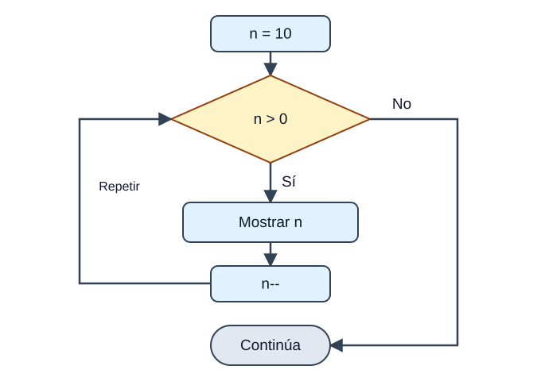
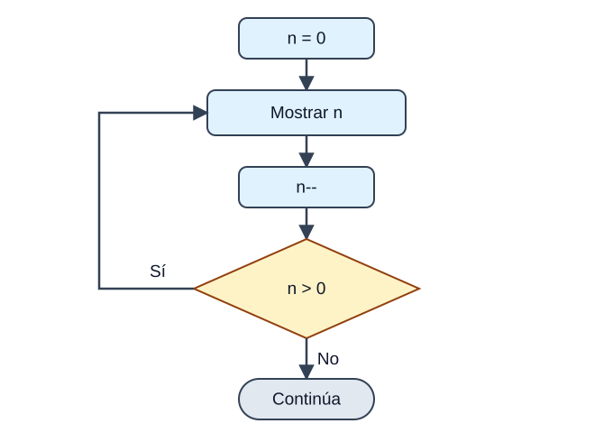
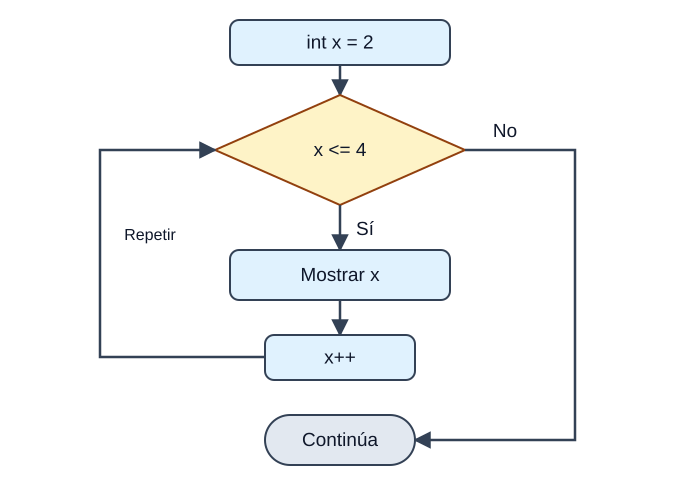

<p>Java cuenta con cuatro formas de crear <strong>bucles</strong>, es decir, de ejecutar un mismo bloque de código de forma repetida mientras se cumpla una condición: <code>while</code>, <code>do-while</code>, <code>for</code> y <code>for-each</code>. Elegir la adecuada es cuestión de responder a estas preguntas:</p>

<div class="java-document-table">
<table>
<tr>
<th scope="col"><p><strong>Bucle</strong></p></th>
<th scope="col"><p><strong>Comprueba la condición…</strong></p></th>
<th scope="col"><p><strong>Mínimo de vueltas</strong></p></th>
<th scope="col"><p><strong>Úsalo cuando…</strong></p></th>
</tr>
<tr>
<td><p><code>while</code></p></td>
<td><p>Al principio</p></td>
<td><p>0</p></td>
<td><p>No sabes cuántas repeticiones habrá</p></td>
</tr>
<tr>
<td><p><code>do-while</code></p></td>
<td><p>Al final</p></td>
<td><p>1</p></td>
<td><p>Necesitas ejecutar el bloque <strong>al menos una vez</strong> (por ejemplo, un menú)</p></td>
</tr>
<tr>
<td><p><code>for</code></p></td>
<td><p>Al principio</p></td>
<td><p>0</p></td>
<td><p>Sabes de antemano cuántas veces repetir</p></td>
</tr>
<tr>
<td><p><code>for-each</code></p></td>
<td><p>—</p></td>
<td><p>0</p></td>
<td><p>Quieres recorrer <strong>todos</strong> los elementos de un array o colección</p></td>
</tr>
</table>
</div>

## while

<p>Repite un bloque <strong>mientras</strong> una condición sea verdadera. Si la condición es falsa desde el principio, el bloque no se ejecuta ni una sola vez. Es como «mientras haya sopa en el plato, sigue comiendo».</p>



<p><em>Primero se comprueba n > 0. Si es falso desde el principio, el cuerpo no se ejecuta. Después de mostrar n y restarle 1, volvemos a comprobar la condición.</em></p>

```text
while (condicion) {
    bloque
}
```

```java
class EjemploWhile {
    public static void main(String[] args) {
        int n = 10;
        while (n > 0) {
            System.out.println("Paso " + n);
            n--;
        }
    }
}
```

<p><strong>SALIDA POR CONSOLA</strong></p>

```text
Paso 10
Paso 9
Paso 8
Paso 7
Paso 6
Paso 5
Paso 4
Paso 3
Paso 2
Paso 1
```

<aside class="java-document-note">
<p><strong>OJO CON ESTO</strong></p>
<p><strong>Bucle infinito:</strong> si dentro del bucle nunca cambias la variable que controla la condición (aquí, olvidar el <code>n--</code>), la condición será siempre verdadera y el programa no terminará jamás. Antes de ejecutar un bucle, pregúntate: «¿qué hace que algún día pare?»</p>
</aside>

## do-while

<p>Es como el <code>while</code>, pero con una diferencia fundamental: la condición se comprueba <strong>al final</strong>, así que el cuerpo se ejecuta <strong>siempre al menos una vez</strong>. Es como probar la sopa antes de decidir si te la comes.</p>



<p><em>Primero se ejecuta el cuerpo y después se pregunta. Con n = 0, se muestra 0, n pasa a −1 y el bucle termina: ha dado una vuelta.</em></p>

```text
do {
    bloque
} while (condicion);      // ¡no olvides el punto y coma!
```

```java
int n = 0;
do {
    System.out.println("Esto se ejecuta aunque n valga " + n);
    n--;
} while (n > 0);
```

<p><strong>SALIDA POR CONSOLA</strong></p>

```text
Esto se ejecuta aunque n valga 0
```

<p>Con un <code>while</code> normal este bloque no se habría ejecutado nunca, porque <code>n &gt; 0</code> es falso desde el principio.</p>

## for

<p>El <code>for</code> reúne en <strong>una sola línea</strong> los tres elementos de un bucle controlado por contador: dónde empieza, hasta cuándo sigue y cómo avanza. Es más compacto que el <code>while</code> y más fácil de depurar.</p>



<p><em>La inicialización solo se hace una vez. Después repetimos: condición → cuerpo → actualización. Este ejemplo muestra 2, 3 y 4; cuando x vale 5, sale del bucle.</em></p>

```text
for (inicializacion; condicion; actualizacion) {
    bloque
}
```

<div class="java-document-table">
<table>
<tr>
<th scope="col"><p><strong>Parte</strong></p></th>
<th scope="col"><p><strong>Qué hace</strong></p></th>
</tr>
<tr>
<td><p><strong>Inicialización</strong></p></td>
<td><p>Se ejecuta <strong>una sola vez</strong> al principio. Aquí se declara o inicializa la variable de control (<code>int i = 0</code>). Si se declara aquí, solo existe dentro del bucle.</p></td>
</tr>
<tr>
<td><p><strong>Condición</strong></p></td>
<td><p>Se comprueba <strong>antes de cada vuelta</strong>. Debe ser un <code>boolean</code>. Cuando pasa a falso, el bucle termina.</p></td>
</tr>
<tr>
<td><p><strong>Cuerpo</strong></p></td>
<td><p>Las instrucciones que se repiten mientras la condición sea verdadera.</p></td>
</tr>
<tr>
<td><p><strong>Actualización</strong></p></td>
<td><p>Se ejecuta <strong>al final de cada vuelta</strong> (normalmente <code>i++</code>) para preparar la siguiente.</p></td>
</tr>
</table>
</div>

```java
class EjemploFor {
    public static void main(String[] args) {
        // el bucle empieza con x = 2 y sigue mientras x <= 4
        for (int x = 2; x <= 4; x++) {
            System.out.println("Valor de x: " + x);
        }
    }
}
```

<p><strong>SALIDA POR CONSOLA</strong></p>

```text
Valor de x: 2
Valor de x: 3
Valor de x: 4
```

<p>Otro ejemplo muy típico: la tabla de multiplicar del 3.</p>

```java
for (int i = 1; i <= 5; i++) {
    System.out.println("3 x " + i + " = " + (3 * i));
}
```

<p><strong>SALIDA POR CONSOLA</strong></p>

```text
3 x 1 = 3
3 x 2 = 6
3 x 3 = 9
3 x 4 = 12
3 x 5 = 15
```

## Las tres partes del for son opcionales

<p>Puedes omitir cualquiera de las tres partes (manteniendo los punto y coma). En el primer ejemplo, la inicialización se hace fuera del bucle y la condición usa una variable booleana; en el segundo, al omitirlo todo, creamos un <strong>bucle infinito</strong> que solo termina con un <code>break</code>:</p>

```java
int i = 0;
boolean done = false;
for ( ; !done; ) {
    System.out.println("i es " + i);
    if (i == 10) done = true;
    i++;
}
```

```java
for ( ; ; ) {
    // se ejecuta infinitas veces (hasta que un break lo detenga)
}
```

## for-each (el bucle for mejorado)

<p>Java 5 introdujo una versión del <code>for</code> pensada para <strong>recorrer todos los elementos</strong> de un array o de una colección de forma sencilla, sin preocuparte de índices. Se lee como «para cada elemento de la colección…».</p>

```text
for (Tipo elemento : coleccion) {
    bloque
}
```

```java
class EjemploForEach {
    public static void main(String[] args) {
        String[] amigos = {"Ron", "Harry", "Hermione"};
        for (String x : amigos) {
            System.out.println(x);
        }
    }
}
```

<p><strong>SALIDA POR CONSOLA</strong></p>

```text
Ron
Harry
Hermione
```

<aside class="java-document-note">
<p><strong>OJO CON ESTO</strong></p>
<p>El <code>for-each</code> es cómodo pero <strong>inflexible</strong>: solo sirve para recorrer todos los elementos de principio a fin y no te dice en qué posición estás. Si necesitas el índice, recorrer solo una parte o modificar elementos, usa el <code>for</code> clásico.</p>
</aside>

## Practica: FizzBuzz

<aside class="java-document-note">
<p><strong>MINI-RETO</strong></p>
<p><strong>El clásico FizzBuzz.</strong> Escribe un programa que recorra los números del 1 al 30 y muestre: <code>Fizz</code> si el número es múltiplo de 3, <code>Buzz</code> si es múltiplo de 5, <code>FizzBuzz</code> si lo es de ambos, y el propio número en cualquier otro caso. (Pista: piensa en el operador <code>%</code> y en qué condición debes comprobar primero.)</p>
</aside>

<details>
<summary>Ver solución</summary>

<p><strong>Solución</strong> (inténtalo antes de mirar):</p>

```java
for (int i = 1; i <= 30; i++) {
    // 15 es múltiplo de 3 y de 5, así que se comprueba primero
    if (i % 15 == 0)      System.out.println("FizzBuzz");
    else if (i % 3 == 0)  System.out.println("Fizz");
    else if (i % 5 == 0)  System.out.println("Buzz");
    else                  System.out.println(i);
}
```

<p>La clave está en el <strong>orden</strong>: si comprobáramos primero <code>i % 3</code>, el 15 mostraría «Fizz» y nunca llegaría a «FizzBuzz».</p>

</details>

## Repaso

<div class="java-document-table">
<table>
<tr>
<th scope="col"><p><strong>Tema</strong></p></th>
<th scope="col"><p><strong>Lo que debes recordar</strong></p></th>
</tr>
<tr>
<td><p><strong>Iteración</strong></p></td>
<td><p><code>while</code> · <code>do-while</code> (mínimo 1 vez) · <code>for</code> · <code>for-each</code>.</p></td>
</tr>
</table>
</div>

## Errores frecuentes

<div class="java-document-table">
<table>
<tr>
<th scope="col"><p><strong>El error</strong></p></th>
<th scope="col"><p><strong>Cómo evitarlo</strong></p></th>
</tr>
<tr>
<td><p>Bucle infinito por no actualizar la variable de control</p></td>
<td><p>Revisa qué hace que la condición deje de cumplirse.</p></td>
</tr>
</table>
</div>
