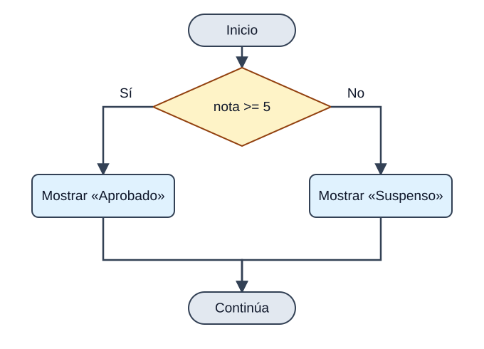

Las estructuras de selección permiten elegir qué bloque de código ejecutar según el resultado de una condición. Utilizaremos `if` y `else` para condiciones y `switch` para distinguir casos a partir de un valor.

## if

<p>La estructura <code>if</code> dirige la ejecución del programa por uno de <strong>dos caminos posibles</strong> según una condición. Su sintaxis es:</p>



<p><em>El rombo es una pregunta: solo se ejecuta una de las dos ramas. Después, los caminos vuelven a unirse.</em></p>

```text
if (condicion) {
    bloque1;
} else {
    bloque2;
}
```

<p>La condición es cualquier expresión que devuelva un <code>boolean</code>, y la cláusula <code>else</code> es <strong>opcional</strong>. Un ejemplo sencillo:</p>

```java
int nota = 7;
if (nota >= 5) {
    System.out.println("Aprobado");
} else {
    System.out.println("Suspenso");
}
```

<p><strong>SALIDA POR CONSOLA</strong></p>

```text
Aprobado
```

<aside class="java-document-note">
<p><strong>TRUCO</strong></p>
<p><strong>Pon siempre las llaves</strong>, incluso si el bloque tiene una sola instrucción. Java te deja omitirlas, pero es una fuente clásica de errores cuando después añades más líneas.</p>
</aside>

<p>Dentro de cada bloque puedes incluir nuevos <code>if</code>. Cuando hay varios <code>if</code> y <code>else</code> mezclados, la regla es: <strong>cada <code>else</code> se asocia con el <code>if</code> más cercano que aún no tenga <code>else</code></strong>.</p>

Este fragmento va dentro de `main` y presupone variables enteras `i`, `j`, `k`, `a`, `b`, `c` y `d` ya declaradas e inicializadas. El objetivo es observar a qué `if` pertenece cada `else`.

```java
if (i == 10) {
    if (j < 20) a = b;
    if (k > 100) c = d;    // este if ...
    else a = c;            // ... se asocia con este else
} else a = d;              // este else pertenece a if (i == 10)
```

## if-else-if (la escalera)

<p>Cuando hay más de dos caminos, se encadenan varios <code>if</code>. Java evalúa las condiciones <strong>de arriba abajo</strong> y ejecuta el bloque de la <strong>primera que sea verdadera</strong>; el resto se ignora. El <code>else</code> final recoge todo lo que no encaja.</p>

```text
if (condicion1) {
    bloque1
} else if (condicion2) {
    bloque2
} else if (condicion3) {
    bloque3
} else {
    bloqueFinal
}
```

```java
class IfElse {
    public static void main(String[] args) {
        int mes = 4;   // Abril
        String estacion;
        if (mes == 12 || mes == 1 || mes == 2)       estacion = "Invierno";
        else if (mes == 3 || mes == 4 || mes == 5)   estacion = "Primavera";
        else if (mes == 6 || mes == 7 || mes == 8)   estacion = "Verano";
        else if (mes == 9 || mes == 10 || mes == 11) estacion = "Otoño";
        else                                         estacion = "Mes erróneo";
        System.out.println("Abril pertenece a la estación " + estacion + ".");
    }
}
```

<p><strong>SALIDA POR CONSOLA</strong></p>

```text
Abril pertenece a la estación Primavera.
```

## switch

<p>El <code>switch</code> permite que el programa siga <strong>caminos diferentes según el valor de una expresión</strong>. Es como un <code>if-else-if</code> muy largo, pero más ordenado cuando comparamos siempre la misma variable con valores concretos. Puede usarse con <code>byte</code>, <code>short</code>, <code>char</code>, <code>int</code>, sus envoltorios, <code>String</code> y enumerados.</p>

```text
switch (expresion) {
    case valor1:
        bloque1
        break;
    case valor2:
        bloque2
        break;
    // ...
    default:
        bloquePorDefecto
}
```

<p>En el siguiente ejemplo se ejecuta el <code>case</code> cuyo valor coincide con <code>i</code>. Como aquí ninguno coincide (<code>i</code> vale 4), se ejecuta el bloque <code>default</code>, que actúa como el <code>else</code> final:</p>

```java
class EjemploSwitch {
    public static void main(String[] args) {
        int i = 4;
        switch (i) {
            case 0:
                System.out.println("i es cero.");
                break;
            case 1:
                System.out.println("i es uno.");
                break;
            case 2:
                System.out.println("i es dos.");
                break;
            default:
                System.out.println("i no es 0, 1 ni 2.");
        }
    }
}
```

<p><strong>SALIDA POR CONSOLA</strong></p>

```text
i no es 0, 1 ni 2.
```

## El break y el «efecto cascada»

<p>El <code>break</code> termina el <code>switch</code>. Si <strong>se omite</strong>, la ejecución <strong>continúa por el siguiente <code>case</code></strong> aunque no coincida (esto se llama *fall-through*, o efecto cascada). Suele ser un despiste, pero a veces se aprovecha a propósito para que varios valores compartan el mismo código:</p>

```java
class SwitchSinBreak {
    public static void main(String[] args) {
        int i = 3;
        switch (i) {
            case 1:
            case 2:
            case 3:
            case 4:
                System.out.println("i es menor que 5");
                break;
            case 5:
            case 6:
            case 7:
            case 8:
            case 9:
                System.out.println("i es menor que 10");
                break;
            default:
                System.out.println("i es 10 o más");
        }
    }
}
```

<p><strong>SALIDA POR CONSOLA</strong></p>

```text
i es menor que 5
```

<p>Aquí <code>i</code> vale 3: coincide con <code>case 3</code>, y como ese <code>case</code> no tiene <code>break</code>, la ejecución «cae» hasta el <code>case 4</code>, donde sí encuentra la instrucción y el <code>break</code>.</p>

## switch moderno (Java 14 en adelante)

<p>Hasta Java 11, el <code>switch</code> era solo una <strong>instrucción</strong>: servía para ejecutar bloques de código y siempre necesitaba <code>break</code>. A partir de Java 14 (y por tanto en JDK 17) disponemos del <strong><code>switch</code> como expresión</strong>: una versión más moderna que además <strong>devuelve un valor</strong>.</p>

```java
int num = 2;
String dia = switch (num) {
    case 1 -> "Lunes";
    case 2 -> "Martes";
    default -> "Otro día";
};
```

<p>Fíjate en tres novedades: el <code>switch</code> devuelve un valor que guardamos en <code>dia</code>, usamos la flecha <code>-&gt;</code> en lugar de <code>:</code>, y <strong>ya no hace falta <code>break</code></strong> (no hay efecto cascada). Además, un mismo caso puede agrupar varios valores separados por comas:</p>

```java
int dia = 6;
String tipo = switch (dia) {
    case 1, 2, 3, 4, 5 -> "Laborable";
    case 6, 7          -> "Fin de semana";
    default            -> "Día no válido";
};
```

<p>Si necesitas varias líneas en un caso, abre llaves <code>{ }</code> y usa la palabra <strong><code>yield</code></strong> para devolver el valor:</p>

```java
int num = 2;
String dia = switch (num) {
    case 1 -> "Lunes";
    case 2 -> {
        System.out.println("Procesando...");
        yield "Martes";
    }
    default -> "Otro día";
};
```

<div class="java-document-table">
<table>
<tr>
<th scope="col"></th>
<th scope="col"><p><strong>switch clásico</strong></p></th>
<th scope="col"><p><strong>switch moderno</strong></p></th>
</tr>
<tr>
<td><p>Sintaxis del caso</p></td>
<td><p><code>case 1:</code></p></td>
<td><p><code>case 1 -&gt;</code></p></td>
</tr>
<tr>
<td><p>¿Necesita <code>break</code>?</p></td>
<td><p>Sí (o cae al siguiente caso)</p></td>
<td><p>No</p></td>
</tr>
<tr>
<td><p>¿Devuelve un valor?</p></td>
<td><p>No, solo ejecuta instrucciones</p></td>
<td><p>Sí, puede asignarse a una variable</p></td>
</tr>
<tr>
<td><p>Varios valores por caso</p></td>
<td><p>Varios <code>case</code> seguidos</p></td>
<td><p><code>case 1, 2, 3 -&gt;</code></p></td>
</tr>
</table>
</div>

## Repaso

<div class="java-document-table">
<table>
<tr>
<th scope="col"><p><strong>Tema</strong></p></th>
<th scope="col"><p><strong>Lo que debes recordar</strong></p></th>
</tr>
<tr>
<td><p><strong>Selección</strong></p></td>
<td><p><code>if / else if / else</code> · <code>switch</code> (con <code>break</code>, o con <code>-&gt;</code> en Java 14+).</p></td>
</tr>
</table>
</div>

## Errores frecuentes

<div class="java-document-table">
<table>
<tr>
<th scope="col"><p><strong>El error</strong></p></th>
<th scope="col"><p><strong>Cómo evitarlo</strong></p></th>
</tr>
<tr>
<td><p>Olvidar el <code>break</code> en un <code>switch</code> clásico</p></td>
<td><p>Ponlo siempre, o usa el <code>switch</code> moderno con <code>-&gt;</code>.</p></td>
</tr>
</table>
</div>
