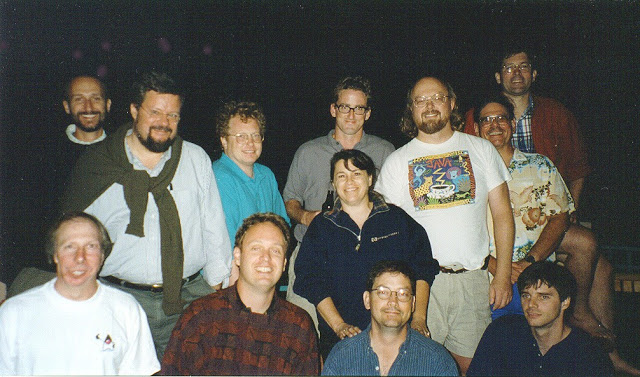
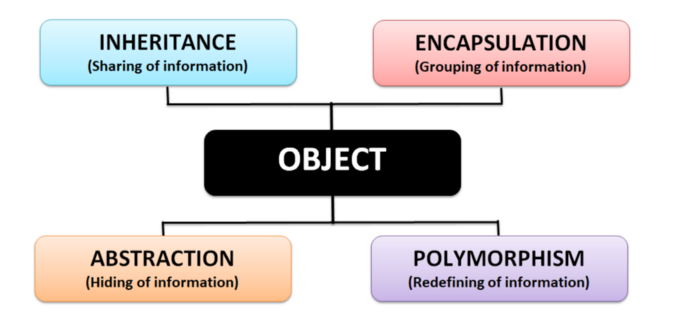
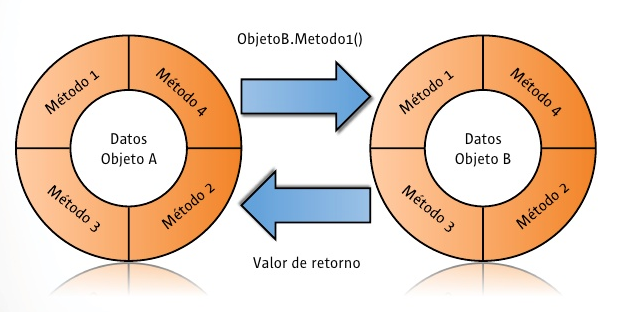
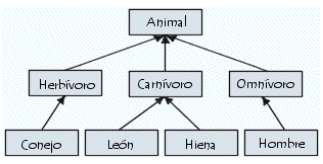
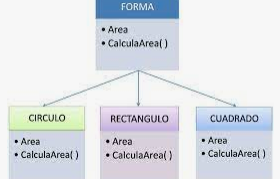
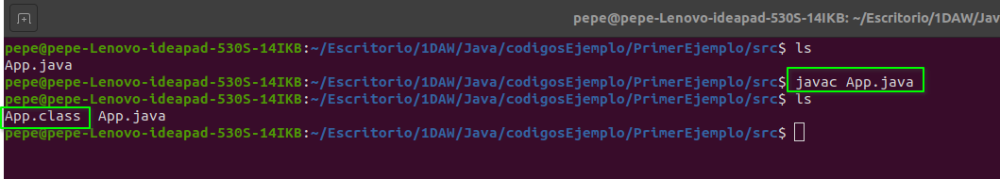
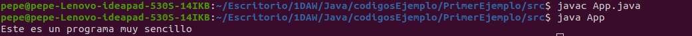
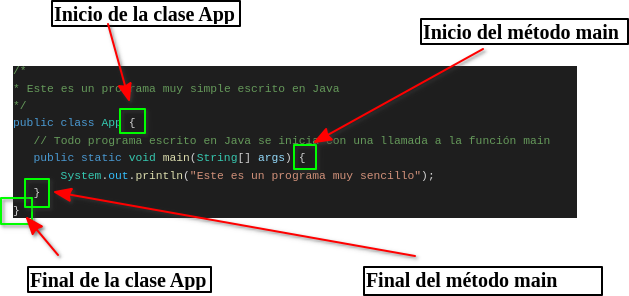
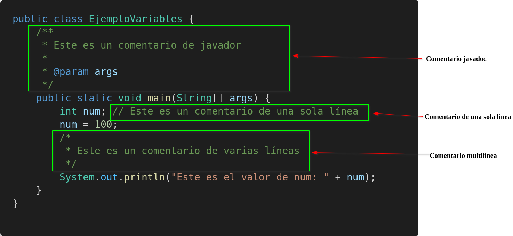

## 1. Historia

<p><em>Detrás de cada lenguaje hay una historia, y la de Java empieza con una pregunta muy sencilla: ¿y si todos los aparatos electrónicos hablaran el mismo idioma?</em></p>

<p>Al empezar a estudiar un lenguaje de programación solemos fijarnos solo en su sintaxis y en su lógica. Sin embargo, conocer <strong>por qué</strong> se creó nos ayuda a entender <strong>por qué es como es</strong>: muchas de las reglas de Java (la máquina virtual, la comprobación estricta de los tipos, la gestión automática de la memoria…) fueron la respuesta a problemas reales que tuvo su equipo de diseño.</p>

### 1.1 Los inicios: el Green Project (1991)

<p>En 1991, el informático <strong>James Gosling</strong>, que por entonces trabajaba como desarrollador de software en <strong>Sun Microsystems</strong>, se puso al frente de un proyecto de investigación interno llamado <strong>Green Project</strong>, formado por 13 personas.</p>

<p>El equipo tenía una intuición adelantada a su tiempo: los microprocesadores no iban a quedarse solo dentro de los ordenadores. Las industrias ya los estaban instalando en teléfonos, ascensores, locomotoras, sistemas de iluminación… y a este grupo le fascinaba la idea de que todos esos aparatos pudieran programarse y comunicarse entre sí. Hoy lo llamaríamos «Internet de las cosas»; ellos lo imaginaban en los años noventa.</p>

<div class="java-document-image" style="max-width: 380px;">



</div>

<p><em>El equipo del Green Project, en Sun Microsystems.</em></p>

### 1.2 El problema: C++ se quedaba corto

<p>Para desarrollar sus ideas, el Green Project usaba sobre todo <strong>C++</strong>. Pronto quedó claro que este lenguaje no estaba a la altura en tres aspectos imprescindibles: <strong>redes, seguridad e independencia de la plataforma</strong>.</p>

<p>El tercero era el más grave. Un programa en C++ se compila para un procesador concreto: si el fabricante cambiaba de chip, había que volver a programarlo casi desde cero. Es como si tuvieras que reescribir la aplicación de tu móvil cada vez que cambias de modelo. En un mundo con miles de dispositivos distintos, eso era inviable. Por este motivo, Gosling se ofreció a crear un lenguaje propio que se adaptara a las exigencias del proyecto.</p>

<aside class="java-document-note">
<p><strong>OBJETIVO</strong>  ·  <strong>La meta de Java</strong></p>
<p>Crear un lenguaje con una estructura y una sintaxis parecidas a las de C++ (para que los programadores pudieran aprenderlo rápido), <strong>fuertemente orientado a objetos</strong> y con <strong>una máquina virtual propia</strong>. Todo ello bajo un lema que se ha hecho famoso:</p>
<p><strong>«Write Once, Run Anywhere»</strong>: escríbelo una vez, ejecútalo en cualquier sitio.</p>
</aside>

<p>¿Cómo se consigue esa magia? Piensa en un intérprete de conferencias: el orador prepara su discurso una sola vez y, en cada país, un intérprete lo traduce en directo. En Java, el programador escribe el programa una vez; el compilador lo convierte en un código intermedio llamado <strong>bytecode</strong>, y en cada sistema (Windows, Linux, macOS, un electrodoméstico…) una <strong>máquina virtual de Java (JVM)</strong> hace de intérprete. Más adelante lo veremos con un esquema.</p>

### 1.3 De Oak a Java (1995)

<p>Gosling bautizó su lenguaje como <strong>Oak</strong> («roble» en español), según cuenta la tradición, por el roble que veía desde la ventana de su despacho. Pero ese nombre ya estaba registrado como marca, así que hubo que buscar otro: en <strong>1995</strong> el lenguaje pasó a llamarse definitivamente <strong>Java</strong>.</p>

<p>Gosling no estuvo solo. Ingenieros como <strong>Bill Joy, Arthur van Hoff, Jonathan Payne, Frank Yellin y Tim Lindholm</strong> fueron clave para que aquel prototipo madurase hasta convertirse en un lenguaje de propósito general.</p>

<p>El impulso definitivo llegó de la mano de la web. Las páginas de entonces eran estáticas; Java permitió incluir pequeños programas dentro de ellas, los <strong>applets</strong> (hoy en desuso), y el navegador Netscape Navigator los soportó. Java dio así el salto de los electrodomésticos a Internet. Su primera versión pública, <strong>JDK 1.0</strong>, salió en enero de 1996 y, desde entonces, el lenguaje no ha dejado de crecer con nuevos paquetes y librerías.</p>

### 1.4 Línea del tiempo

<div class="java-document-table">
<table>
<tr>
<th scope="col"><p><strong>1991</strong></p></th>
<th scope="col"><p><strong>1995</strong></p></th>
<th scope="col"><p><strong>1996</strong></p></th>
<th scope="col"><p><strong>2006-07</strong></p></th>
<th scope="col"><p><strong>2010</strong></p></th>
<th scope="col"><p><strong>2017</strong></p></th>
</tr>
<tr>
<td><p>Nace el Green Project en Sun Microsystems.</p></td>
<td><p>Oak pasa a llamarse Java.</p></td>
<td><p>Sale JDK 1.0, la primera versión pública.</p></td>
<td><p>Java se libera como software libre (OpenJDK).</p></td>
<td><p>Oracle adquiere Sun Microsystems.</p></td>
<td><p>Comienza el ciclo de una versión nueva cada seis meses.</p></td>
</tr>
</table>
</div>

<aside class="java-document-note">
<p><strong>¿SABÍAS QUE?</strong>  ·  <strong>Curiosidades: ¿de dónde sale el nombre «Java»?</strong></p>
<p>Su origen es objeto de debate y circulan varias teorías:</p>
<ul>
<li><strong>La del café</strong>, la más difundida: en inglés «java» es una forma coloquial de llamar al café (por la isla indonesia del mismo nombre) y el equipo tomaba mucho. De ahí vendría también el logo, una taza de café humeante.</li>
<li><strong>La del acrónimo</strong>: <em>Just Another Vague Acronym</em> («solo otro acrónimo ambiguo más»). Suena a broma de programadores, y probablemente lo es.</li>
<li><strong>La más plausible</strong>: el nombre se eligió de una lista de candidatos, porque cumplía con las exigencias legales de registro de marca.</li>
</ul>
<p>Y otra más: la mascota de Java, <strong>Duke</strong>, es anterior al propio nombre. Nació como personaje de la interfaz de uno de los prototipos del Green Project.</p>
</aside>

## 2. Características

<p><em>Cuando Sun presentó Java, resumió su filosofía en una lista de palabras clave. Son sus «cartas de presentación» y entenderlas te ayudará a saber qué esperar del lenguaje.</em></p>

<p>La principal motivación de Java (independencia de la plataforma, redes y seguridad) ya la conocemos, pero otros factores también moldearon su forma final. El equipo de Java resumió las consideraciones clave en la siguiente lista, que podemos tomar como sus principales características. Fíjate en la última columna: traduce cada término técnico a lo que <strong>notarás tú</strong> al programar.</p>

<div class="java-document-table">
<table>
<tr>
<th scope="col"><p><strong>Característica</strong></p></th>
<th scope="col"><p><strong>Qué significa</strong></p></th>
<th scope="col"><p><strong>Lo notarás cuando…</strong></p></th>
</tr>
<tr>
<td><p><strong>Simple</strong></p></td>
<td><p>Java se diseñó para aprenderse y usarse con facilidad: tiene una sintaxis parecida a la de C++, pero sin sus partes más peligrosas (no hay punteros y la memoria se libera sola).</p></td>
<td><p>Aprendas rápido y no tengas que preocuparte de reservar ni liberar memoria a mano.</p></td>
</tr>
<tr>
<td><p><strong>Orientado a objetos</strong></p></td>
<td><p>Heredero de sus predecesores, basa su modelo en objetos que se crean a partir de clases. Todo el código vive dentro de clases.</p></td>
<td><p>Representes clientes, pedidos o coches casi tal como los ves en la vida real.</p></td>
</tr>
<tr>
<td><p><strong>Robusto</strong></p></td>
<td><p>Busca problemas tanto al compilar como al ejecutar: tipado estricto, gestión de excepciones y recolector de basura que libera la memoria que ya no se usa.</p></td>
<td><p>El compilador te avise de un fallo antes de que lo sufra el usuario.</p></td>
</tr>
<tr>
<td><p><strong>Seguro</strong></p></td>
<td><p>Antes de ejecutar, la JVM verifica los <em>bytecodes</em> y el lenguaje no permite acceder directamente a la memoria.</p></td>
<td><p>Ejecutes código ajeno sin que pueda «hacer lo que quiera» con tu equipo.</p></td>
</tr>
<tr>
<td><p><strong>Portable</strong></p>
<p>(independiente de la arquitectura)</p></td>
<td><p>El mismo bytecode funciona en cualquier sistema que tenga una JVM. Además, los tipos tienen tamaño fijo: un <code>int</code> mide 32 bits en todas partes.</p></td>
<td><p>Programes en Windows y tu aplicación funcione igual en Linux o macOS.</p></td>
</tr>
<tr>
<td><p><strong>Interpretado</strong></p></td>
<td><p>Se compila a una representación intermedia (bytecode) que la JVM ejecuta. Es a la vez compilado e interpretado.</p></td>
<td><p>Compiles una sola vez y distribuyas el mismo <code>.class</code> a todo el mundo.</p></td>
</tr>
<tr>
<td><p><strong>Alto rendimiento</strong></p></td>
<td><p>La JVM incorpora un compilador JIT (<em>Just-In-Time</em>) que traduce a código nativo las partes que más se ejecutan.</p></td>
<td><p>Tus programas ganen velocidad conforme llevan un rato ejecutándose.</p></td>
</tr>
<tr>
<td><p><strong>Distribuido</strong></p></td>
<td><p>Java en sí no es un sistema distribuido, pero su librería estándar ofrece todo lo necesario para crearlos: soporte TCP/IP y protocolos como <em>http</em> o <em>ftp</em>. Acceder a información en red es casi tan fácil como abrir un fichero local.</p></td>
<td><p>Descargues una página web o hables con un servidor en pocas líneas de código.</p></td>
</tr>
<tr>
<td><p><strong>Multihilo</strong></p>
<p>(multiproceso)</p></td>
<td><p>Permite escribir programas que realizan muchas acciones a la vez. Desde Java 21 existen además los «hilos virtuales», muy ligeros.</p></td>
<td><p>Tu programa descargue un archivo mientras la interfaz sigue respondiendo.</p></td>
</tr>
<tr>
<td><p><strong>Dinámico</strong></p></td>
<td><p>Los programas llevan mucha información que se usa en tiempo de ejecución, y las clases se cargan solo cuando hacen falta. Permite vincular código de forma segura y rápida.</p></td>
<td><p>Añadas librerías o amplíes un programa sin tener que reconstruirlo entero.</p></td>
</tr>
</table>
</div>

#### El truco de la portabilidad, paso a paso

<p>De todas las características, la más importante es sin duda la <strong>portabilidad</strong>. Este esquema muestra cómo funciona:</p>

<div class="java-document-table">
<table>
<tr>
<td><p><strong>Código fuente</strong></p>
<p>archivo .java</p></td>
<td><p><strong>→</strong></p></td>
<td><p><strong>Compilador</strong></p>
<p>javac</p></td>
<td><p><strong>→</strong></p></td>
<td><p><strong>Bytecode</strong></p>
<p>archivo .class</p></td>
<td><p><strong>→</strong></p></td>
<td><p><strong>JVM</strong></p>
<p>una para cada sistema</p></td>
<td><p><strong>→</strong></p></td>
<td><p><strong>Se ejecuta</strong></p>
<p>Windows · Linux · macOS</p></td>
</tr>
</table>
</div>

<aside class="java-document-note">
<p><strong>RECUERDA</strong></p>
<p>El compilador <strong>no</strong> genera código para un procesador concreto, sino bytecode: un «idioma intermedio» que entiende cualquier JVM. Lo único que cambia de un sistema a otro es la JVM, no tu programa. Por eso el mismo <code>.class</code> funciona igual en el portátil de clase y en un servidor de otro continente.</p>
</aside>

## 3. Popularidad

<p><em>Java tiene más de 30 años y sigue en la parte alta de todos los rankings. ¿Merece la pena aprenderlo? Veamos qué dicen los datos.</em></p>

<p>Desde hace más de dos décadas, la popularidad de Java lo mantiene entre los primeros puestos del índice <strong>TIOBE</strong>; en septiembre de 2026 ocupa el <strong>cuarto lugar</strong>. Además, su comunidad es enorme (Oracle habla de más de 9 millones de desarrolladores en todo el mundo), lo que significa que para casi cualquier duda que te surja ya existe una respuesta publicada en foros, libros y tutoriales.</p>

<div class="java-document-table">
<table>
<tr>
<th scope="col"><p><strong>Puesto</strong></p></th>
<th scope="col"><p><strong>Lenguaje</strong></p></th>
<th scope="col"><p><strong>Cuota</strong></p></th>
</tr>
<tr>
<td><p>1</p></td>
<td><p>Python</p></td>
<td><p>17,76 %</p></td>
</tr>
<tr>
<td><p>2</p></td>
<td><p>C</p></td>
<td><p>10,28 %</p></td>
</tr>
<tr>
<td><p>3</p></td>
<td><p>C++</p></td>
<td><p>8,67 %</p></td>
</tr>
<tr>
<td><p><strong>4</strong></p></td>
<td><p><strong>Java</strong></p></td>
<td><p><strong>7,54 %</strong></p></td>
</tr>
<tr>
<td><p>5</p></td>
<td><p>C#</p></td>
<td><p>4,22 %</p></td>
</tr>
</table>
</div>

<p><em>Cinco primeros puestos del índice TIOBE, septiembre de 2026.</em></p>

<p>Java fue además elegido <strong>«lenguaje del año»</strong> por TIOBE en 2005 y en 2015.</p>

<aside class="java-document-note">
<p><strong>¿SABÍAS QUE?</strong>  ·  <strong>¿Qué es el índice TIOBE?</strong></p>
<p>El <em>TIOBE Programming Community Index</em> mide la popularidad de los lenguajes de programación. Lo elabora la empresa TIOBE, con sede en Eindhoven (Países Bajos), a partir del número de resultados que devuelven los buscadores para consultas que contienen el nombre de cada lenguaje.</p>
<p>Ojo: mide <strong>popularidad</strong>, no calidad ni la cantidad de código que hay escrito en cada lenguaje.</p>
</aside>

### 3.1 ¿Dónde se usa Java?

<p>Java es un lenguaje versátil y práctico, y esa es una de las razones por las que ofrece una empleabilidad tan alta. Se utiliza para crear aplicaciones de escritorio y móviles, videojuegos y páginas web, entre otras muchas cosas:</p>

<div class="java-document-table">
<table>
<tr>
<th scope="col"><p><strong>Ámbito</strong></p></th>
<th scope="col"><p><strong>Ejemplos</strong></p></th>
</tr>
<tr>
<td><p><strong>Servidores y empresa</strong></p></td>
<td><p>Aplicaciones de bancos, aseguradoras y administraciones públicas; muchos servicios web se programan con Java y frameworks como Spring.</p></td>
</tr>
<tr>
<td><p><strong>Móviles</strong></p></td>
<td><p>Android nació con Java como lenguaje principal (hoy comparte protagonismo con Kotlin).</p></td>
</tr>
<tr>
<td><p><strong>Videojuegos</strong></p></td>
<td><p>Minecraft: Java Edition, uno de los videojuegos más vendidos de la historia, está escrito en Java.</p></td>
</tr>
<tr>
<td><p><strong>Escritorio</strong></p></td>
<td><p>Entornos de desarrollo como Eclipse, NetBeans o IntelliJ IDEA están hechos en Java.</p></td>
</tr>
<tr>
<td><p><strong>Datos masivos</strong></p></td>
<td><p>Herramientas de <em>big data</em> y sistemas distribuidos como Apache Hadoop o Cassandra.</p></td>
</tr>
<tr>
<td><p><strong>Dispositivos pequeños</strong></p></td>
<td><p>Tarjetas inteligentes (Java Card) y sistemas embebidos, fiel al espíritu original del Green Project.</p></td>
</tr>
</table>
</div>

<p>Por todo ello, empresas como <strong>Google, Amazon, Twitter, IBM, Netflix</strong> e incluso la <strong>NASA</strong> utilizan o han utilizado Java.</p>

<aside class="java-document-note">
<p><strong>MINI-RETO</strong>  ·  <strong>Investiga</strong></p>
<p>Busca en un portal de empleo (InfoJobs, LinkedIn…) ofertas que pidan Java. Apunta qué otras tecnologías aparecen junto a él y qué experiencia se solicita. Lo comentaremos en clase.</p>
</aside>

## 4. Versiones

<p><em>Java ha cambiado tanto que un programa de 1996 y otro de hoy parecen casi de lenguajes distintos. Repasemos su evolución.</em></p>

<p>Desde su primera versión (enero de 1996), Java ha seguido un ciclo constante de lanzamientos. Durante años las versiones aparecían cada dos o tres años, pero desde <strong>2017</strong> existe un calendario fijo: <strong>una versión nueva cada seis meses</strong> (en marzo y en septiembre). Algunas de ellas son <strong>LTS</strong> (<em>Long Term Support</em>, «soporte a largo plazo»): versiones que reciben actualizaciones durante años, pensadas para las empresas que no pueden cambiar de versión cada seis meses. Al principio las LTS llegaban cada tres años; desde Java 17 llegan <strong>cada dos</strong>. Esto ha permitido una evolución más continua y predecible.</p>

### 4.1 Principales hitos de Java

<div class="java-document-table">
<table>
<tr>
<th scope="col"><p><strong>Versión</strong></p></th>
<th scope="col"><p><strong>Año</strong></p></th>
<th scope="col"><p><strong>Novedades destacadas</strong></p></th>
</tr>
<tr>
<td><p>JDK 1.0</p></td>
<td><p>1996</p></td>
<td><p>Primera versión estable: applets y la promesa «Write Once, Run Anywhere».</p></td>
</tr>
<tr>
<td><p>Java 2 (1.2)</p></td>
<td><p>1998</p></td>
<td><p>Ediciones diferenciadas (SE, EE y ME) y la librería gráfica Swing.</p></td>
</tr>
<tr>
<td><p>Java 5</p></td>
<td><p>2004</p></td>
<td><p>Genéricos, anotaciones, enumerados, bucle <em>for-each</em> y mejoras en concurrencia.</p></td>
</tr>
<tr>
<td><p>Java 6</p></td>
<td><p>2006</p></td>
<td><p>Mejor integración con otros lenguajes y soporte ampliado de plataformas.</p></td>
</tr>
<tr>
<td><p>Java 7</p></td>
<td><p>2011</p></td>
<td><p>Nueva librería NIO.2 para ficheros, <code>try-with-resources</code> y soporte para lenguajes dinámicos.</p></td>
</tr>
<tr>
<td><p><strong>Java 8</strong> · LTS</p></td>
<td><p>2014</p></td>
<td><p>Expresiones lambda, <em>streams</em> y nueva API de fechas: el gran salto hacia la programación funcional.</p></td>
</tr>
<tr>
<td><p>Java 9</p></td>
<td><p>2017</p></td>
<td><p>Sistema de módulos (Project Jigsaw) y <code>jshell</code>. Empieza el ciclo de seis meses.</p></td>
</tr>
<tr>
<td><p>Java 10</p></td>
<td><p>2018</p></td>
<td><p>Inferencia de tipos con <code>var</code>.</p></td>
</tr>
<tr>
<td><p><strong>Java 11</strong> · LTS</p></td>
<td><p>2018</p></td>
<td><p>Cliente HTTP estándar, posibilidad de ejecutar un <code>.java</code> directamente y retirada de APIs obsoletas.</p></td>
</tr>
<tr>
<td><p><strong>Java 17</strong> · LTS</p></td>
<td><p>2021</p></td>
<td><p><em>Records</em>, bloques de texto, clases selladas y <em>pattern matching</em> con <code>instanceof</code>.</p></td>
</tr>
<tr>
<td><p><strong>Java 21</strong> · LTS</p></td>
<td><p>2023</p></td>
<td><p>Hilos virtuales, <em>pattern matching</em> en <code>switch</code> y <em>record patterns</em>.</p></td>
</tr>
<tr>
<td><p><strong>Java 25</strong> · LTS</p></td>
<td><p>2025</p></td>
<td><p>Última LTS publicada: programas más sencillos para empezar (método <code>main</code> simplificado) y mejoras de rendimiento.</p></td>
</tr>
<tr>
<td><p>Java 26 y 27</p></td>
<td><p>2026</p></td>
<td><p>Las versiones más recientes: Java 26 (marzo) y Java 27 (15 de septiembre de 2026).</p></td>
</tr>
</table>
</div>

<aside class="java-document-note">
<p><strong>RECUERDA</strong>  ·  <strong>¿Qué versión elijo?</strong></p>
<p>Para aprender y para proyectos reales conviene una versión <strong>LTS</strong>: hoy, Java 21 o Java 25. Las versiones intermedias sirven para probar novedades, pero dejan de recibir actualizaciones a los seis meses.</p>
<p>Aun así, muchas empresas mantienen aplicaciones en Java 8 u 11. Saber qué cambió en cada versión te ayudará a leer código antiguo sin perderte.</p>
</aside>

## 5. Programación orientada a objetos (OOP)

<p><em>Java es orientado a objetos hasta la médula. Antes de escribir código conviene cambiar de forma de pensar: en lugar de pensar en «pasos», pensaremos en «cosas» que colaboran entre sí.</em></p>

<p>La programación orientada a objetos (POO, o <em>OOP</em> en inglés) es el núcleo de Java. Por eso resulta de vital importancia entender sus principios básicos antes de empezar a escribir un programa, por sencillo que sea. Se apoya en cuatro pilares:</p>

<div class="java-document-image" style="max-width: 430px;">



</div>

<p><em>Los cuatro pilares de la POO: abstracción, encapsulación, herencia y polimorfismo.</em></p>

### 5.1 Clases y objetos: la idea base

<p>Piensa en un molde de galletas. El molde no se come, pero define la forma de todas las galletas que hagas con él. En POO, ese molde es una <strong>clase</strong> y cada galleta es un <strong>objeto</strong> (o <em>instancia</em>). La clase describe <strong>qué datos</strong> tiene y <strong>qué puede hacer</strong>; cada objeto guarda sus propios valores.</p>

<div class="java-document-table">
<table>
<tr>
<th scope="col"><p><strong>Concepto</strong></p></th>
<th scope="col"><p><strong>Significado</strong></p></th>
<th scope="col"><p><strong>Ejemplo</strong></p></th>
</tr>
<tr>
<td><p><strong>Clase</strong></p></td>
<td><p>El molde: describe cómo son y qué hacen los objetos de un tipo.</p></td>
<td><p><code>Coche</code></p></td>
</tr>
<tr>
<td><p><strong>Objeto</strong></p></td>
<td><p>Una «galleta» concreta creada con ese molde.</p></td>
<td><p>El coche rojo de tu vecino</p></td>
</tr>
<tr>
<td><p><strong>Atributos</strong></p></td>
<td><p>Los datos que guarda cada objeto.</p></td>
<td><p>marca, color, velocidad</p></td>
</tr>
<tr>
<td><p><strong>Métodos</strong></p></td>
<td><p>Lo que el objeto sabe hacer (su comportamiento).</p></td>
<td><p><code>acelerar()</code>, <code>frenar()</code></p></td>
</tr>
</table>
</div>

<p>Con esta idea en la cabeza, veamos los cuatro pilares uno a uno.</p>

### 5.2 Abstracción

<p>Un elemento esencial de la programación orientada a objetos es la abstracción. Los humanos gestionamos la complejidad a través de ella: nadie piensa en un automóvil como un conjunto de miles de piezas sueltas, sino como un objeto bien definido con su propio comportamiento (arrancar, frenar, girar). Para conducirlo no necesitas saber cómo funciona el motor: te basta con el volante y los pedales. Abstraer es <strong>quedarse con lo esencial e ignorar los detalles</strong>.</p>

<p>Una forma potente de gestionar la abstracción es mediante <strong>clasificaciones jerárquicas</strong>, que nos permiten dividir sistemas complejos en piezas más manejables. Desde fuera, el automóvil es un solo objeto; una vez dentro, vemos que consta de varios subsistemas (dirección, frenos, sonido, cinturones de seguridad, calefacción…) y que cada uno de ellos se compone, a su vez, de sistemas más especializados.</p>

<p>Las abstracciones jerárquicas se pueden aplicar igualmente al desarrollo de software. En un programa tradicional, orientado a procesos, tendríamos una secuencia de pasos. En uno orientado a objetos, los datos se transforman en objetos y la secuencia de pasos se convierte en una colección de <strong>mensajes</strong> entre ellos. Cada objeto describe su propio comportamiento y responde a los mensajes que le piden hacer algo. Esa es la esencia de la programación orientada a objetos.</p>

<aside class="java-document-note">
<p><strong>RECUERDA</strong>  ·  <strong>La abstracción depende del problema</strong></p>
<p>Para una aplicación de taller mecánico, un <code>Coche</code> necesita matrícula y kilometraje; para un videojuego de carreras, potencia y velocidad máxima. Es el mismo coche real, pero dos abstracciones distintas: cada programa se queda solo con lo que le importa.</p>
</aside>

### 5.3 Encapsulación

<p>Los objetos son la abstracción que hace posible la encapsulación, un concepto fundamental. Consiste en <strong>hacer que los datos solo puedan modificarse a través de las funciones (métodos) pensadas para ello</strong>. De este modo, los datos conservan un estado válido y consistente, y se evita que cualquier código externo los deje en una situación absurda.</p>

<p>Se llama <em>encapsulación</em> porque los datos y sus estructuras no son accesibles de forma directa: para consultarlos o manipularlos hay que pasar por sus métodos asociados, como si estuvieran dentro de una cápsula. Piensa en un cajero automático: no metes la mano en la caja fuerte, sino que usas la pantalla y el teclado, y el cajero decide si tu operación es válida.</p>

<div class="java-document-image" style="max-width: 340px;">



</div>

<p><em>Cada objeto protege sus datos y solo se comunica con otros mediante sus métodos.</em></p>

<p><code>Ejemplo de encapsulación (solo para que veas el aspecto)</code></p>

```java
public class CuentaBancaria {
    private double saldo;               // nadie de fuera puede tocarlo directamente

    public void ingresar(double cantidad) {
        if (cantidad > 0) {             // el propio objeto valida la operación
            saldo = saldo + cantidad;
        }
    }

    public double getSaldo() {          // acceso de solo lectura
        return saldo;
    }
}
```

<p>No hace falta que entiendas cada línea todavía. Fíjate solo en la idea: <code>private</code> («privado») impide que otros modifiquen <code>saldo</code> a su antojo, y <code>ingresar</code> se asegura de que nunca se ingrese una cantidad negativa.</p>

### 5.4 Herencia

<p>La herencia es el proceso mediante el cual un objeto adquiere las propiedades de otro objeto. La mayor parte del conocimiento se hace manejable mediante clasificaciones jerárquicas (de arriba hacia abajo): un Golden Retriever es un perro, que a su vez forma parte de la clase de los mamíferos, que se encuentra bajo la clase más amplia de los animales.</p>

<p>Sin jerarquías, cada objeto tendría que definir explícitamente todas sus características. Con la herencia, un objeto solo necesita definir lo que lo hace único dentro de su clase y <strong>hereda</strong> los atributos generales de su padre. Si describieras a los animales de forma abstracta, dirías que tienen atributos (tamaño, inteligencia, tipo de esqueleto) y comportamientos (comen, respiran, duermen). Esa descripción de atributos y comportamiento es la definición de clase para <em>Animal</em>; perros, leones o conejos la reutilizan y le añaden lo suyo.</p>

<div class="java-document-image" style="max-width: 330px;">



</div>

<p><em>Jerarquía de clases: cada nivel hereda lo que define el nivel superior.</em></p>

<p><code>Un Perro puede respirar() y ladrar()</code></p>

```java
public class Animal {
    public void respirar() { /* ... */ }
}

public class Perro extends Animal {     // Perro HEREDA de Animal
    public void ladrar() { /* ... */ }
}
```

<aside class="java-document-note">
<p><strong>RECUERDA</strong>  ·  <strong>El test del «es un»</strong></p>
<p>Para saber si la herencia tiene sentido, pregúntate: ¿un perro <strong>es un</strong> animal? Sí, luego <code>Perro</code> puede heredar de <code>Animal</code>. ¿Un coche <strong>es un</strong> motor? No: un coche <strong>tiene un</strong> motor, así que el motor será un atributo del coche, no su clase padre.</p>
</aside>

### 5.5 Polimorfismo

<p>La palabra polimorfismo se compone de dos raíces griegas: <em>poli</em>, que significa «muchos», y <em>morfo</em>, que significa «forma». Literalmente, «muchas formas». Está relacionado con el comportamiento de los objetos: un objeto polimorfo es aquel que tiene varias formas de comportarse o, más concretamente, varias maneras de hacer las cosas.</p>

<p>Piensa en el botón «reproducir» de tu móvil: es siempre el mismo botón, pero si hay un vídeo lo proyecta, si hay una canción la reproduce y si hay un podcast lo narra. Misma orden, respuesta adaptada a cada caso.</p>

<p>Los objetos pueden manifestar esta cualidad de dos maneras: directamente con su <strong>comportamiento</strong> (métodos con el mismo nombre pero distintos parámetros) y a través de la <strong>relación de herencia</strong> (las subclases redefinen un método de su clase padre a su manera).</p>

<div class="java-document-image" style="max-width: 250px;">



</div>

<p><em>Todas las formas calculan su área, cada una con su propia fórmula.</em></p>

<p><code>Misma orden, distinto resultado</code></p>

```java
Forma f1 = new Circulo();
Forma f2 = new Rectangulo();

f1.calcularArea();   // aplica la fórmula del círculo
f2.calcularArea();   // aplica la del rectángulo
```

#### Los cuatro pilares de un vistazo

<div class="java-document-table">
<table>
<tr>
<th scope="col"><p><strong>Pilar</strong></p></th>
<th scope="col"><p><strong>En una frase</strong></p></th>
<th scope="col"><p><strong>Una imagen para recordarlo</strong></p></th>
</tr>
<tr>
<td><p><strong>Abstracción</strong></p></td>
<td><p>Quedarse con lo esencial e ignorar los detalles.</p></td>
<td><p>Conducir sin saber de mecánica.</p></td>
</tr>
<tr>
<td><p><strong>Encapsulación</strong></p></td>
<td><p>Proteger los datos y darles acceso solo mediante métodos.</p></td>
<td><p>Un cajero automático.</p></td>
</tr>
<tr>
<td><p><strong>Herencia</strong></p></td>
<td><p>Reutilizar y ampliar lo que define una clase padre.</p></td>
<td><p>Perro → Mamífero → Animal.</p></td>
</tr>
<tr>
<td><p><strong>Polimorfismo</strong></p></td>
<td><p>Una misma orden con respuestas distintas según el objeto.</p></td>
<td><p>El botón «reproducir».</p></td>
</tr>
</table>
</div>

## 6. Un primer programa escrito en Java

<p><em>Es tradición que el primer programa en cualquier lenguaje salude al mundo. El nuestro será algo más modesto, pero cumple la misma función: comprobar que todo funciona.</em></p>

<p>Ahora que ya conocemos un poco la historia de Java, sus características y el modelo de POO en el que se basa, veamos un pequeño ejemplo. Vamos a compilar y ejecutar el siguiente código (para preparar el entorno de trabajo, consulta el documento correspondiente):</p>

<p><code>App.java</code></p>

```java
/*
 * Este es un programa muy simple escrito en Java
 */
public class App {
    // Todo programa escrito en Java se inicia con una llamada a la función main
    public static void main(String[] args) {
        System.out.println("Este es un programa muy sencillo");
    }
}
```

### 6.1 El nombre del archivo importa

<p>En la mayoría de los lenguajes, el nombre del archivo que contiene el código fuente es irrelevante. En Java no es así: lo primero que debemos recordar es que <strong>el nombre que damos al archivo fuente es muy importante</strong>. En este ejemplo debe llamarse <code>App.java</code>. Veamos por qué.</p>

<p>En Java, un archivo de código fuente se denomina oficialmente <strong>unidad de compilación</strong>. Es un archivo de texto que contiene, entre otras cosas, una o más definiciones de clase (por ahora usaremos archivos con una sola). El compilador exige que tenga la extensión <code>.java</code>.</p>

<p>Al revisar el código observamos que la clase que define el programa también se llama <code>App</code>. No es una coincidencia: en Java, todo el código debe residir dentro de una clase y, por convención, <strong>el nombre de la clase principal debe coincidir con el del archivo</strong>, respetando las mayúsculas y minúsculas, porque Java las distingue. Esta convención puede parecer una molestia, pero facilita el mantenimiento y la organización de nuestros programas.</p>

<aside class="java-document-note">
<p><strong>OJO</strong></p>
<p><code>App.java</code> no es lo mismo que <code>app.java</code>. Si la clase pública se llama <code>App</code> y guardas el archivo como <code>app.java</code>, el compilador se negará a compilarlo.</p>
</aside>

### 6.2 Compilar y ejecutar

<p>Aunque Visual Studio Code compila el programa sin que nos demos cuenta cuando pulsamos «ejecutar», es interesante saber hacerlo a mano. Es como conocer el motor de un coche aunque siempre lo conduzcas con cambio automático.</p>

<div class="java-document-table">
<table>
<tr>
<td><p><strong><code>App.java</code></strong></p>
<p>código fuente</p></td>
<td><p><strong>→</strong></p></td>
<td><p><strong><code>javac App.java</code></strong></p>
<p>compilar</p></td>
<td><p><strong>→</strong></p></td>
<td><p><strong><code>App.class</code></strong></p>
<p>bytecode</p></td>
<td><p><strong>→</strong></p></td>
<td><p><strong><code>java App</code></strong></p>
<p>ejecutar (JVM)</p></td>
<td><p><strong>→</strong></p></td>
<td><p><strong>Resultado</strong></p>
<p>en la consola</p></td>
</tr>
</table>
</div>

<p>Para compilar usamos el compilador <strong>javac</strong> (que se encuentra en la carpeta <code>bin</code> de nuestro JDK), indicando el nombre del archivo fuente en la línea de comandos. En nuestro caso:</p>

<div class="java-document-image" style="max-width: 560px;">



</div>

<p><em>Antes de compilar solo existe App.java; después aparece también App.class.</em></p>

<p>El compilador <code>javac</code> crea un archivo llamado <strong>App.class</strong> que contiene la versión en <em>bytecode</em> del programa. Como comentamos antes, el bytecode es la representación intermedia de nuestro programa, con instrucciones que ejecutará la máquina virtual de Java. Por lo tanto, la salida de <code>javac</code> <strong>no es un código que se pueda ejecutar directamente</strong>.</p>

<p>Para ejecutar realmente el programa usamos el lanzador de aplicaciones Java, llamado <strong>java</strong>. Le pasamos el nombre de la <em>clase</em> (<code>App</code>, sin extensión) como argumento de la línea de comandos:</p>

<div class="java-document-image" style="max-width: 560px;">



</div>

<p>Cuando se ejecuta, se muestra el siguiente resultado:</p>

<p><code>Salida por consola</code></p>

```text
Este es un programa muy sencillo
```

<p>Cuando se compila el código fuente, <strong>cada clase se coloca en su propio archivo de salida</strong>, con el nombre de la clase y la extensión <strong>.class</strong>. Al ejecutar <code>java App</code> estamos indicando el nombre de la clase que queremos ejecutar: la JVM busca un archivo con ese nombre y extensión <code>.class</code> y, si lo encuentra, ejecuta el código que contiene.</p>

<aside class="java-document-note">
<p><strong>¿SABÍAS QUE?</strong>  ·  <strong>Un atajo desde Java 11</strong></p>
<p>Puedes ejecutar un archivo directamente, sin compilar aparte: <code>java App.java</code>. La JVM lo compila en memoria y lo lanza. Es ideal para pruebas rápidas.</p>
<p>Y desde Java 25 existe incluso una forma abreviada para programas pequeños: basta con <code>void main() { IO.println("Hola"); }</code>, sin declarar la clase. Aquí usamos la versión completa porque es la que verás en cualquier proyecto real y la que mejor enseña cómo se organiza un programa Java.</p>
</aside>

### 6.3 Analizando el código fuente

<p>Aunque el código que acabamos de ejecutar es muy simple, incluye elementos comunes a muchos programas escritos en Java. Vamos a examinarlos uno a uno, ayudándonos de este esquema:</p>

<div class="java-document-image" style="max-width: 520px;">



</div>

<p><em>Partes principales del programa.</em></p>

#### Los comentarios

<p>El código empieza con las líneas <code>/* ... */</code>. Representan un <strong>comentario</strong>. Como la mayoría de los lenguajes, Java permite añadir texto que el compilador ignora y que, por tanto, <strong>no repercute en la ejecución</strong> del programa. Sirve para describir o explicar el funcionamiento del código a cualquier persona que lo lea (incluido tú mismo dentro de seis meses). En nuestro caso solo añadimos una descripción personal, pero en aplicaciones reales los comentarios suelen explicar cómo funciona una parte del programa o qué hace una característica concreta.</p>

<p><strong>Java admite tres estilos de comentarios.</strong> El que aparece en la parte superior es el <strong>comentario multilínea</strong>: debe comenzar con <code>/*</code> y terminar con <code>*/</code>. El compilador ignora todo lo que haya entre estos dos símbolos y, como su nombre indica, puede ocupar varias líneas.</p>

#### La clase

<p>El siguiente bloque se compone de varias órdenes. Eliminemos las líneas del centro y quedémonos solo con lo que nos interesa por ahora:</p>

```java
public class App {

    [... aquí van las líneas de código ...]

}
```

<p>Es la <strong>definición de una clase</strong> llamada <code>App</code>. Por ahora podemos pensar que «clase» es sinónimo de «programa»: nuestro programa se llama <code>App</code>. Más adelante veremos que los programas complejos se componen de varias clases que crean objetos que cooperan entre sí.</p>

<p>La primera línea usa la palabra clave <code>class</code> para declarar que estamos definiendo una nueva clase pública (de ahí el <code>public</code>, un <strong>modificador de acceso</strong>) cuyo identificador es <code>App</code>. Fíjate también en las <strong>llaves</strong> de apertura <code>{</code> y de cierre <code>}</code>: las veremos constantemente, porque <strong>delimitan cualquier conjunto de órdenes dentro de un programa</strong>.</p>

#### El método main

<p>Tras el comentario <code>// Todo programa escrito en Java...</code> (el segundo estilo de comentario admitido: el de <strong>una sola línea</strong>, que empieza con <code>//</code> y termina al final de la línea) encontramos este bloque:</p>

```java
public static void main(String[] args) {

    [... aquí falta código ...]

}
```

<p>Este bloque, llamado <strong>main</strong>, representa <strong>el cuerpo del programa</strong>: es el punto de entrada por donde la máquina virtual empieza a ejecutar. Como ves, la primera línea contiene más palabras (<code>public</code>, <code>static</code>, <code>void</code>). Por ahora basta con asumir que siempre deben estar, pero te adelantamos qué significan:</p>

<div class="java-document-table">
<table>
<tr>
<th scope="col"><p><strong>Palabra</strong></p></th>
<th scope="col"><p><strong>Significado</strong></p></th>
</tr>
<tr>
<td><p><code>public</code></p></td>
<td><p>«Público»: la JVM, que está fuera de nuestra clase, tiene que poder llamar a <code>main</code>.</p></td>
</tr>
<tr>
<td><p><code>static</code></p></td>
<td><p>Permite llamar al método sin haber creado antes ningún objeto de la clase; así la JVM puede arrancarlo directamente.</p></td>
</tr>
<tr>
<td><p><code>void</code></p></td>
<td><p>«Vacío»: <code>main</code> no devuelve ningún valor cuando termina.</p></td>
</tr>
</table>
</div>

<p><strong>main</strong> es el método que se llama cuando comienza una aplicación Java. Recuerda que <strong>Java distingue entre mayúsculas y minúsculas</strong>: <code>Main</code> es diferente de <code>main</code>. Es importante entender que el compilador compilará clases que no contengan un método <code>main()</code>, pero <code>java</code> no tendrá forma de ejecutarlas. Por lo tanto, si escribimos <code>Main</code> en lugar de <code>main</code>, el programa compilará, pero al intentar ejecutarlo obtendremos un error.</p>

<p>Cualquier información que un método necesite recibir llega mediante variables situadas dentro de los <strong>paréntesis</strong> que siguen a su nombre: son los <strong>parámetros</strong>. Si un método no requiere ninguno, se dejan los paréntesis vacíos. En <code>main()</code> hay un único parámetro, aunque algo especial: <strong>`String[] args`</strong> declara un parámetro llamado <code>args</code>, que es un <strong>array</strong> (una colección ordenada de elementos del mismo tipo) de objetos de la clase <code>String</code>, que nos permiten almacenar cadenas de caracteres. En <code>args</code> se recibe cualquier argumento que pasemos por la línea de comandos al ejecutar el programa.</p>

<div class="java-document-image" style="max-width: 470px;">

![Al ejecutar «java App hola mundo», args[0] valdrá «hola» y args[1] valdrá «mundo».](../../../../assets/introduccion_java/historia-documento/argumentos-main.png)

</div>

<p><em>Al ejecutar «java App hola mundo», args[0] valdrá «hola» y args[1] valdrá «mundo».</em></p>

<p>El último carácter de la línea, <code>{</code>, indica el comienzo del cuerpo de <code>main()</code>. El código que forma el método aparecerá entre la llave de apertura y la de cierre.</p>

<aside class="java-document-note">
<p><strong>¿SABÍAS QUE?</strong>  ·  <strong>`main()` es solo el punto de partida</strong></p>
<p>Un programa complejo puede tener docenas de clases, pero solo una necesitará un método <code>main()</code> para arrancar. En algunos casos ni siquiera hace falta: los applets, hoy en desuso, se lanzaban desde el navegador web, que usaba otro mecanismo.</p>
</aside>

#### Mostrar texto por pantalla

<p>Revisemos la siguiente línea, que se ejecuta dentro de <code>main()</code>:</p>

```java
System.out.println("Este es un programa muy sencillo");
```

<p>Esta línea muestra en pantalla el texto que va entre comillas, seguido de un salto de línea. La salida se logra mediante el método incorporado <strong>println()</strong> (de <em>print line</em>), que muestra la cadena que se le pasa y que, como veremos, sirve también para mostrar otros tipos de información. La línea comienza con <code>System.out</code>; explicarlo en detalle es demasiado complejo por ahora, pero, de forma muy simple, <strong>`System`</strong> es una clase predefinida que da acceso al sistema y <strong>`out`</strong> es el flujo de salida conectado a la consola.</p>

<p>Observa que la instrucción <code>println()</code> termina con un <strong>punto y coma</strong>. <strong>Todas las órdenes (sentencias) en Java terminan con punto y coma.</strong> Las demás líneas del programa no lo llevan porque, técnicamente, no son sentencias sino declaraciones y bloques. Por último, la primera <code>}</code> cierra el método <code>main()</code> y la última <code>}</code> cierra la definición de la clase <code>App</code>.</p>

#### Errores típicos del principiante

<p>Equivocarse es parte del aprendizaje, y el compilador es tu mejor aliado para corregirte. Estos son los mensajes que más verás (aparecen en inglés, y conviene acostumbrarse):</p>

<div class="java-document-table">
<table>
<tr>
<th scope="col"><p><strong>Mensaje del compilador o de la JVM</strong></p></th>
<th scope="col"><p><strong>Causa probable</strong></p></th>
</tr>
<tr>
<td><p><code>class App is public, should be declared in a file named App.java</code></p></td>
<td><p>El nombre del archivo no coincide con el de la clase. Vigila las mayúsculas.</p></td>
</tr>
<tr>
<td><p><code>';' expected</code></p></td>
<td><p>Falta un punto y coma al final de una sentencia.</p></td>
</tr>
<tr>
<td><p><code>cannot find symbol</code></p></td>
<td><p>Un nombre mal escrito (por ejemplo <code>printn</code> en vez de <code>println</code>) o una variable sin declarar.</p></td>
</tr>
<tr>
<td><p><code>Main method not found in class App</code></p></td>
<td><p>Has escrito <code>Main</code> en lugar de <code>main</code>, o falta la declaración <code>public static void main(String[] args)</code>.</p></td>
</tr>
</table>
</div>

<aside class="java-document-note">
<p><strong>MINI-RETO</strong>  ·  <strong>Rompe el programa a propósito</strong></p>
<p>Cambia el mensaje, añade una segunda línea con <code>System.out.println(...)</code> y vuelve a compilar y ejecutar. Después provoca cada error de la tabla anterior a propósito, uno por uno, y comprueba qué mensaje aparece. Perder el miedo a los errores es la mejor manera de aprender a corregirlos.</p>
</aside>

## 7. Un segundo programa escrito en Java

<p><em>Hasta ahora nuestro programa solo repetía un texto fijo. Los programas de verdad calculan, recuerdan y reaccionan, y para eso necesitan un lugar donde guardar datos: las variables.</em></p>

<p>En el primer ejemplo escribimos un texto en pantalla, pero ese texto estaba prefijado dentro del programa. Lo habitual es que los datos con los que trabaja un programa sean el resultado de alguna operación matemática o de cualquier otro tipo, a partir de datos que introduce el usuario, que se leen de un fichero, que se obtienen de Internet… Por eso necesitamos un espacio donde ir almacenando valores temporales y los resultados de las operaciones. Aquí entra en juego uno de los elementos más importantes de cualquier lenguaje de programación: la <strong>variable</strong>.</p>

### 7.1 ¿Qué es una variable?

<aside class="java-document-note">
<p><strong>DEFINICIÓN</strong>  ·  <strong>Variable</strong></p>
<p>Una <strong>variable</strong> es el nombre que se le asigna a una posición de memoria utilizada para guardar un valor en nuestro programa. Ese valor puede <strong>variar</strong> durante la ejecución.</p>
<p>Imagínala como una caja con una etiqueta: la etiqueta es el nombre de la variable (<code>num</code>), lo que hay dentro es el valor (<code>100</code>) y el tamaño de la caja depende de lo que vayas a guardar.</p>
</aside>

<p>Por ejemplo, si queremos que el usuario introduzca dos números y que el ordenador calcule su multiplicación y la muestre por pantalla, necesitamos espacio para almacenar, como mínimo, esos dos números iniciales. No sería imprescindible reservar espacio para el resultado, porque podemos mostrarlo nada más calcularlo, sin guardarlo previamente en ningún sitio. Los pasos serían:</p>

<ol>

<li>Pedir al usuario que introduzca un número.</li>

<li>Almacenar ese valor (por ejemplo, en un espacio de memoria al que llamamos «primerValor»).</li>

<li>Pedir al usuario que introduzca otro número.</li>

<li>Almacenar el nuevo valor (por ejemplo, en otro espacio llamado «segundoValor»).</li>

<li>Mostrar en pantalla el resultado de multiplicar «primerValor» por «segundoValor».</li>

</ol>

<p>En este programa emplearíamos, pues, dos variables llamadas «primerValor» y «segundoValor». Cada una nos daría acceso a un espacio de memoria capaz de guardar un número. Así se vería en Java:</p>

<p><code>Multiplicar.java  (un adelanto: no hace falta entenderlo todo)</code></p>

```java
import java.util.Scanner;

public class Multiplicar {
    public static void main(String[] args) {
        Scanner teclado = new Scanner(System.in);

        System.out.print("Introduce un número: ");
        int primerValor = teclado.nextInt();

        System.out.print("Introduce otro número: ");
        int segundoValor = teclado.nextInt();

        System.out.println("El resultado es: " + (primerValor * segundoValor));
    }
}
```

<p>Fíjate solo en cómo <code>primerValor</code> y <code>segundoValor</code> guardan los números y cómo se usan después en la multiplicación. <code>Scanner</code> es la herramienta para leer del teclado; la estudiaremos más adelante.</p>

<p>Para gestionar mejor la memoria del ordenador, el espacio que hace falta «reservar» depende de lo grande que pueda llegar a ser el número (la cantidad de cifras) o del tipo de valor (texto o número). Por eso existen distintos <strong>tipos de variables</strong>. Estos son los más habituales:</p>

<div class="java-document-table">
<table>
<tr>
<th scope="col"><p><strong>Tipo</strong></p></th>
<th scope="col"><p><strong>Qué guarda</strong></p></th>
<th scope="col"><p><strong>Ejemplo de valor</strong></p></th>
</tr>
<tr>
<td><p><code>int</code></p></td>
<td><p>Números enteros</p></td>
<td><p><code>100</code></p></td>
</tr>
<tr>
<td><p><code>double</code></p></td>
<td><p>Números con decimales</p></td>
<td><p><code>98.6</code></p></td>
</tr>
<tr>
<td><p><code>char</code></p></td>
<td><p>Un único carácter</p></td>
<td><p><code>'S'</code></p></td>
</tr>
<tr>
<td><p><code>boolean</code></p></td>
<td><p>Verdadero o falso</p></td>
<td><p><code>true</code></p></td>
</tr>
<tr>
<td><p><code>String</code></p></td>
<td><p>Texto (cadenas de caracteres). No es un tipo básico, sino una clase, por eso empieza con mayúscula.</p></td>
<td><p><code>"Hola"</code></p></td>
</tr>
</table>
</div>

### 7.2 Declarar, asignar y usar

<p>El siguiente ejemplo muestra cómo declarar una variable y asignarle un valor en Java:</p>

<p><code>EjemploVariables.java</code></p>

```java
public class EjemploVariables {
    public static void main(String[] args) {
        int num;                // Declaramos una variable de tipo entero denominada num
        num = 100;              // Asignamos a num el valor 100
        System.out.println("Este es el valor de num: " + num);
        num = num * 2;          // Multiplicamos el valor de num por 2
        System.out.print("Este es el nuevo valor de num: ");
        System.out.println(num);
    }
}
```

<p>Si ejecutamos el código, la consola muestra la siguiente salida:</p>

<p><code>Salida por consola</code></p>

```text
Este es el valor de num: 100
Este es el nuevo valor de num: 200
```

<p>Veamos cómo se genera este resultado. Igual que en el ejemplo anterior, hemos creado un nuevo archivo (<code>EjemploVariables.java</code>) que contiene la definición de una clase pública cuyo nombre coincide con el del archivo. En su interior hemos incluido un método <code>main</code>. Vamos línea a línea:</p>

<div class="java-document-table">
<table>
<tr>
<th scope="col"><p><strong>Línea de código</strong></p></th>
<th scope="col"><p><strong>Qué hace</strong></p></th>
</tr>
<tr>
<td><p><code>int num;</code></p></td>
<td><p><strong>Declara</strong> una variable llamada <code>num</code>. Nos permitirá guardar valores de tipo entero (de ahí el <code>int</code>). En Java, al igual que en otros muchos lenguajes, <strong>para poder utilizar una variable hay que declararla antes</strong>.</p></td>
</tr>
<tr>
<td><p><code>num = 100;</code></p></td>
<td><p><strong>Asigna</strong> el valor 100 a la variable <code>num</code>, usando el símbolo <code>=</code> seguido del valor deseado.</p></td>
</tr>
<tr>
<td><p><code>System.out.println("Este es el valor de num: " + num);</code></p></td>
<td><p>Muestra por consola el texto entre comillas. El símbolo <code>+</code> provoca que el valor de <code>num</code> se <strong>concatene</strong> (se pegue) al texto que le precede. En realidad, primero se convierte <code>num</code> en su texto equivalente y luego se une con la cadena.</p></td>
</tr>
<tr>
<td><p><code>num = num * 2;</code></p></td>
<td><p>Asigna a <code>num</code> su propio valor multiplicado por 2. Java usa <code>*</code> para multiplicar, como la mayoría de lenguajes. Tras esta línea, <code>num</code> contiene 200.</p></td>
</tr>
<tr>
<td><p><code>System.out.print("Este es el nuevo valor de num: ");</code></p></td>
<td><p>Muestra el texto <strong>sin</strong> añadir un salto de línea, de modo que lo siguiente que se escriba continuará en la misma línea.</p></td>
</tr>
<tr>
<td><p><code>System.out.println(num);</code></p></td>
<td><p>Muestra el valor de <code>num</code> (200) y salta de línea. Observa que aquí <code>num</code> se usa solo, sin texto. Tanto <code>print()</code> como <code>println()</code> sirven para mostrar valores de cualquiera de los tipos integrados de Java.</p></td>
</tr>
</table>
</div>

<aside class="java-document-note">
<p><strong>RECUERDA</strong>  ·  <strong>Tres ideas para llevarte</strong></p>
<ul>
<li>La sintaxis más común para declarar una variable es <code>tipo nombreVariable;</code>, donde el <em>tipo</em> indica qué clase de valor guarda (entero, carácter, decimal…) y <em>nombreVariable</em> es el nombre que le damos. Se puede declarar y asignar a la vez: <code>int num = 100;</code>.</li>
<li>Con el operador <code>+</code> puedes unir tantos elementos como quieras en una sola sentencia <code>println()</code>.</li>
<li><code>print()</code> es igual que <code>println()</code>, salvo que <strong>no</strong> genera un salto de línea después de cada llamada.</li>
</ul>
</aside>

<aside class="java-document-note">
<p><strong>MINI-RETO</strong>  ·  <strong>Ponlo a prueba</strong></p>
<p>Modifica <code>EjemploVariables</code>: (1) declara una segunda variable llamada <code>doble</code> y guarda en ella <code>num * 2</code>; (2) muestra las dos variables en una misma línea; (3) intenta guardar <code>3.5</code> en la variable <code>num</code>. ¿Qué mensaje de error te da el compilador y cómo lo solucionarías? <em>(Pista: el tipo `int` no admite decimales.)</em></p>
</aside>

## 8. Léxico a tener en cuenta

<p><em>Un idioma se construye con letras, palabras y signos de puntuación. Java también tiene sus «ladrillos» básicos, y conocerlos te permitirá leer y escribir programas sin tropezar con la gramática.</em></p>

<p>Ahora que hemos analizado dos pequeños programas, es hora de describir los <strong>elementos atómicos</strong> que componen este lenguaje. Los programas en Java son una colección de <strong>espacios en blanco, identificadores, literales, comentarios, operadores, separadores y palabras reservadas</strong>. Los operadores los veremos en detalle más adelante; aquí introducimos el resto.</p>

### 8.1 Espacios en blanco

<p>A la hora de programar en Java <strong>no necesitamos respetar ninguna regla de indentación o espaciado</strong>, como sí ocurre en otros lenguajes (por ejemplo, Python). Los espacios en blanco (un espacio simple, una tabulación o un salto de línea) no se tienen en cuenta: cualquiera de los programas anteriores podría escribirse perfectamente en una sola línea.</p>

<p><code>Esto compila igual que si estuviera bien ordenado</code></p>

```java
public class A { public static void main(String[] a) { System.out.println("Hola"); } }
```

<aside class="java-document-note">
<p><strong>RECUERDA</strong>  ·  <strong>Que el compilador no lo exija no significa que sea opcional</strong></p>
<p>Indenta siempre (cuatro espacios o una tabulación) y deja líneas en blanco entre bloques. El código se lee muchas más veces de las que se escribe, y el código ordenado se depura en la mitad de tiempo.</p>
</aside>

### 8.2 Identificadores

<p>Los identificadores <strong>se utilizan para nombrar elementos</strong>, como clases, variables y métodos. Un identificador puede ser cualquier secuencia de letras mayúsculas y minúsculas, números, el carácter de subrayado (<code>_</code>) y el signo de dólar (<code>$</code>). Ningún identificador debe comenzar con un número, para que no se confunda con un número literal, ni coincidir con una palabra reservada. Y, como ya hemos recalcado, <strong>Java distingue entre mayúsculas y minúsculas</strong>: por ejemplo, el identificador <code>AVGTEMP</code> es distinto de <code>avgTemp</code>.</p>

<aside class="java-document-note">
<p><strong>DEFINICIÓN</strong>  ·  <strong>Un identificador solo puede estar formado por</strong></p>
<ul>
<li>Letras (mayúsculas o minúsculas).</li>
<li>Números, pero <strong>nunca como primer carácter</strong>.</li>
<li>El carácter de subrayado <code>_</code>, aunque no es muy recomendable (desde Java 9, un <code>_</code> solo ya no es un nombre válido).</li>
<li>El signo <code>$</code>, que conviene evitar porque se reserva por costumbre para código generado automáticamente.</li>
</ul>
</aside>

<p>Ejemplos de identificadores <strong>válidos</strong>:</p>

<div class="java-document-table">
<table>
<tr>
<td><p><code>MediaTiempo</code></p></td>
<td><p><code>contador</code></p></td>
<td><p><code>a5</code></p></td>
<td><p><code>ejemplo_id</code></p></td>
</tr>
<tr>
<td><p><code>$ejemplo</code></p></td>
<td><p><code>edadAlumno</code></p></td>
<td><p><code>total2</code></p></td>
<td><p><code>nombreCompleto</code></p></td>
</tr>
</table>
</div>

<div class="java-document-table">
<table>
<tr>
<th scope="col"><p><strong>Identificadores incorrectos</strong></p></th>
<th scope="col"><p><strong>Por qué no son válidos</strong></p></th>
</tr>
<tr>
<td><p><code>2variable</code></p></td>
<td><p>Empieza por un número.</p></td>
</tr>
<tr>
<td><p><code>contador-invalido</code></p></td>
<td><p>El guion medio no está permitido (se interpretaría como una resta).</p></td>
</tr>
<tr>
<td><p><code>Si/No</code></p></td>
<td><p>La barra no es un carácter válido en un identificador.</p></td>
</tr>
<tr>
<td><p><code>class</code></p></td>
<td><p>Es una palabra reservada del lenguaje.</p></td>
</tr>
</table>
</div>

#### Convenciones de nombres

<p>Además de las reglas, existen <strong>convenciones</strong> que sigue toda la comunidad. No son obligatorias, pero hacen que cualquier programador lea tu código con naturalidad:</p>

<div class="java-document-table">
<table>
<tr>
<th scope="col"><p><strong>Elemento</strong></p></th>
<th scope="col"><p><strong>Convención</strong></p></th>
<th scope="col"><p><strong>Ejemplo</strong></p></th>
</tr>
<tr>
<td><p>Clases</p></td>
<td><p>Cada palabra empieza con mayúscula</p></td>
<td><p><code>CuentaBancaria</code></p></td>
</tr>
<tr>
<td><p>Variables y métodos</p></td>
<td><p>Empiezan en minúscula; cada palabra nueva, en mayúscula</p></td>
<td><p><code>primerValor</code>, <code>calcularArea()</code></p></td>
</tr>
<tr>
<td><p>Constantes</p></td>
<td><p>Todo en mayúsculas, separado por guiones bajos</p></td>
<td><p><code>IVA_GENERAL</code></p></td>
</tr>
</table>
</div>

<aside class="java-document-note">
<p><strong>RECUERDA</strong></p>
<p>Elegir buenos nombres es media programación: <code>edadAlumno</code> se entiende sola; <code>x1</code> te obliga a adivinar.</p>
</aside>

### 8.3 Literales

<p>Como hemos visto en el segundo programa, un valor en Java se asigna utilizando un <strong>literal</strong>: el valor escrito directamente en el código. Algunos ejemplos:</p>

<div class="java-document-table">
<table>
<tr>
<th scope="col"><p><code>100</code></p></th>
<th scope="col"><p><code>98.6</code></p></th>
<th scope="col"><p><code>'S'</code></p></th>
<th scope="col"><p><code>"Esto es una cadena"</code></p></th>
</tr>
<tr>
<td><p>Entero</p></td>
<td><p>Decimal (flotante)</p></td>
<td><p>Carácter (comillas simples)</p></td>
<td><p>Cadena (comillas dobles)</p></td>
</tr>
</table>
</div>

<p>De izquierda a derecha, el primer literal representa un número entero, el segundo un valor decimal (o flotante), el tercero un carácter (se escribe entre comillas simples) y el cuarto una cadena de texto (entre comillas dobles). Además existen los literales <code>true</code> y <code>false</code> (valores booleanos) y <code>null</code> (ausencia de valor).</p>

<aside class="java-document-note">
<p><strong>OJO</strong>  ·  <strong>Dos trampas para hispanohablantes</strong></p>
<ul>
<li>Los decimales llevan <strong>punto</strong>, no coma: <code>98.6</code>, nunca <code>98,6</code>.</li>
<li><code>'S'</code> (un carácter) y <code>"S"</code> (una cadena de un carácter) <strong>no son lo mismo</strong>: fíjate en las comillas.</li>
</ul>
</aside>

### 8.4 Comentarios

<p>Como se mencionó, hay tres tipos de comentarios definidos por Java. Ya has visto dos: el de una sola línea y el multilínea. El tercero se denomina <strong>comentario de documentación</strong> (solemos llamarlo <em>javadoc</em>). Se utiliza para producir automáticamente un archivo HTML que documenta nuestro programa. Comienza con <code>/**</code> y termina con <code>*/</code>.</p>

<div class="java-document-table">
<table>
<tr>
<th scope="col"><p><strong>Tipo</strong></p></th>
<th scope="col"><p><strong>Sintaxis</strong></p></th>
<th scope="col"><p><strong>Para qué se usa</strong></p></th>
</tr>
<tr>
<td><p>Una sola línea</p></td>
<td><p><code>// texto</code></p></td>
<td><p>Descripciones breves, línea por línea.</p></td>
</tr>
<tr>
<td><p>Multilínea</p></td>
<td><p><code>/* texto */</code></p></td>
<td><p>Explicaciones largas que ocupan varias líneas.</p></td>
</tr>
<tr>
<td><p>Documentación (javadoc)</p></td>
<td><p><code>/** texto */</code></p></td>
<td><p>Generar documentación HTML de clases y métodos.</p></td>
</tr>
</table>
</div>

<div class="java-document-image" style="max-width: 560px;">



</div>

<p><em>Los tres tipos de comentarios en un mismo programa.</em></p>

### 8.5 Separadores

<p>En Java hay algunos caracteres que se utilizan como separadores. El más utilizado es el <strong>punto y coma</strong> que, como hemos visto, sirve para terminar las sentencias. El resto de separadores se muestran en la siguiente tabla:</p>

<div class="java-document-table">
<table>
<tr>
<th scope="col"><p><strong>Símbolo</strong></p></th>
<th scope="col"><p><strong>Nombre</strong></p></th>
<th scope="col"><p><strong>Propósito</strong></p></th>
</tr>
<tr>
<td><p><code>( )</code></p></td>
<td><p>Paréntesis</p></td>
<td><p>Contienen listas de parámetros en la definición e invocación de métodos. También definen la precedencia en expresiones, contienen expresiones en sentencias de control y sirven para las conversiones de tipo (<em>casting</em>).</p></td>
</tr>
<tr>
<td><p><code>{ }</code></p></td>
<td><p>Llaves</p></td>
<td><p>Contienen los valores de arrays inicializados automáticamente. También definen bloques de código: clases, métodos y ámbitos locales.</p></td>
</tr>
<tr>
<td><p><code>[ ]</code></p></td>
<td><p>Corchetes</p></td>
<td><p>Se utilizan para declarar arrays y para referirse a sus elementos.</p></td>
</tr>
<tr>
<td><p><code>;</code></p></td>
<td><p>Punto y coma</p></td>
<td><p>Separa (termina) las sentencias.</p></td>
</tr>
<tr>
<td><p><code>,</code></p></td>
<td><p>Coma</p></td>
<td><p>Separa identificadores consecutivos en una declaración de variables. También encadena sentencias dentro de un <code>for</code>.</p></td>
</tr>
<tr>
<td><p><code>.</code></p></td>
<td><p>Punto</p></td>
<td><p>Separa los nombres de paquetes, subpaquetes y clases. También separa una variable o método de una variable de referencia.</p></td>
</tr>
<tr>
<td><p><code>::</code></p></td>
<td><p>Doble dos puntos</p></td>
<td><p>Sirve para crear una referencia a un método o a un constructor (desde Java 8).</p></td>
</tr>
</table>
</div>

### 8.6 Palabras reservadas

<p>Actualmente hay <strong>50 palabras clave</strong> definidas en el lenguaje Java (51 si contamos el guion bajo <code>_</code>, que desde Java 9 también está reservado). Tienen un significado especial para el compilador, así que <strong>no se pueden utilizar como identificadores</strong>: no puedes llamar <code>class</code> a una variable ni <code>for</code> a un método.</p>

<p>Las palabras <code>const</code> y <code>goto</code> están reservadas pero no se utilizan. Además de las palabras clave, Java se reserva <code>true</code>, <code>false</code> y <code>null</code>, que son valores definidos por el propio lenguaje.</p>

<div class="java-document-table">
<table>
<tr>
<td><p><code>abstract</code></p></td>
<td><p><code>continue</code></p></td>
<td><p><code>for</code></p></td>
<td><p><code>new</code></p></td>
<td><p><code>switch</code></p></td>
</tr>
<tr>
<td><p><code>assert</code></p></td>
<td><p><code>default</code></p></td>
<td><p><code>goto</code></p></td>
<td><p><code>package</code></p></td>
<td><p><code>synchronized</code></p></td>
</tr>
<tr>
<td><p><code>boolean</code></p></td>
<td><p><code>do</code></p></td>
<td><p><code>if</code></p></td>
<td><p><code>private</code></p></td>
<td><p><code>this</code></p></td>
</tr>
<tr>
<td><p><code>break</code></p></td>
<td><p><code>double</code></p></td>
<td><p><code>implements</code></p></td>
<td><p><code>protected</code></p></td>
<td><p><code>throw</code></p></td>
</tr>
<tr>
<td><p><code>byte</code></p></td>
<td><p><code>else</code></p></td>
<td><p><code>import</code></p></td>
<td><p><code>public</code></p></td>
<td><p><code>throws</code></p></td>
</tr>
<tr>
<td><p><code>case</code></p></td>
<td><p><code>enum</code></p></td>
<td><p><code>instanceof</code></p></td>
<td><p><code>return</code></p></td>
<td><p><code>transient</code></p></td>
</tr>
<tr>
<td><p><code>catch</code></p></td>
<td><p><code>extends</code></p></td>
<td><p><code>int</code></p></td>
<td><p><code>short</code></p></td>
<td><p><code>try</code></p></td>
</tr>
<tr>
<td><p><code>char</code></p></td>
<td><p><code>final</code></p></td>
<td><p><code>interface</code></p></td>
<td><p><code>static</code></p></td>
<td><p><code>void</code></p></td>
</tr>
<tr>
<td><p><code>class</code></p></td>
<td><p><code>finally</code></p></td>
<td><p><code>long</code></p></td>
<td><p><code>strictfp</code></p></td>
<td><p><code>volatile</code></p></td>
</tr>
<tr>
<td><p><code>const</code></p></td>
<td><p><code>float</code></p></td>
<td><p><code>native</code></p></td>
<td><p><code>super</code></p></td>
<td><p><code>while</code></p></td>
</tr>
</table>
</div>

<aside class="java-document-note">
<p><strong>RECUERDA</strong>  ·  <strong>Un truco de tu editor</strong></p>
<p>Visual Studio Code colorea las palabras reservadas. Si un nombre que has elegido para una variable aparece con el color de las palabras clave, es que has usado una reservada.</p>
<p>Además, hay palabras más recientes (<code>var</code>, <code>record</code>, <code>sealed</code>, <code>yield</code>…) que son <em>contextuales</em>: solo tienen un significado especial en ciertos lugares. Aun así, conviene no usarlas como nombres.</p>
</aside>

## 9. Repaso y autoevaluación

<p><em>Has llegado al final de la unidad. Antes de seguir, repasa las ideas clave y comprueba lo que has aprendido.</em></p>

### 9.1 Lo esencial en ocho ideas

<ol>

<li><strong>Historia:</strong> Java nació en 1991 en Sun Microsystems (Green Project) para programar dispositivos de todo tipo. Se llamó Oak, pasó a llamarse Java en 1995 y su primera versión pública, JDK 1.0, es de 1996.</li>

<li><strong>Lema:</strong> «Write Once, Run Anywhere». El compilador genera <em>bytecode</em> y la JVM lo ejecuta en cualquier sistema.</li>

<li><strong>Características:</strong> simple, orientado a objetos, robusto, seguro, portable, interpretado, de alto rendimiento, distribuido, multihilo y dinámico.</li>

<li><strong>Versiones:</strong> una nueva cada seis meses; las LTS (Java 21, Java 25…) son las más recomendables.</li>

<li><strong>POO:</strong> se apoya en abstracción, encapsulación, herencia y polimorfismo.</li>

<li><strong>Primer programa:</strong> el archivo se llama como la clase pública, el punto de entrada es <code>main</code>, se compila con <code>javac</code> y se ejecuta con <code>java</code>.</li>

<li><strong>Variables:</strong> se declaran antes de usarse, Java distingue mayúsculas de minúsculas y las sentencias acaban en <code>;</code>.</li>

<li><strong>Léxico:</strong> espacios en blanco, identificadores, literales, comentarios, operadores, separadores y palabras reservadas.</li>

</ol>

### 9.2 Comprueba lo aprendido

<p>Intenta responder sin mirar los apartados anteriores. Las soluciones están justo debajo.</p>

<ol>

<li>¿Cómo se llamaba el proyecto de Sun Microsystems en el que nació Java y qué nombre tuvo el lenguaje al principio?</li>

<li>¿Qué significa «Write Once, Run Anywhere» y qué dos piezas lo hacen posible?</li>

<li>¿Qué significa LTS y cada cuánto se publica una versión nueva de Java?</li>

<li>¿Qué diferencia hay entre una clase y un objeto? Ponle un ejemplo.</li>

<li>¿Qué pilar de la POO ilustra el ejemplo del cajero automático?</li>

<li>Un archivo contiene <code>public class Saludo</code>. ¿Cómo debe llamarse el archivo y con qué comando se compila?</li>

<li>Si escribes <code>Main</code> en lugar de <code>main</code>, ¿compila el programa? ¿Y se ejecuta?</li>

<li>¿Cuáles de estos identificadores no son válidos? <code>total1</code>, <code>1total</code>, <code>mi-nota</code>, <code>_edad</code>, <code>class</code>.</li>

<li>¿Qué mostrará este código? <code>int n = 5; n = n * 3; System.out.println("n vale " + n);</code></li>

<li>¿Qué diferencia hay entre <code>print()</code> y <code>println()</code>?</li>

</ol>

<details>
<summary>Ver soluciones</summary>

<div class="java-document-table">
<table>
<tr>
<td><p><strong>1</strong></p></td>
<td><p>Green Project; el lenguaje se llamó Oak.</p></td>
</tr>
<tr>
<td><p><strong>2</strong></p></td>
<td><p>Escribes el programa una vez y funciona en cualquier sistema. Lo hacen posibles el <em>bytecode</em> y la máquina virtual de Java (JVM).</p></td>
</tr>
<tr>
<td><p><strong>3</strong></p></td>
<td><p><em>Long Term Support</em>: versión con soporte ampliado. Sale una versión nueva cada seis meses y una LTS cada dos años.</p></td>
</tr>
<tr>
<td><p><strong>4</strong></p></td>
<td><p>La clase es el molde (<code>Coche</code>); el objeto es una instancia concreta creada con ese molde (el coche rojo de tu vecino).</p></td>
</tr>
<tr>
<td><p><strong>5</strong></p></td>
<td><p>La encapsulación: los datos quedan protegidos y solo se accede a ellos mediante operaciones controladas.</p></td>
</tr>
<tr>
<td><p><strong>6</strong></p></td>
<td><p><code>Saludo.java</code>; se compila con <code>javac Saludo.java</code>.</p></td>
</tr>
<tr>
<td><p><strong>7</strong></p></td>
<td><p>Sí compila, pero al ejecutarlo da error: la JVM no encuentra el método <code>main</code>.</p></td>
</tr>
<tr>
<td><p><strong>8</strong></p></td>
<td><p><code>1total</code> (empieza por número), <code>mi-nota</code> (guion medio) y <code>class</code> (palabra reservada). <code>_edad</code> es válido.</p></td>
</tr>
<tr>
<td><p><strong>9</strong></p></td>
<td><p><code>n vale 15</code>.</p></td>
</tr>
<tr>
<td><p><strong>10</strong></p></td>
<td><p><code>println()</code> añade un salto de línea al final; <code>print()</code> no.</p></td>
</tr>
</table>
</div>

</details>

<aside class="java-document-note">
<p><strong>OBJETIVO</strong>  ·  <strong>¡Enhorabuena!</strong></p>
<p>Ya conoces de dónde viene Java, cómo piensa y cómo se escribe un programa básico. En la próxima unidad empezaremos a trabajar con operadores y tipos de datos con la misma filosofía: entender el porqué antes que el cómo.</p>
</aside>
