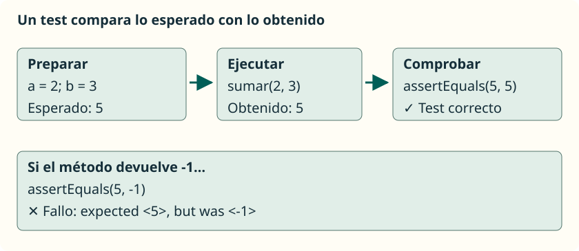

Un método puede compilar y devolver un resultado que no sea el que necesitamos. Ahora que sabemos definir métodos con entradas y salidas, podemos comprobarlos por separado: damos unos argumentos, indicamos qué debería ocurrir y verificamos el resultado. **JUnit automatiza esa comprobación para que podamos repetirla después de cada cambio.**

Trabajaremos especialmente la prueba y depuración del código del **RA3** y reforzaremos las llamadas con parámetros del **RA2** y los métodos estáticos del **RA4**. Utilizaremos los tipos, condiciones y arrays ya estudiados. No hace falta conocer todavía herencia, expresiones lambda ni programación avanzada con objetos.

## Qué es una prueba unitaria

Una **prueba unitaria** comprueba una parte pequeña del programa de forma aislada. En esta unidad, esa parte será un método que calcula o transforma datos, sin pedir información por teclado. Por ejemplo, si `sumar(2, 3)` debe devolver `5`, el test llama al método y compara el valor obtenido con `5`.

No es lo mismo imprimir `5` y mirarlo que escribir una comprobación automática. JUnit registra si cada test pasa o falla y nos ayuda a localizar el problema. Tampoco basta con que todos los tests pasen para demostrar que el programa funciona con cualquier entrada: solo hemos comprobado los casos elegidos.

<aside class="java-document-note">

<strong>EN PALABRAS SENCILLAS</strong>

Un test es como una ficha de comprobación: «Con estos datos, debe salir esto». JUnit sigue la ficha cada vez que se lo pedimos. Si cambiamos el método y deja de cumplirla, nos avisa. Debemos escribir la respuesta esperada pensando en el problema, sin copiársela al programa que estamos comprobando.

</aside>

