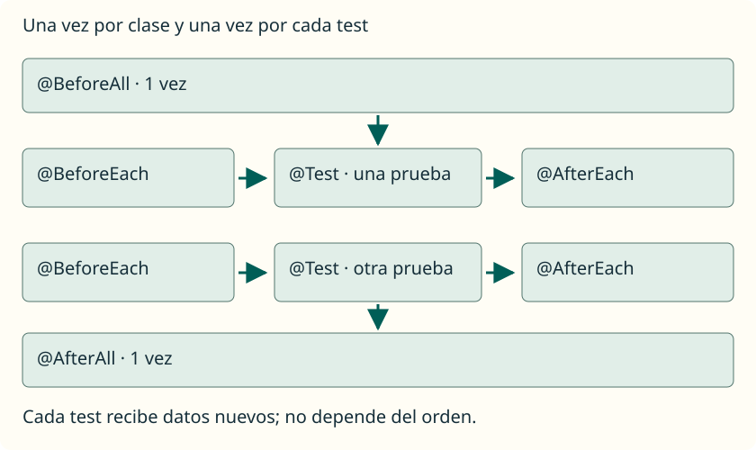

Las aserciones comprueban resultados. Las anotaciones del **ciclo de vida** indican cuándo ejecutar tareas de preparación o finalización. No hacen que un test pase por sí mismas. Al principio puedes preparar datos dentro de cada test; cuando varios necesitan la misma preparación, `@BeforeEach` evita repetirla.

En la configuración predeterminada de JUnit Jupiter, los tests de una clase siguen este recorrido:

1. `@BeforeAll`: una vez antes del grupo de tests.
2. Para cada test, JUnit crea una instancia nueva de la clase, ejecuta `@BeforeEach`, ejecuta el método `@Test` y ejecuta `@AfterEach`.
3. `@AfterAll`: una vez después del grupo.

No se repiten los pasos globales por cada test. Tampoco se presupone que los tests se ejecuten en el orden en que los hemos escrito. En este apartado conservamos la configuración predeterminada: no cambiamos el modo de creación de instancias ni configuramos la ejecución en paralelo.



## @BeforeAll: preparación del grupo

Sirve para una tarea común que debe hacerse una sola vez antes de los tests de esa clase. En nuestros ejemplos será un mensaje que permita seguir la ejecución. Más adelante podría preparar un recurso compartido; no lo necesitamos para crear los pequeños arrays de cada test.

En la configuración que utilizamos, el método es `static` y devuelve `void`. No lleva `@Test`, porque no es una prueba. Que aquí sea estático no contradice que los métodos de test normales no deban serlo: desempeñan papeles diferentes.

## @BeforeEach: datos nuevos para cada prueba

Se ejecuta antes de cada test. Lo utilizaremos para crear un array nuevo con los mismos valores iniciales. Así, si una prueba cambia sus datos, la siguiente sigue empezando con su propio array. El método devuelve `void` y no es `static`.

## @AfterEach: finalización de cada prueba

Se ejecuta después de cada test; también se utiliza cuando una aserción de ese test falla. Aquí solo mostraremos un mensaje para observar el recorrido. Cuando se trabajen recursos como archivos, puede servir para liberar lo que se haya abierto durante esa prueba. No hace falta inventar una tarea de limpieza si no tenemos nada que cerrar.

## @AfterAll: finalización del grupo

Se ejecuta una vez al terminar el grupo de tests de la clase. En esta configuración también usa `static` y `void`. Un mensaje escrito aquí no sustituye al informe de JUnit: imprimir «fin» no demuestra que los tests hayan pasado.

| Anotación | Cuántas veces para una clase con dos tests | Método en esta guía |
| --- | --- | --- |
| `@BeforeAll` | Una. | `static void`. |
| `@BeforeEach` | Dos, una antes de cada test. | `void`, sin `static`. |
| `@AfterEach` | Dos, una después de cada test. | `void`, sin `static`. |
| `@AfterAll` | Una. | `static void`. |

## Ejemplo completo con preparación independiente

Guarda este nuevo archivo en **`test/CicloDeVidaTest.java`**. Utiliza la clase `Operaciones` de [la primera prueba](/ApuntesProgramacion/guides/testing-con-junit/primera-prueba/):

```java
import org.junit.jupiter.api.Test;
import org.junit.jupiter.api.DisplayName;
import org.junit.jupiter.api.BeforeAll;
import org.junit.jupiter.api.BeforeEach;
import org.junit.jupiter.api.AfterEach;
import org.junit.jupiter.api.AfterAll;
import static org.junit.jupiter.api.Assertions.assertArrayEquals;

public class CicloDeVidaTest {
    private int[] datos;

    @BeforeAll
    static void iniciarClase() {
        System.out.println("Inicio de CicloDeVidaTest");
    }

    @BeforeEach
    void prepararDatos() {
        datos = new int[] { 2, 5 };
        System.out.println("Preparar datos");
    }

    @Test
    @DisplayName("Incrementar después de cambiar el primer dato")
    void incrementarTrasCambiarUnDato() {
        datos[0] = 10;
        int[] obtenido = Operaciones.crearIncrementado(datos);
        assertArrayEquals(new int[] { 11, 6 }, obtenido);
    }

    @Test
    @DisplayName("El otro test recibe de nuevo los datos iniciales")
    void incrementarLosDatosIniciales() {
        int[] obtenido = Operaciones.crearIncrementado(datos);
        assertArrayEquals(new int[] { 3, 6 }, obtenido);
    }

    @AfterEach
    void terminarTest() {
        System.out.println("Fin de un test");
    }

    @AfterAll
    static void terminarClase() {
        System.out.println("Fin de CicloDeVidaTest");
    }
}
```


`datos` es un campo de la clase de test, declarado fuera de sus métodos. No lo hacemos `static`: cada instancia de prueba trabaja con su propio campo. JUnit crea las instancias automáticamente y `prepararDatos` asigna un array nuevo antes de cada test.

En un test cambiamos la primera casilla a `10` y esperamos los incrementos `[11, 6]`; en el otro esperamos `[3, 6]` a partir de los datos iniciales. Los dos deben funcionar aunque se invierta su orden. Son dos comprobaciones independientes, no dos pasos de una misma prueba.

<aside class="java-document-note">
<p><strong>EN PALABRAS SENCILLAS</strong></p>
<p><code>@BeforeEach</code> es como entregar una hoja limpia antes de cada tarea. Una persona puede escribir en su hoja sin dejar marcas en la de la siguiente. <code>@BeforeAll</code> es abrir el aula una sola vez; no hay que volver a abrirla antes de cada hoja.</p>
</aside>

Para compilar también esta segunda clase de tests y ejecutar el proyecto completo, usa desde la carpeta del ejemplo:

```sh
javac -encoding UTF-8 -cp lib/junit-platform-console-standalone-1.13.4.jar -d bin src/Operaciones.java test/OperacionesTest.java test/CicloDeVidaTest.java
java -jar lib/junit-platform-console-standalone-1.13.4.jar execute --class-path bin --scan-class-path --fail-if-no-tests --disable-ansi-colors
```


Esta clase aporta **2 tests**, que se ejecutan junto a los que hayas añadido a `OperacionesTest`. Los mensajes de inicio y fin de la clase aparecen una vez; «Preparar datos» y «Fin de un test» aparecen dos veces. Las anotaciones del ciclo de vida no añaden tests al contador.

No utilices el orden de los mensajes entre clases para enlazar pruebas: JUnit puede organizar las clases y tests de otra manera. El criterio es que cada test empiece con lo que necesita y pueda ejecutarse solo.
