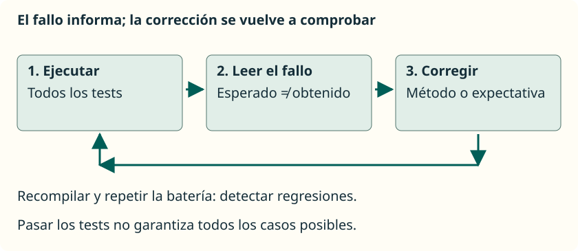

Partimos de los tests correctos. Ahora, **en una copia del proyecto**, introduce este error deliberado en `sumar`, sustituyendo el cuerpo correcto:

```java
public static int sumar(int a, int b) {
    return a - b; // Error deliberado.
}
```


Recompila y ejecuta la batería. El test de `sumar(2, 3)` debe fallar: esperaba `5`, pero ha recibido `-1`. Un mensaje de fallo puede contener esta parte:

```text
expected: <5> but was: <-1>
```


`expected` identifica lo que debía salir; `was` muestra lo que ha salido. Busca también `OperacionesTest.java` y la línea de la aserción. Eso localiza la comprobación que detecta el problema, pero la causa puede estar en el método de aplicación.

No cambies el esperado a `-1` para que el test pase: el comportamiento solicitado sigue siendo sumar. Recupera `return a + b;`, recompila y vuelve a ejecutar **todas** las pruebas. Así compruebas también que la corrección no haya estropeado otros casos. Esa repetición ayuda a detectar **regresiones**: errores en comportamientos que antes funcionaban.



## Errores frecuentes al escribir tests

| Qué observas | Qué revisar |
| --- | --- |
| `org.junit.jupiter.api` no se reconoce | El JAR debe estar en `lib`; revisa `referencedLibraries` y abre la carpeta completa. |
| El editor pide un `main` | Estás intentando ejecutar la clase como aplicación. Usa Testing o el ejecutor de JUnit. |
| No aparece ningún test | Revisa `@Test`, su import, las rutas `src` y `test`, y que el método no sea `private` ni `static`. |
| Imports mezclados | Usa Jupiter: `org.junit.jupiter.api.Test`, no `org.junit.Test` de JUnit 4. |
| Expected y actual parecen intercambiados | Escribe primero el valor esperado y después el obtenido. |
| Una prueba muestra valores pero nunca falla | `println` no es una aserción: añade una comprobación de JUnit. |
| Los arrays parecen iguales y `assertEquals` falla | Para sus casillas, utiliza `assertArrayEquals`. |
| El resultado cambia según el orden | Cada test debe preparar sus datos; evita compartir arrays modificables o depender de otro test. |
| Los cambios no afectan a las pruebas de terminal | Recompila los fuentes; no ejecutes `.class` desactualizados. |
| Hay muchos tests correctos, pero ninguno de un límite | Revisa los casos elegidos, no solo el contador de tests. |

Estos ejemplos prueban métodos de cálculo y transformación. Las pruebas parametrizadas, mocks, excepciones y la entrada por teclado quedan para apartados posteriores: primero necesitamos entender qué comprobamos y por qué esperamos ese resultado.

## Referencias

- [Documento docente de referencia: JUnit y ciclo de vida](https://docs.google.com/document/d/1bIacVwr0B5GcT4v-oJK4wsgz5SpAFWt8jbR_y47Wwlw/edit?usp=sharing).

- [Guía oficial de JUnit Jupiter 5.13.4](https://docs.junit.org/5.13.4/user-guide/index.html).
- [API de las aserciones de JUnit](https://docs.junit.org/5.13.4/api/org.junit.jupiter.api/org/junit/jupiter/api/Assertions.html).
- [Pruebas Java en VS Code](https://code.visualstudio.com/docs/java/java-testing).
- [Gestión de proyectos y bibliotecas Java en VS Code](https://code.visualstudio.com/docs/java/java-project).
